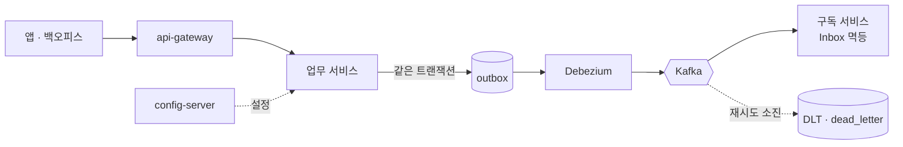

<div align="center">

[동성인재개발교육원](https://www.dshrd.or.kr/)<br>
교과과정: [클라우드 AI기반 마이크로서비스 풀스택(리액트/자바) 개발](https://www.work24.go.kr/hr/a/a/3100/selectTracseDetl.do?tracseId=AIG20250000501497&tracseTme=2&cstmConsTme=&crseTracseSe=C0061&trainstCstmrId=&tracseReqstsCd=&focusId=)

</div>

# PMart Backend

퀵 커머스(도심 소형 풀필먼트 기반 즉시·예약 배달) 백엔드. Spring Boot 마이크로서비스 / Gradle Multi-Project (Kotlin DSL) / Java 21.

PMart 프로젝트 전체 소개와 다른 저장소(앱·설정·시뮬레이터)는 조직 페이지 [code-and-pick](https://github.com/code-and-pick)에서 볼 수 있다.

## 서비스 영역
| 영역 | 하는 일 |
|---|---|
| Commerce | 상품·상품 콘텐츠·고객·장바구니·검색·홈 진열·가격·프로모션·리뷰 |
| Order & Payment | 주문·주문 사가 조정·이행 경로·취소/반품 클레임·결제(토스페이먼츠) |
| CDC WMS | 중앙 물류센터 재고·입고·위치·출고·품질 |
| MFC | 도심 소형 풀필먼트 센터 재고·피킹/포장·입고·처리 능력·위치·품질 |
| Middle-mile TMS | CDC → MFC 간선 운송 계획·실행 |
| Last-mile Delivery | 배송 가능 지역·배차·배송 실행·라이더·추적 |
| Platform & Support | API 게이트웨이·인증(고객·라이더·직원)·인사·승인·알림·감사·상담·AI 상담(RAG)·설정 서버 |

서비스별 책임 경계는 `docs/architecture/service-map.md`, 기술 스택은 `docs/architecture/tech-stack.md`.

## 핵심 설계
| 주제 | 방식 | 근거 |
|---|---|---|
| 여러 서비스에 걸친 거래 | 주문·취소·시간 변경은 `order-orchestration-service` 가 사가로 조정(보상 포함), 확정 사실은 이벤트로 전파. 2PC 없음 | `docs/adr/0003-order-saga-orchestration.md`, `docs/business/flows/` |
| 이벤트 발행·소비 | Outbox(같은 트랜잭션) → Debezium → Kafka(KRaft 3노드), 소비는 Spring Cloud Stream + Inbox 멱등, 실패는 DLT + `dead_letter` 재처리 API | ADR-0035·0037, `docs/architecture/events.md` |
| 계약 | REST = `contracts/openapi/`(코드 생성), 이벤트 = `contracts/events/` JSON Schema(발행 전 검증, 필드 추가만) | ADR-0009 |
| 데이터 소유 | 서비스마다 자기 DB·Flyway. 다른 서비스 테이블 접근 금지 — API 또는 이벤트만 | `.claude/rules/service-architecture.md` |
| 설정 | Spring Cloud Config(정본 [pmart-config](https://github.com/code-and-pick/pmart-config)), 서비스 `application.yml` 은 부트스트랩만, 비밀값은 `{cipher}` | ADR-0029 |
| 인증 | 고객 `auth-service`(소셜 로그인)·라이더 `rider-auth-service`·직원 `employee-auth-service`(Keycloak), 게이트웨이가 사용자 종류별 접근 확인 | ADR-0054·0056 |
| 최적화 | 배차·MFC 작업 배정·피킹 순서 = Google OR-Tools(CP-SAT·Routing, JVM 유지) | ADR-0053 |
| 검색·AI | Elasticsearch(형태소·초성·동의어·오타 교정) + 벡터 의미 검색, RAG AI 상담(Ollama·pgvector) | ADR-0072·0073·0088·0051 |
| 관측 | JSON 로그 → Elastic Stack, Micrometer → Prometheus·Grafana, OpenTelemetry → Zipkin | ADR-0030·0031 |
| 이미지·배포 | Jib(Dockerfile 없음) → Docker Hub(git SHA 태그, digest 로 배포), LAN 5대 배포 스크립트 `deploy/lan/` | ADR-0012·0028 |



## 시작하기
```bash
./gradlew build                         # 전체 (Windows: .\gradlew.bat)
./gradlew :services:<name>:test         # 단위 테스트
./gradlew :services:<name>:check        # 단위 + 통합(Testcontainers, Docker 필요) + 계약 검증 + 형식
./gradlew :services:<name>:bootJar      # 실행 이미지용 jar
./gradlew check -PskipIntegration=true  # Docker 없는 환경
./gradlew :services:<name>:jibBuildTar  # 컨테이너 이미지 tar (Docker 데몬 불필요)
./gradlew :services:<name>:jibDockerBuild  # 로컬 Docker 데몬에 이미지 생성
./gradlew :services:<name>:jib -PcontainerRegistry=docker.io/<계정> -PimageTag=<tag>  # Docker Hub push → <계정>/pmart-<name> (CI, 인증은 REGISTRY_USERNAME/PASSWORD 환경변수)
```

## 구조
`CLAUDE.md`의 "구조"와 "문서 지도"를 참조한다. 설계 정본은 `docs/architecture/`, 계약 정본은 `contracts/`.

## 문서
- 전체 흐름·확정 정책: `docs/business/overview.md`
- 서비스 책임 경계: `docs/architecture/service-map.md`
- 아키텍처: `docs/architecture/architecture-design.md`, 결정 기록 `docs/adr/`
- 작업 일지: `docs/worklog/`

## 팀

| 이름 | 비즈니스 로직 | 개발 |
|---|---|---|
| 배희지 | Commerce | 플랫폼(로그인·인증, 인사, 승인, API 게이트웨이, 공통 라이브러리, LAN 배포), 커머스·주문·결제·검색 서비스 |
| 오화실 | SCM | AI 상담(RAG) |
| 윤서영 | Delivery, TMS, MFC·DC 규모 | 라스트마일 배송·라이더 서비스, CDC(중앙 물류센터) 서비스 |
| 이유현 | MFC | MFC 서비스 |
| 이종근 | WMS | 백오피스 서버(backoffice-bff)·상담/사건 서비스 |
| 전소영 | OMS | AI 상담(RAG) |

앱·웹 담당까지 포함한 전체 팀 구성은 조직 페이지 [code-and-pick](https://github.com/code-and-pick#팀)에 있다.
