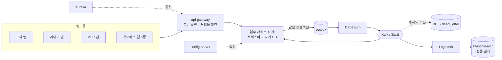

<div align="center">

<sub>[동성인재개발교육원](https://www.dshrd.or.kr/) · [클라우드 AI기반 마이크로서비스 풀스택(리액트/자바) 개발](https://www.work24.go.kr/hr/a/a/3100/selectTracseDetl.do?tracseId=AIG20250000501497&tracseTme=2&cstmConsTme=&crseTracseSe=C0061&trainstCstmrId=&tracseReqstsCd=&focusId=)</sub>

# PMart Backend

**동네 MFC(도심 소형 물류센터)에서 바로 꺼내 배달하는 퀵 커머스 — 그 뒤에서 도는 서버 전부**


[앱·웹(pmart-clients)](https://github.com/code-and-pick/pmart-clients) &nbsp;·&nbsp; [설정(pmart-config)](https://github.com/code-and-pick/pmart-config) &nbsp;·&nbsp; [프로젝트 소개(code-and-pick)](https://github.com/code-and-pick)

</div>

<br>

고객이 앱에서 주문하면 가까운 MFC 가 재고를 잡고, 작업자가 PDA 로 피킹·포장하고, 라이더가 받아 집 앞까지 갖다 줍니다. MFC 재고는 중앙 물류센터(CDC)에서 간선 차량으로 채웁니다. 이 저장소에는 그 과정에 필요한 서버가 모두 들어 있습니다 — 상품·주문·결제부터 물류센터 재고, 배차, 직원 로그인과 승인, AI 상담까지.

2026년 10월 23일 첫 커밋 뒤 다음 주에 API 게이트웨이를 세우고 사무실 PC 5대(LAN)에 나눠 올렸습니다. 지금도 모든 서비스가 그 PC 들에서 돌고, 앱과 시뮬레이터가 실제로 붙어 씁니다.

| 업무 서비스 | 플랫폼 앱 | 공통 라이브러리 | REST 계약 | 이벤트 스키마 | 결정 기록(ADR) |
|:---:|:---:|:---:|:---:|:---:|:---:|
| 46 | 4 | 6 | 58 | 226 | 91 |

## 서비스 영역

| 영역 | 하는 일 |
|---|---|
| Commerce | 상품·상품 콘텐츠·고객·장바구니·검색·홈 진열·가격·프로모션·리뷰 |
| Order & Payment | 주문·주문 사가 조정·이행 경로·취소/반품 클레임·결제(토스페이먼츠) |
| CDC WMS | 중앙 물류센터 재고·입고·위치·출고·품질 |
| MFC | 도심 소형 풀필먼트 센터 재고·피킹/포장·입고·처리 능력·위치·품질 |
| Middle-mile TMS | CDC → MFC 간선 운송 계획·실행 |
| Last-mile Delivery | 배송 가능 지역·배차·배송 실행·라이더·추적 |
| Platform & Support | API 게이트웨이·인증(고객·라이더·직원)·인사·승인·알림·감사·상담·AI 상담(RAG)·설정 서버 |

서비스마다 맡는 일과 경계는 [`docs/architecture/service-map.md`](docs/architecture/service-map.md) 에 정리해 두었습니다.

## 구조



주문처럼 여러 서비스를 거치는 일은 `order-orchestration-service` 가 사가로 순서를 잡고, 중간에 실패하면 이번에 잡은 것만 되돌립니다(2PC 는 쓰지 않습니다). 확정된 사실은 이벤트로 퍼집니다.

## 핵심 설계

| 주제 | 방식 | 근거 |
|---|---|---|
| 여러 서비스에 걸친 거래 | 주문·취소·시간 변경은 사가로 조정(보상 포함), 확정 사실은 이벤트로 전파 | [ADR-0003](docs/adr/0003-order-saga-orchestration.md), [`docs/business/flows/`](docs/business/flows/) |
| 이벤트 발행·소비 | Outbox → Debezium → Kafka(KRaft 3노드), 소비는 Spring Cloud Stream + Inbox 로 한 번만 반영, 실패는 DLT + 재처리 API | ADR-0035·0037, [`events.md`](docs/architecture/events.md) |
| 계약 | REST 는 `contracts/openapi/` 에서 코드 생성, 이벤트는 `contracts/events/` JSON Schema 로 발행 전에 검사(필드 추가만 허용) | ADR-0009 |
| 데이터 소유 | 서비스마다 자기 DB 와 Flyway. 다른 서비스 테이블은 읽지도 않고 API 나 이벤트로만 | — |
| 설정 | Spring Cloud Config, 정본은 [pmart-config](https://github.com/code-and-pick/pmart-config). 서비스 `application.yml` 에는 부트스트랩만, 비밀값은 `{cipher}` | ADR-0029 |
| 인증 | 고객 `auth-service`(Google·카카오·네이버), 라이더 `rider-auth-service`, 직원 `employee-auth-service` + Keycloak. 게이트웨이가 사용자 종류별로 경로를 확인 | ADR-0054·0056 |
| 최적화 | 배차·MFC 작업 배정·피킹 순서는 Google OR-Tools(CP-SAT·Routing). 이 서비스들은 네이티브 이미지 대신 JVM 으로 | ADR-0053 |
| 검색 | Elasticsearch — 형태소·초성·띄어쓰기·동의어·오타 교정, 여기에 벡터 의미 검색("빨간 라면" → 신라면) | ADR-0072·0073·0088 |
| AI 상담 | 운영자·고객 상담을 RAG 로 — Ollama(로컬 모델) + pgvector | ADR-0051 |
| 관측 | JSON 로그 → Elastic Stack, Micrometer → Prometheus·Grafana, OpenTelemetry → Zipkin | ADR-0030·0031 |
| 이미지·배포 | Jib 으로 이미지(Dockerfile 없음) → Docker Hub, git SHA 태그·digest 로 배포. LAN 배포 스크립트 `deploy/lan/` | ADR-0012·0028 |

## 부하 시험 (2026-11-27, LAN)

JMeter 로 게이트웨이에 비회원 고객 부하를 걸었습니다(둘러보기 40 · 검색 30 · 장바구니 20 · 배송·쿠폰 10, 요청 사이 1~3초).

| 동시 사용자 | 처리량 | 오류 | p95 |
|---:|---:|---:|---:|
| 100명 | 44.6 건/초 | 0% | 54ms |
| 200명 | 88.8 건/초 | 0% | 59ms |
| 300명 | 132.7 건/초 | 0% | 72ms |

같은 300명이 0.2~0.5초 간격으로 몰아치면 초당 260건 근처에서 장바구니·상세가 초 단위로 느려졌습니다. CPU 는 여유가 있었고, 서비스당 DB 연결 5개(LAN 설정)가 먼저 찼습니다. 100명 부하 중에 넣은 시험 주문은 결제 승인부터 주문 확정까지 약 1.1초로 부하가 없을 때와 같았습니다. 자세한 내용: [`docs/operations/2026-11-27-jmeter-load-test-result.md`](docs/operations/2026-11-27-jmeter-load-test-result.md)

## 시작하기

JDK 21 과 Docker(통합 시험용 Testcontainers)가 필요합니다.

```bash
./gradlew build                            # 전체 (Windows: .\gradlew.bat)
./gradlew :services:<name>:test            # 단위 시험
./gradlew :services:<name>:check           # 단위 + 통합 + 계약 검사 + 형식
./gradlew check -PskipIntegration=true     # Docker 없이
./gradlew :services:<name>:bootJar         # 실행 jar
./gradlew :services:<name>:jibBuildTar     # 컨테이너 이미지 tar (Docker 데몬 불필요)
```

로컬에서 서비스를 띄울 때는 설정 서버부터 올립니다.

```bash
./gradlew :platform-services:config-server:bootRun --args='--spring.profiles.active=local'
./gradlew :services:<name>:bootRun --args='--spring.profiles.active=local'
```

## 저장소 구성

```
services/            업무 마이크로서비스 46개 (각자 Spring Boot 앱)
platform-services/   api-gateway · config-server · eureka-server · mail-provisioner
libraries/           공통 라이브러리 (web · messaging · security · jwt · observability · test)
contracts/           openapi/ (REST) · events/ (Kafka 이벤트 JSON Schema)
build-logic/         Gradle convention plugin
deploy/              local · lan · remote · helm
demos/               운영과 따로 도는 데모 (수요 예측·보충)
docs/                업무 정책 · 아키텍처 · ADR · 흐름 · 작업 일지
```

서비스 안 패키지는 `com.pmart.<domain>.{api, application, domain, infrastructure}` 로 나눕니다.

## 문서

- 전체 업무 흐름과 확정 정책: [`docs/business/overview.md`](docs/business/overview.md)
- 서비스 책임 경계: [`docs/architecture/service-map.md`](docs/architecture/service-map.md)
- 아키텍처: [`docs/architecture/architecture-design.md`](docs/architecture/architecture-design.md), 결정 기록 [`docs/adr/`](docs/adr/)
- 사가·보상 흐름: [`docs/business/flows/`](docs/business/flows/)
- 작업 일지: [`docs/worklog/`](docs/worklog/)

## 팀

| 이름 | 비즈니스 로직 | 개발 |
|---|---|---|
| 배희지 | Commerce | 플랫폼(로그인·인증, 인사, 승인, API 게이트웨이, 공통 라이브러리, LAN 배포), 커머스·주문·결제·검색 서비스 |
| 오화실 | SCM | AI 상담(RAG) |
| 윤서영 | Delivery, TMS, MFC·DC 규모 | 라스트마일 배송·라이더 서비스, CDC(중앙 물류센터) 서비스 |
| 이유현 | MFC | MFC 서비스 |
| 이종근 | WMS | 백오피스 서버(backoffice-bff)·상담/사건 서비스 |
| 전소영 | OMS | AI 상담(RAG) |

앱·웹 담당까지 넣은 전체 팀 구성은 [code-and-pick](https://github.com/code-and-pick#팀) 에 있습니다.

---

<div align="center">

<sub><a href="https://www.dshrd.or.kr/">동성인재개발교육원</a> · 지도: 서성원 훈련 교사</sub>

</div>
