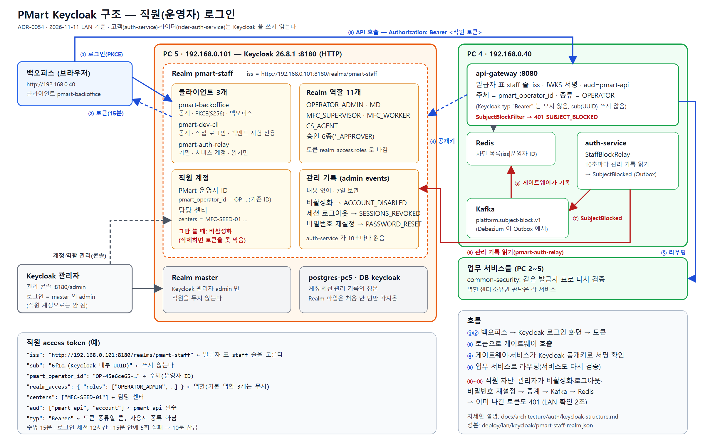

# PMart Keycloak 구조 — 직원(운영자) 로그인

> **2026-11-12 ADR-0056 으로 바뀔 예정(구현 전)**: Keycloak 은 직원 신원 확인만 하고, API 용 직원 토큰은 employee-auth-service(Keycloak 기밀 클라이언트)가 발급한다. `pmart-backoffice`·`pmart-auth-relay` 클라이언트, Realm 역할·`centers` 속성, 관리 화면 계정 관리(결정 L), 차단 중계(결정 M)는 전환 뒤 없어진다. 새 구조: `employee-auth-structure.md`. 이 문서는 지금 LAN 에서 도는 구조다.

- 상태: **LAN 운영 중**(2026-11-11). 백오피스가 Keycloak 로그인으로 배포됨, auth-service 운영자 계정 11개를 같은 운영자 ID 로 옮김. auth-service 운영자 로그인은 옮기는 동안 함께 둔다(ADR-0054 결정 D) — 확인 뒤 발급자 표에서 뺀다.
- 결정: ADR-0054(직원 = Keycloak, 고객 = auth-service, 라이더 = rider-auth-service) 결정 A~D·L·M. 전체 로그인 구조는 `login-structure-and-flow.md`, 발급자 표·차단 목록은 `issuer-type-pairing-and-access-lists.md`.
- 설정의 정본: `deploy/lan/keycloak/pmart-staff-realm.json`(Realm), `deploy/lan/render.sh`(컨테이너), pmart-config `application-lan.yml`(발급자 표)·`auth-service-lan.yml`(차단 중계).

## 1. 한눈에



그림 원본은 `diagrams/keycloak-structure.html`(SVG). 고친 뒤 PNG 다시 만들기:
`chrome --headless=new --hide-scrollbars --force-device-scale-factor=1.5 --window-size=1600,1010 --screenshot=<경로>\keycloak-structure.png file:///<경로>/keycloak-structure.html`

```
                 ┌──────────── PC 5 (192.168.0.101) ────────────┐
 백오피스(브라우저) │ Keycloak 26.8.1 :8180                        │
  http://192.168.0.40 ──로그인(PKCE)──► Realm pmart-staff          │
        │        │   ├ 클라이언트 pmart-backoffice  (백오피스)    │
        │        │   ├ 클라이언트 pmart-dev-cli     (백엔드 시험)  │
        │        │   ├ 클라이언트 pmart-auth-relay  (차단 중계)    │
        │        │   ├ 역할 11개 · 사용자 속성 pmart_operator_id·centers
        │        │   └ 관리 기록(admin events, 7일)               │
        │        │ Realm master — Keycloak 관리자(admin)만        │
        │        └──────────┬───────────────────────────────────┘
        │ access token(15분)  │ JWKS(공개키)           ▲ 관리 기록 읽기(10초)
        ▼                     ▼                        │
   api-gateway(PC 4) ── 발급자 표 staff 줄로 검증 ──► 서비스들(common-security, 같은 표로 다시 검증)
        │                                              │
        └── Redis 차단 목록 ◄── Kafka SubjectBlocked ◄── auth-service StaffBlockRelay
```

- 토큰을 **발급**하는 곳은 Keycloak 하나다. 게이트웨이·서비스는 Keycloak 의 공개키(JWKS)로 **검증만** 한다.
- 고객(auth-service)·라이더(rider-auth-service)는 Keycloak 을 쓰지 않는다 — 한 게이트웨이가 발급자 셋을 `iss` 로 구분한다.

## 2. 서버 배치 (`render.sh`, `placement.conf`)

| 항목 | 값 |
|---|---|
| PC | PC 5 `192.168.0.101`(배송 서비스·rider-auth-service·RAG 와 같은 PC) |
| 이미지 | `quay.io/keycloak/keycloak:26.8.1`, `start --import-realm` |
| 포트 | LAN `8180` → 컨테이너 8080. **HTTP**(LAN 개발 — 운영은 TLS 앞단 필요) |
| 주소(= 토큰 `iss`) | `KC_HOSTNAME=http://192.168.0.101:8180` → 직원 토큰 `iss` = `http://192.168.0.101:8180/realms/pmart-staff`. 브라우저(로그인 화면)와 서비스(JWKS)가 같은 주소를 본다. **PC 나 IP 를 바꾸면 `iss` 가 바뀐다** — 발급자 표·차단 중계·백오피스 설정을 같이 고친다 |
| DB | 같은 PC postgres(`postgres-pc5:15432`)의 DB·계정 `keycloak`(`init-db.sql` 이 만든다) |
| 자원 | 메모리 1.5GB, CPU 2 |
| 상태 확인 | `KC_HEALTH_ENABLED=true` |
| 첫 관리자 | `master` Realm `admin` — 비밀번호 `.secrets/keycloak-admin-password` |
| Realm 가져오기 | `pmart-staff-realm.json` 을 **Realm 이 없을 때 한 번만** 가져온다. 이미 있으면 건너뛴다 → 파일을 고쳐도 실행 중 Keycloak 에는 반영되지 않는다(§10) |

## 3. Realm

| Realm | 용도 | 누가 로그인하나 |
|---|---|---|
| `master` | Keycloak 서버 관리 | Keycloak 관리자 `admin` 만. 관리 콘솔 `http://192.168.0.101:8180/admin` 의 로그인 창이 이 Realm 이다 |
| `pmart-staff` | PMart 직원(본사 운영자·MFC·CDC 작업자·승인자·상담원) | 직원 계정. 백오피스 로그인, 본인 계정 화면 `http://192.168.0.101:8180/realms/pmart-staff/account` |

- 직원을 `master` 에 두지 않는다(그 Realm 로그인은 Keycloak 전체 관리 권한으로 이어지기 쉽다). 직원 안의 구분(본사·MFC·CDC)은 Realm 을 나누지 않고 **역할·센터 속성**으로 한다(2026-11-11 사용자 확인). Realm 을 나눌 때는 협력사처럼 로그인 정책·관리 주체가 완전히 다른 집단이 생길 때.
- 라이더용 Realm(`pmart-rider`)은 없다 — 라이더는 rider-auth-service(ADR-0054 E).

### `pmart-staff` 설정

| 항목 | 값 | 뜻 |
|---|---|---|
| access token 수명 | 900초(15분) | 직원 토큰. 차단 목록 남길 기간(게이트웨이 2시간)보다 짧다 |
| 세션 | 유휴·최대 모두 12시간 | 로그인부터 12시간 뒤 다시 로그인 |
| 잘못된 비밀번호 | 15분 안에 5회 → 10분 잠금 | `bruteForceProtected` |
| 자기 가입·비밀번호 찾기·이메일 로그인 | 끔 | 계정은 관리자가 만든다(결정 L) |
| SSL | `none` | LAN HTTP |
| 관리 기록 | 켬, **내용 없이**(`adminEventsDetailsEnabled: false`), 7일 보관 | 차단 중계가 읽는다(§9). 내용을 끄는 이유: 사용자 표현(개인정보)이 기록에 남지 않게 |
| 사용자 정보 항목(user profile) | username·email·firstName·lastName + **`pmart_operator_id`**("PMart 운영자 ID")·**`centers`**("담당 센터", 여러 값) | 관리자만 보고 고친다. 관리 콘솔의 사용자 화면(Details)에 칸으로 나온다 |

## 4. 클라이언트

| 클라이언트 | 종류 | 흐름 | 쓰는 곳 |
|---|---|---|---|
| `pmart-backoffice` | 공개(client secret 없음) | Authorization Code + **PKCE S256** | 백오피스 웹. redirect·로그아웃 뒤 주소: `http://192.168.0.40/*`, `http://d603-16/*`, `http://localhost:5173/*`(그 밖은 400 `Invalid parameter: redirect_uri`). CORS 출처 = redirect 출처(`webOrigins: +`) |
| `pmart-dev-cli` | 공개 | 아이디·비밀번호 직접(Direct Access Grant) | **백엔드 시험 전용**(Claude LAN 확인 스크립트). 화면 없이 토큰을 받는다. 운영에는 두지 않는다 |
| `pmart-auth-relay` | 기밀(client secret) | client_credentials(서비스 계정) | auth-service 차단 중계(§9). 서비스 계정 역할 realm-management `view-events`·`view-users` **만**(읽기). `fullScopeAllowed: false` 라 **클라이언트 범위 매핑**으로 두 역할을 토큰에 싣는다 — 빠지면 403(2026-11-11 겪음) |

`pmart-backoffice`·`pmart-dev-cli` 에는 토큰 내용 설정(mapper) 셋이 있다:

| mapper | 토큰에 넣는 것 |
|---|---|
| `pmart-api-audience` | `aud` 에 `pmart-api`(ADR-0055 결정 6 — 게이트웨이·서비스가 요구) |
| `pmart_operator_id` | 사용자 속성 `pmart_operator_id` → 같은 이름 클레임(access token) |
| `centers` | 사용자 속성 `centers` → 같은 이름 클레임(배열) |

## 5. 역할 (Realm roles)

`OPERATOR_ADMIN`, `MD`, `MFC_SUPERVISOR`, `MFC_WORKER`, `CS_AGENT`, `PRODUCT_APPROVER`, `DISPLAY_APPROVER`, `PRICE_APPROVER`, `INVENTORY_APPROVER`, `SERVICEABILITY_APPROVER`, `CENTER_MASTER_APPROVER` — auth-service 운영자 역할과 같은 이름(2026-11-11 옮김).

- 역할은 **Realm roles** 로만 준다. 서비스는 토큰의 `realm_access.roles` 만 읽는다(Client roles 는 읽지 않음).
- 토큰의 역할 목록에는 Keycloak 기본 역할(`default-roles-pmart-staff`·`offline_access`·`uma_authorization`)도 들어 있다 — 서비스·백오피스 판단에는 쓰지 않는다.
- 새 역할이 생기면: Keycloak 에 같은 이름으로 만들고(관리 콘솔 Realm roles → Create role) Realm 파일에도 넣는다. 역할의 뜻·권한 판단은 각 서비스가 한다(게이트웨이는 역할을 보지 않음).

## 6. 직원 토큰 (access token)

```json
{
  "iss": "http://192.168.0.101:8180/realms/pmart-staff",
  "sub": "6f1c…(Keycloak 내부 UUID — 쓰지 않는다)",
  "aud": ["pmart-api", "account"],
  "typ": "Bearer",
  "azp": "pmart-backoffice",
  "exp": …, "iat": …,
  "pmart_operator_id": "OP-45e6ce65-6af8-4d9f-ac94-f8e27a99853a",
  "centers": ["MFC-SEED-01"],
  "realm_access": { "roles": ["OPERATOR_ADMIN", "default-roles-pmart-staff", "offline_access", "uma_authorization"] }
}
```

| 값 | 어디서 읽나 | 주의 |
|---|---|---|
| 직원(운영자) ID | **`pmart_operator_id`** | `sub` 는 Keycloak 내부 UUID 라 쓰지 않는다. 기존 auth-service 운영자 ID(`OP-<UUID>`)를 그대로 넣어 MFC 작업자 배정·승인 기록 등이 이어진다(결정 C). **없으면 401**(주체 클레임 없음) |
| 사용자 종류 | 발급자(`iss`) | `typ` 은 Keycloak 의 토큰 종류("Bearer" 고정)라 사용자 종류가 아니다. 이 발급자의 토큰은 모두 `OPERATOR` |
| 역할 | `realm_access.roles` | 기본 역할 3개는 무시 |
| 센터 | `centers` | 없으면 빈 목록 |
| 대상 | `aud` 에 `pmart-api` | `account` 는 Keycloak 기본 — 무시 |

## 7. 검증 — 게이트웨이와 서비스

pmart-config `application-lan.yml` 발급자 표 `staff` 줄:

```yaml
- id: staff
  issuer-uri: 'http://192.168.0.101:8180/realms/pmart-staff'
  jwk-set-uri: 'http://192.168.0.101:8180/realms/pmart-staff/protocol/openid-connect/certs'
  audiences: [pmart-api]
  user-types: [OPERATOR]
  type-claim: ''                 # typ("Bearer")을 보지 않고 발급자로 종류를 정한다
  subject-claim: pmart_operator_id
  roles-claim: realm_access.roles
```

- 게이트웨이(`IssuedToken`)와 모든 서비스(`common-security` `TrustedIssuers`)가 같은 표·같은 규칙(`common-jwt` `IssuerPolicy`)으로 검증한다: `iss` 로 발급자 선택 → 그 JWKS 로 서명 → 만료·`iss`·`aud`·종류 짝·주체 클레임.
- 발급자 표는 **앱이 시작할 때만** 읽는다 — 표를 바꾸면 게이트웨이·앱을 다시 시작한다.
- 주체로 무언가를 찾는 코드는 `sub` 가 아니라 **인증 이름**(발급자 규칙의 주체)을 쓴다 — 게이트웨이 차단 목록이 `sub` 로 찾아 Keycloak 직원을 막지 못한 적이 있다(2026-11-11, `ad6e2bc`).
- auth-service 의 "현재 세션"(`GET /auth/sessions/current`)은 auth-service 세션을 찾는 API 라 Keycloak 토큰에는 401 이다 — 백오피스는 토큰 값을 쓴다.

## 8. 계정 관리 (결정 L — 당분간 Keycloak 관리 콘솔에서 직접)

관리 콘솔: `http://192.168.0.101:8180/admin` → **`master` 의 `admin` 으로 로그인** → 왼쪽 위 Realm 을 `pmart-staff` 로.

1. **역할 확인** — 줄 역할이 Realm roles 에 없으면 먼저 만든다(이름은 대문자 그대로).
2. **Users → Create new user**
   - Username: 로그인 아이디(소문자). 기존 auth-service 계정을 옮기면 같은 아이디
   - First name: 표시 이름(백오피스에 보임). **괄호 `( )` 등 일부 문자는 Keycloak 이 거절**한다(`person-name-prohibited-characters`)
   - **PMart 운영자 ID**(`pmart_operator_id`): 기존 사람이면 auth-service 운영자 ID 그대로, 새 사람이면 `OP-` + UUID(PowerShell `"OP-" + [guid]::NewGuid()`)
   - **담당 센터**(`centers`): 센터마다 값 하나(없으면 비움 = 본사)
3. **Credentials** → Set password. Temporary 를 켜면 첫 로그인 때 Keycloak 이 비밀번호 변경 화면을 띄운다.
4. **Role mapping** → Assign role → **Realm roles** 에서 고른다(Client roles 아님).
5. 확인: 본인 계정 화면 `…/realms/pmart-staff/account` 로그인, 또는 백오피스 로그인.

규칙:
- **계정을 그만 쓸 때는 지우지 말고 Enabled 를 끈다.** 비활성화는 차단 중계가 보고 이미 나간 토큰도 막는다. 삭제하면 운영자 ID 를 알 수 없어 막지 못한다(§9).
- 직원 계정으로 관리 콘솔(`/admin`)에 로그인할 수 없다 — 그 창은 `master` 다(2026-11-11 `heeji-test` 로그인 실패 원인).
- 계정이 늘면 백엔드가 Keycloak 관리 API 를 대신 부르는 방식(결정 L 의 B)으로 옮긴다 — 다시 결정.

### 지금 계정 (2026-11-11)
- auth-service 에서 옮긴 11개 + `claude-dev`(백엔드 Claude LAN 시험용, OPERATOR_ADMIN) + 사용자가 만든 `heeji-test`.
- 옮긴 계정의 비밀번호는 옮길 수 없어(auth-service 는 bcrypt 만 가짐) 새로 정했다 → `.secrets/keycloak-staff-passwords.tsv`(아이디 TAB 비밀번호).

## 9. 직원 차단 — 이미 나간 토큰 막기 (ADR-0054 ⑤·결정 M)

Keycloak 은 계정을 막아도 이미 나간 access token(최대 15분)은 그대로 유효하고, Kafka 로 사건을 내지 않는다. 그래서:

```
관리자: 비활성화 / 세션 로그아웃 / 비밀번호 재설정 (관리 콘솔)
  → Keycloak 관리 기록
  → auth-service StaffBlockRelay(10초마다, 클라이언트 pmart-auth-relay 로 읽기)
  → SubjectBlocked(Outbox → Debezium → platform.subject-block.v1)
  → 게이트웨이 → Redis "이 운영자 ID 의 이 시각 이전 토큰 거부"
  → 그 토큰으로 오는 요청 401 SUBJECT_BLOCKED
```

| 관리 콘솔에서 한 일 | 사유 |
|---|---|
| 사용자 Enabled 끔 | `ACCOUNT_DISABLED` |
| 사용자 Sessions → Sign out(로그아웃) | `SESSIONS_REVOKED` |
| Credentials → 비밀번호 재설정 | `PASSWORD_RESET` |
| 사용자 삭제 | **막지 못함**(경고 로그만) — 지우지 말고 비활성화 |

- LAN 확인(2026-11-11): 세션 로그아웃 뒤 **2초** 만에 옛 토큰 401, 새로 받은 토큰 200.
- 같은 관리 기록은 한 번만 사건이 된다(auth-service 표 `staff_admin_event_seen` + Outbox 같은 트랜잭션). Keycloak 이 응답하지 않으면 다음 주기에 다시 읽는다(되돌아 1일).
- 비밀번호를 재설정하면 그 사람의 그 전 토큰이 막힌다 — 2026-11-11 계정을 옮기며 비밀번호를 정했을 때도 `PASSWORD_RESET` 이 나갔다(정상).

## 10. 바꾸는 방법 — Realm 파일과 실행 중 Keycloak

Realm 파일은 **처음 한 번만** 가져온다. 그래서 설정을 바꿀 때는 둘 다 고친다:
1. 실행 중 Keycloak — 관리 콘솔 또는 관리 API(`master` admin 토큰). Claude 는 관리 API 로 바꾸고 바로 읽어 확인한다.
2. `deploy/lan/keycloak/pmart-staff-realm.json` — 같은 내용(새로 만들 때 같은 상태가 되게). 커밋.

- 비밀값은 Realm 파일에 넣지 않는다: 중계 클라이언트 비밀은 파일에 `__PMART_KEYCLOAK_RELAY_SECRET__` 자리표시자로 두고 `render.sh` 가 `.secrets` 값으로 바꿔 `build/`(git 제외)에만 쓴다.
- 사용자 계정은 Realm 파일에 넣지 않는다(서비스 계정 `service-account-pmart-auth-relay` 만). 계정은 실행 중 Keycloak 이 정본이고 DB(`keycloak`)에 있다.
- Keycloak 을 처음부터 다시 만들면(DB 삭제): Realm·클라이언트·역할·중계 클라이언트는 파일로 돌아오지만 **직원 계정은 다시 만들어야 한다**.

## 11. 비밀값

| 파일(`deploy/lan/.secrets/`, git 제외) | 무엇 | 어디에 쓰나 |
|---|---|---|
| `keycloak-admin-password` | `master` admin 비밀번호 | 관리 콘솔·관리 API, compose `.env` |
| `keycloak-db-password` | DB 계정 `keycloak` | compose `.env` |
| `keycloak-relay-client-secret` | `pmart-auth-relay` 비밀 | Realm 가져오기(render.sh), pmart-config `auth-service-lan.yml` 에는 `{cipher}` 암호문 |
| `keycloak-claude-dev-password` | `claude-dev` 비밀번호 | 백엔드 시험 스크립트 |
| `keycloak-staff-passwords.tsv` | 옮긴 운영자 11개 비밀번호 | 사람에게 전달할 때 |

`init-secrets.sh` 가 앞의 셋(없으면)을 만든다. 비밀번호·토큰은 로그·출력에 남기지 않는다.

## 12. 알아둘 것

- **관리 콘솔 로그인 창 = `master`** — 직원 계정은 거기서 `user_not_found`.
- **이름에 괄호 등 금지 문자** — 사용자 만들기 400(관리 API 로 옮길 때 겪음).
- **`fullScopeAllowed: false` 클라이언트는 범위 매핑이 있어야** 역할이 토큰에 실린다(중계 클라이언트 403).
- Keycloak 로그의 경고 둘은 LAN 에서 알고 있는 것: `Non-secure context detected; cookies are not secured`(HTTP), `pmart-dev-cli … 'Full scope allowed' … deprecated`(시험 클라이언트).
- 직원 토큰을 손으로 만들어 시험하지 않는다(서명키가 Keycloak 안에 있음) — `pmart-dev-cli` 로 받는다.

## 13. 남은 일

- 백오피스 Keycloak 로그인 확인(pmart-clients 회신) → 발급자 표 auth-service 줄에서 `OPERATOR` 빼기·앱 재시작 → auth-service 운영자 로그인·계정 관리 API 를 내릴지 정하기(결정 D 마무리).
- 운영(prod): TLS, 호스트 이름(`iss`), 관리 콘솔 접근 제한, `pmart-dev-cli` 제거, 백업 — 아직 정하지 않음.
- 계정 관리 자동화(결정 L 의 B)는 계정이 늘면.
