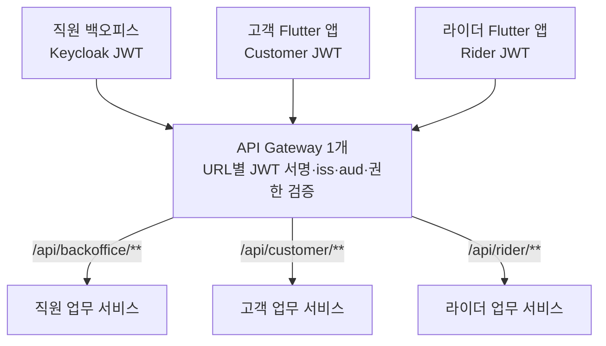

# PMart API Gateway 단일 구성과 URL별 JWT 인증·인가

**결론부터 말하면, PMart의 API Gateway를 고객용과 라이더용으로 2개 분리할 필요는 없어. 하나의 API Gateway에서 URL 경로로 요청을 구분하고, 해당 경로에 맞는 JWT 검증·권한 정책을 적용하면 돼.**

다만 중요한 차이가 있어.

- **URL 구분(Routing):** 요청을 어느 마이크로서비스로 보낼지 결정
- **토큰 검증(Authentication):** JWT가 정상적으로 발급된 유효한 토큰인지 확인
- **권한 검증(Authorization):** 그 토큰으로 해당 URL에 접근해도 되는지 확인

따라서 **URL만 구분하는 것으로는 부족하지만, URL에 따라 허용되는 토큰과 권한을 검증하면 해결할 수 있어.**

## 1. PMart에서 추천하는 구조



## 2. URL만 구분하면 왜 문제가 생길까?

예를 들어 고객이 정상적으로 발급받은 JWT가 있다고 가정해 보자.

```http
POST /api/rider/deliveries/123/accept
Authorization: Bearer <customer-jwt>
```

API Gateway가 URL만 확인하면 이 요청을 Rider Service로 전달할 수 있어.

그런데 고객 JWT도 서명과 만료 시간이 정상인 토큰이잖아?

만약 Gateway가 단순히 **신뢰하는 발급자의 유효한 JWT인지**만 확인한다면 고객 토큰이 라이더 API로 전달되는 문제가 생길 수 있어.

따라서 `/api/rider/**`에는 Rider Auth가 발급한 토큰만 허용하도록 설정해야 해.

## 3. URL별로 JWT 검증 정책을 다르게 설정하면 해결돼

| URL | 허용 발급자(`iss`) | 필요한 권한 |
|---|---|---|
| `/api/backoffice/**` | Keycloak | ADMIN, STAFF 등 |
| `/api/customer/**` | Customer Auth | CUSTOMER |
| `/api/rider/**` | Rider Auth | RIDER |

여기서 `iss`는 JWT를 발급한 인증 서버의 식별자야.

예를 들어 고객과 라이더 토큰이 다음과 같다고 가정해 보자.

**고객 JWT**

```json
{
  "iss": "https://auth-customer.pmart.example",
  "sub": "customer-1001",
  "aud": "pmart-customer-api",
  "role": "CUSTOMER"
}
```

**라이더 JWT**

```json
{
  "iss": "https://auth-rider.pmart.example",
  "sub": "rider-3001",
  "aud": "pmart-rider-api",
  "role": "RIDER"
}
```

이렇게 분리하면 고객 JWT로 라이더 API를 호출했을 때, 라이더 API에서 허용하는 발급자와 대상이 일치하지 않으므로 요청을 거절할 수 있어.

중요한 건 JWT에 적힌 `iss`, `aud`, `role` 문자열을 단순히 읽어서 믿는 게 아니라, **서명을 검증한 다음 신뢰할 수 있는 발급자·대상·권한인지 확인해야 한다는 것**이야.

## 4. Spring Cloud Gateway에서 어떻게 구현할까?

PMart가 Spring Cloud Gateway(WebFlux)를 사용한다면, **`SecurityWebFilterChain`을 URL 영역별로 분리하는 방식**이 직관적이야.

예를 들어 하나의 Gateway 안에 다음과 같은 보안 설정을 둘 수 있어.

```java
@Configuration
@EnableWebFluxSecurity
public class GatewaySecurityConfig {

    // 고객 API 전용 보안 설정
    @Bean
    @Order(1)
    SecurityWebFilterChain customerChain(
            ServerHttpSecurity http) {

        return http
            .securityMatcher(
                new PathPatternParserServerWebExchangeMatcher(
                    "/api/customer/**"))
            .authorizeExchange(ex -> ex
                .anyExchange().hasRole("CUSTOMER"))
            .oauth2ResourceServer(oauth2 -> oauth2
                .jwt(jwt -> jwt
                    .jwtDecoder(customerJwtDecoder())))
            .build();
    }

    // 라이더 API 전용 보안 설정
    @Bean
    @Order(2)
    SecurityWebFilterChain riderChain(
            ServerHttpSecurity http) {

        return http
            .securityMatcher(
                new PathPatternParserServerWebExchangeMatcher(
                    "/api/rider/**"))
            .authorizeExchange(ex -> ex
                .anyExchange().hasRole("RIDER"))
            .oauth2ResourceServer(oauth2 -> oauth2
                .jwt(jwt -> jwt
                    .jwtDecoder(riderJwtDecoder())))
            .build();
    }
}
```

위 코드는 핵심 구조만 보여 주는 예시야. 실제로는 `customerJwtDecoder()`와 `riderJwtDecoder()`를 각각 구현하고, JWT의 `iss`, `aud` 검증 및 역할을 Spring Security Authority로 변환하는 설정이 필요해. 백오피스용 Chain과 기본 거부 정책도 추가해야 해.

Spring Security는 여러 `SecurityWebFilterChain`을 URL 조건에 따라 선택하는 방식을 지원해.

## 5. 그러면 API Gateway는 언제 2개로 분리할까?

| 분리 이유 | Gateway 2개 필요성 |
|---|---|
| 고객·라이더 URL 분리 | 불필요 |
| 고객·라이더 JWT 발급자 분리 | 불필요 |
| 고객·라이더 역할 및 권한 분리 | 불필요 |
| 서로 다른 Rate Limiter 설정 | 불필요 |
| 고객·라이더 트래픽 독립 확장 | 상황에 따라 고려 |
| 장애 격리 및 독립적인 배포 | 고려할 가치 있음 |
| 서로 다른 네트워크·보안 경계 | 분리 권장 가능 |

API Gateway 하나에서도 인증 정책뿐 아니라 Rate Limiter, Circuit Breaker, 라우팅 정책을 경로별로 다르게 적용할 수 있어.

그리고 **Gateway에서 검증했다고 개별 MSA가 아무런 검증도 하지 않아도 되는 것은 아니야.** 직접 접근 차단 등 신뢰 경계를 명확히 하고, 특히 배차 소유권과 라이더 승인 여부 같은 업무 권한은 Rider Service에서 다시 확인해야 해.

---

## 최종 추천

PMart에서는 다음 구성을 유지하면 돼.

- **API Gateway:** 1개
- **인증 시스템:** Keycloak(직원), Customer Auth(고객), Rider Auth(라이더)
- **보안 정책:** URL 경로별 JWT 발급자·대상·권한 검증
- **업무 인가:** 각 마이크로서비스에서 계정 상태·리소스 소유권 등 추가 확인

즉, **Auth Service가 2개라고 API Gateway도 2개여야 하는 건 아니야.**

하나의 Gateway에서 URL을 기준으로 서로 다른 인증 정책을 적용하는 것이 가능하고, Spring Security가 이를 지원하므로 PMart의 현재 규모에서는 이 구성이 더 적합해.

### 참고 문서

- [Spring Security WebFlux Multiple SecurityWebFilterChain](https://docs.spring.io/spring-security/reference/reactive/configuration/webflux.html)
- [Spring Security Reactive OAuth2 Resource Server JWT](https://docs.spring.io/spring-security/reference/reactive/oauth2/resource-server/jwt.html)
