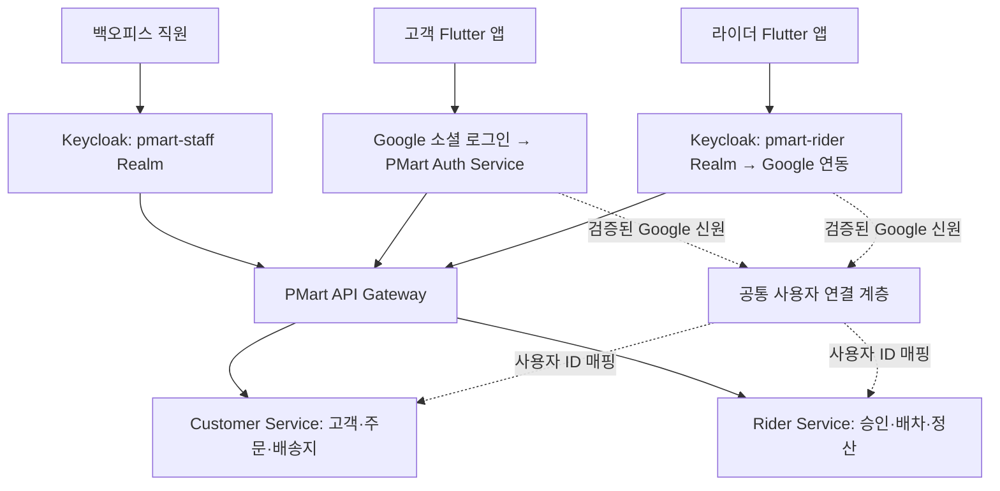

# PMart 최종 인증 아키텍처 추천

**동일한 Google 계정으로 고객 앱과 라이더 앱에 로그인해야 한다면, 기존 추천인 'Keycloak 서버 1개 + Realm 2개'를 유지하되, 고객과 라이더의 신원을 연결하는 공통 계정 매핑 계층을 추가하는 구조를 추천해.**

즉, **인증 시스템은 분리하고, 동일 인물 여부는 연결하며, 고객·라이더의 업무 정보와 권한은 독립적으로 관리**하는 방식이야.

PMart에 적합한 구성은 다음과 같아.

| 구분 | 백오피스 직원 | 고객 | 라이더 |
|---|---|---|---|
| 로그인 | Keycloak 계정 | Google 소셜 로그인 | Google 소셜 로그인 |
| 인증·토큰 발급 | Keycloak | PMart Auth Service | Keycloak |
| Keycloak Realm | `pmart-staff` | 사용하지 않음 | `pmart-rider` |
| JWT | 직원 Keycloak JWT | PMart 자체 JWT | 라이더 Keycloak JWT |
| 권한 관리 | 직원 역할 | CUSTOMER | RIDER + 승인 상태 |
| 업무 데이터 | 직원 관련 서비스 | Customer Service | Rider Service |

## 1. 전체 구조



여기서 Keycloak은 물리적으로 하나의 서버이지만 Realm을 두 개 만들어 직원 계정과 라이더 계정을 독립적으로 관리해.

고객은 Keycloak에 등록하지 않아도 돼.

## 2. 같은 Google 계정인데 어떻게 동일 인물로 인식할까?

예를 들어 같은 Google 계정으로 로그인해도 발급되는 토큰은 달라.

| 구분 | 고객 앱 | 라이더 앱 |
|---|---|---|
| 로그인 Google 계정 | abc@gmail.com | abc@gmail.com |
| 최종 JWT 발급자 | PMart Auth Service | Keycloak |
| JWT `sub` | PMart 고객 식별자 | Keycloak 라이더 UUID |
| 서비스 권한 | CUSTOMER | RIDER |

따라서 두 JWT의 `sub`를 직접 비교하면 같은 사람인지 알 수 없어.

여기서 사용하는 것이 **Google 계정의 `sub`**야.

Google 공식 문서에서도 이메일 대신 Google `sub`를 고유 식별자로 사용하도록 안내하고 있어. 이메일은 변경될 수 있기 때문이야.

예를 들어 PMart에서는 다음과 같은 연결 정보를 관리할 수 있어.

```text
Google sub: 109876543210

PMart 고객 ID: customer-1001
Keycloak 라이더 ID: rider-uuid-abc
```

이것은 실제 Google ID나 JWT 값이 아니라 설명을 위한 예시야.

중요한 점은 **라이더 Realm에서 Keycloak이 Google과 연동하면서 확인한 Google 사용자 식별자를 PMart의 연결 계층에서 신뢰할 수 있는 방법으로 조회해야 한다는 것**이야. Keycloak JWT의 `sub`는 Google `sub`가 아니므로, 필요한 경우 별도 매핑 또는 서버 측 조회 기능을 구현해야 해.

이렇게 연결하면 두 서비스의 계정은 별도로 존재하지만 동일한 사람인지 알 수 있어.

## 3. 실제 고객·라이더 가입 흐름

### 상황 A. 고객으로 먼저 가입한 사람이 라이더를 신청

1. 고객 앱에서 Google 로그인 → PMart 고객 계정 생성
2. 라이더 앱에서 동일한 Google 계정으로 로그인 → Keycloak rider Realm에서 인증
3. PMart가 검증된 Google 신원으로 기존 고객 계정과의 연결 여부 확인
4. 라이더 프로필 생성 및 자격 심사
5. 승인 완료 후 배차 기능 활성화

### 상황 B. 라이더가 나중에 고객으로 가입

1. 라이더 앱에서 먼저 Google 로그인 및 라이더 등록
2. 고객 앱에서 같은 Google 계정으로 로그인
3. PMart가 기존 Google 신원과 연결된 라이더 계정 확인
4. 새 고객 프로필 생성 후 고객 서비스를 독립적으로 이용

두 상황 모두 동일한 Google 계정이라는 사실로 연결할 수 있지만, **고객 가입이 라이더 자격을 자동으로 부여하거나 라이더 가입이 고객 정보를 공유하도록 만들어서는 안 돼.**

또한 Google 계정의 일치 여부는 단순 이메일 비교가 아니라 신뢰할 수 있는 인증 결과로 확인해야 해.

## 4. 고객과 라이더는 어디까지 독립적으로 관리할까?

| 관리 항목 | 고객 | 라이더 |
|---|---|---|
| 계정 상태 | ACTIVE / SUSPENDED | ACTIVE / SUSPENDED |
| 이용 권한 | 주문·결제 | 배차·배송 |
| 가입 절차 | Google 로그인 후 가입 | Google 로그인 + 라이더 승인 |
| 제재 처리 | 고객 계정에 적용 | 라이더 계정에 적용 |
| 프로필 | 고객 서비스 저장 | 라이더 서비스 저장 |
| 토큰 | PMart JWT | Keycloak JWT |
| 로그아웃 | 고객 세션 종료 | 라이더 세션 종료 |

예를 들어 라이더가 배송 중 규정을 위반해 라이더 자격이 정지되더라도 고객 계정은 유지할 수 있어.

반대로 고객으로서 주문한 내역은 라이더 업무 관리 시스템에 자동으로 노출되지 않아야 해.

Keycloak에서 라이더 계정을 비활성화하거나 Rider Service에서 라이더 승인을 취소하면 라이더 업무만 제한하도록 설계하면 돼. 이미 발급된 JWT의 즉각적인 차단까지 필요하다면 짧은 토큰 수명과 서버 측 상태 확인 또는 토큰 폐기 전략이 추가로 필요해.

## 5. 두 가지 Keycloak 배치 중 최종 선택

| 평가 기준 | Realm 분리 | 서버 분리 |
|---|---|---|
| 직원·라이더 계정 독립성 | 충족 | 충족 |
| 동일 Google 계정 연결 | 별도 매핑으로 가능 | 별도 매핑으로 가능 |
| 서로 다른 JWT 발급자 | 가능 | 가능 |
| 서로 다른 로그인 정책 | 가능 | 가능 |
| 물리적 장애 격리 | 제한적 | 가능 |
| 구현·운영 부담 | 낮음 | 높음 |

**동일한 Google 계정을 사용하는 조건은 Keycloak 서버를 분리해야 하는 이유가 아니야.** 신원 연결 문제는 서버 수와 별개로 해결해야 하기 때문이야.

따라서 현재 PMart에서는 서버 분리로 얻는 이점보다 관리할 컨테이너, 데이터베이스, 설정 및 모니터링이 늘어나는 부담이 더 크다고 판단해.

## 6. 내가 추천하는 최종 구성

**Keycloak 인스턴스 1개, Realm 2개**

| 구분 | 구성 |
|---|---|
| 백오피스 | `pmart-staff` Realm |
| 고객 | Google 로그인 + PMart 자체 JWT |
| 라이더 | `pmart-rider` Realm + Google 연동 |
| 동일 인물 식별 | Google 신원 기반 계정 매핑 |
| 업무 데이터 | Customer / Rider Service 별도 관리 |

구현할 때 중요한 것은 다음 순서야.

1. 고객은 기존 Google 로그인 + JWT를 유지한다.
2. Keycloak에 직원·라이더 Realm을 각각 생성한다.
3. 라이더 Realm에 Google Identity Provider를 연동한다.
4. 사용자 연결 테이블에 Google 신원과 각 시스템의 사용자 ID를 매핑한다. 처음에는 라이더 등록 시점에 연결하는 방식으로 충분하다.
5. API Gateway와 각 서비스는 직원·고객·라이더 JWT의 발급자를 구별하고, 허용된 API만 접근하도록 설정한다.
6. 라이더 승인·정지·배차 가능 상태는 Rider Service에서 관리한다.

단, Google 인증으로 연결된 신원을 여러 시스템에서 매핑할 때는 토큰을 먼저 검증하고, Keycloak의 Google 연동 식별자를 신뢰할 수 있는 서버 측 경로로 확보해야 해. 임의로 전달된 이메일이나 Google ID 문자열만 믿고 계정을 연결하면 안 돼.

**최종 결론: PMart는 인증 계정을 분리하되 동일한 사람이라는 연결 정보만 공유하면 돼. 이를 위해 Keycloak 서버를 두 개 만들 필요는 없고, Realm 분리 + 공통 신원 매핑이 가장 적절해.**
