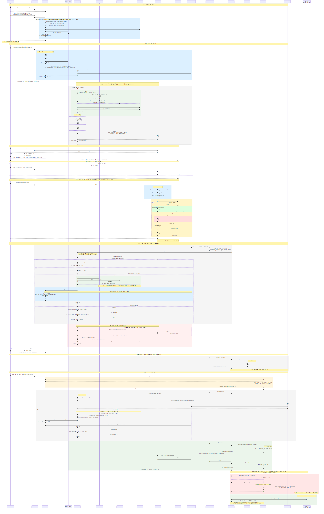

# 주문 전체 흐름 분석 (order-full-flow)

- 그림: [`diagrams/order-full-flow.png`](diagrams/order-full-flow.png) · 원본 [`diagrams/order-full-flow.mmd`](diagrams/order-full-flow.mmd) (커밋 `7e48af9`, 추적 반영 2026-11-05)
- 번호별 설명(누가 누구에게 어떤 방식으로, 앱이 받는 응답과 trace): [`order-full-flow-steps.md`](order-full-flow-steps.md)
- 기준: 그림을 만든 시점에 **구현된 코드**(main `dae7b8c`, 2026-11-03). 이 문서의 상태값·타이머·키는 코드(`CheckoutRules`, `PaymentStage`, 계약 `order-service.yaml`)와 흐름 문서에서 확인한 것이다. 이후의 Eureka(ADR-0032)·설정 실행 중 갱신(ADR-0033)은 주문 흐름을 바꾸지 않는다. 2026-11-04 의 이벤트 소비 Spring Cloud Stream 전환(ADR-0035, `b8e70b7`)과 추적 작업 A·C·B(`a1d514c` — 사가 실행기 문맥 전달, correlationId = sagaId/claimId, Kafka `traceparent`)는 소비·추적 방식만 바꾸고 단계·상태·키는 그대로다 — 본문에 반영(2026-11-05 확인).
- 업무 규칙의 정본: [`docs/business/flows/order-checkout-saga.md`](../business/flows/order-checkout-saga.md)(S1·S2), [`cancel-vs-handover.md`](../business/flows/cancel-vs-handover.md)(S3). 이 문서는 **그림을 읽기 위한 해설**이고 규칙을 새로 정하지 않는다.
- 패턴별 책임(오케스트레이션·코레오그래피·Outbox): [`payment-saga-patterns.md`](payment-saga-patterns.md)
- 2026-11-04 그림 갱신: 소비 지점마다 실패 표시, 맨 아래 **[Phase 8] 소비 실패** — 재시도 1+3회 → 바인더 DLQ(`PmartDlqDestinationResolver`: `dead_letter` 기록 → `{토픽}.DLT`) → `DeadLetterOpen` 경보 → StreamBridge 재처리(ADR-0030·0035)
- 관련 ADR: 0003(사가는 orchestration 이 조정, 확정 사실은 이벤트로 전파), 0006(동기 체인 2 hop), 0020(Toss 결제), 0026(서비스 간 호출 인증 없음)
- 이벤트 경로 그림(2026-11-04, main `4342c58`): 이 그림은 동기 호출 위주라 Debezium·토픽·DLT 가 잘 안 보인다. 따로 그렸다.
  - [`diagrams/order-event-topics.png`](diagrams/order-event-topics.png) — 발행 서비스 → Debezium 커넥터(EventRouter 설정) → 토픽(이벤트 종류) → 구독 서비스(처리하는 이벤트) → `{토픽}.DLT`·`dead_letter`·경보
  - [`diagrams/order-event-pipeline.png`](diagrams/order-event-pipeline.png) — 이벤트 한 건(PaymentApproved)의 outbox 저장 → WAL 캡처·라우팅 → InboxGuard 소비·offset 커밋 → 재시도 3회(1·2·4초) → DLT·`dead_letter`·`DeadLetterOpen` 경보 → 운영자 재처리(`POST /api/v1/internal/dead-letters/{id}/replays`)·폐기 (ADR-0030)
  - 영문판: [`order-event-topics.en.png`](diagrams/order-event-topics.en.png) · [`order-event-pipeline.en.png`](diagrams/order-event-pipeline.en.png) (원본 `*.en.mmd`, 한글판과 같은 내용 — 고칠 때 둘 다 고친다)



---

## 0. 한눈에 보기

주문 하나는 **두 번의 사용자 요청(주문서 만들기, 결제 진입) + 한 번의 결제창 + 그 뒤의 비동기 처리**로 확정된다.

```
[앱] 주문서 만들기 ─동기─► order-service (견적 10분 동결)
[앱] 결제 진입    ─동기─► order-service ─► orchestration: 결제 사가 S1 시작 (202 접수)
                           S1: 재고 예약 → 처리 여력 hold → (예약배달) 슬롯 hold → 결제 시도 생성
[앱] Toss 결제창 ─► Toss ─► [앱] 결제 승인 요청 ─► payment-service ─► Toss confirm
                           payment: PaymentApproved 이벤트 ─► orchestration 이 결제를 다시 조회해 확인
                           S1: 금액 대조 → 자원 확정 → 주문 확정(OrderConfirmed)
                           ─► cart(장바구니 정리)·customer(첫 구매 기록)  … 이행(S2)은 아직 없음
[앱] 취소 신청   ─► claim ─► orchestration: 취소 사가 S3 → 작업 중지 → 자원 해제 → 주문 취소 → claim: 환불
```

### 참여자와 각자 가진 정본

| 참여자 | 이 흐름에서 하는 일 | 정본(자기 DB) |
|---|---|---|
| customer_app | 주문서·결제 진입 요청, Toss SDK 결제창, 결과를 **조회로** 기다림 | — |
| api-gateway | JWT 확인·라우팅(`lb://`), X-Request-Id, 처리율 제한 | — |
| **order-service** | 주문서(견적 동결), 결제 진입 접수, **주문 확정·취소 반영** | `order_draft`, `customer_order`·`_line`·`_shipping` |
| **order-orchestration** | **결제 사가 S1·취소 사가 S3 조정**, 보상 | `checkout_saga`, `saga_step`, `saga_compensation`, `cancellation_saga` |
| mfc-inventory | 재고 예약(전부 또는 전무) → 확정·해제 | `reservation`, `stock_balance`, `stock_ledger_entry` |
| mfc-capacity | MFC 1시간 처리 여력 hold | `capacity_window`, `capacity_hold` |
| delivery-capacity | 예약배달 슬롯 hold(정원) | `slot_hold`, `slot_hold_command`, `slot_lock` |
| **payment-service** | 결제 시도, Toss confirm·cancel, 대사(sweep)·웹훅 | `payment_attempt`(원장) |
| Toss API | 실제 결제 승인·취소 | (외부) |
| cart / customer | 확정 뒤 장바구니 정리 / 첫 구매 기록 | 각자 |
| claim-service | 취소 접수, 환불 의도·결과 | `claim`, `claim_line`, `refund_intent` |
| mfc-fulfillment | 취소 때 작업 중지 응답(이행은 아직 없음) | `order_work_stop` |
| outbox → Debezium → Kafka | 모든 이벤트 발행 경로(업무 변경과 같은 트랜잭션에 outbox 저장) | — |

---

## 1. 단계별 상세

### Phase 1. 주문서 만들기 (동기)

**요청**: `POST /order-drafts` (Idempotency-Key)
`{ purchaseIntentId, items[{cartItemId, sku, quantity}], shoppingAddressId, deliveryMode(SINGLE|BUNDLED|SCHEDULED), arrivalWindow?, outOfStockPreference }`
그 전에 앱은 `GET /delivery-options`, 예약배달이면 `GET /slots` 로 고를 수 있는 방식·시간을 받는다.

**order-service 가 동기로 묻는 것** (`Downstream.call` — 4xx 는 그대로, 503 은 `DEPENDENCY_UNAVAILABLE`, 시간 초과는 `UNKNOWN_RESULT`)

| 대상 | 무엇을 | 왜 |
|---|---|---|
| customer | 계정 상태, 쇼핑 컨텍스트(배송 가능·mfcId), 첫 구매 후보 | 구매 가능 계정인지, 어느 MFC 에서 보낼지 |
| product | SKU 판매 상태, 구매 상한 검사 | 판매 중지·상한(Σ qty × unitsPerSku ≤ 10) |
| pricing | 견적 `POST /quotes` | 고정 가격(이 견적이 끝까지 기준) |
| center-master | 센터 달력 | 영업일·시간 |
| delivery-capacity | 슬롯(예약배달) | 고른 시간이 열려 있는지 |
| product-content | 상품 스냅샷 | 주문 품목에 남길 이름·옵션 사본(BR-35) |

**저장**: `order_draft` — `status=DRAFT`, `quoteVersion`, **`quoteExpiresAt = 지금 + 10분`(가격 동결)**, 상품·배송지 사본.

**응답**: `201 OrderDraft { blockers, nextAction }`. 막는 사유(판매 중지, 최소 금액 미달 등)가 있으면 `blockers` 에 나오고 결제 진입이 막힌다. `nextAction=WAIT` 이면 앱이 2초 × 10회 다시 조회한다.

### Phase 2. 결제 진입 → 결제 사가 S1 시작 (동기, 접수까지만)

**요청**: `POST /order-drafts/{draftId}/checkouts` (Idempotency-Key, X-Expected-Version) `{ acceptedQuoteVersion, paymentMethod: TOSS_PAYMENTS }`

**order-service** (`CheckoutService`, 멱등 처리 안, 초안 행 잠금)
1. 소유자·버전 확인. **이미 확정됐거나 사가가 진행 중이면 기존 orderId 를 돌려준다**(중복 결제 방지).
2. 견적 만료·버전 불일치 → `422 RE_QUOTE_REQUIRED`(다시 견적), 막는 사유 → `422 CHECKOUT_BLOCKED`.
3. 계정 상태를 한 번 더 확인(BR-37 질문 4).
4. `orderId = "ORD-" + nameUUID(draftId:requestId)` — 같은 진입 요청은 언제나 같은 주문 ID.
5. orchestration `POST /internal/checkout-sagas` (키 `CHK-draftId:requestId`) — 금액, mfcId, 배송 방식, 줄, 수요(줄 수·개수·중량·출고 수).

**orchestration**: 견적 만료 재확인, **초안 하나에 열린 사가 하나**(`409 SAGA_ALREADY_ACTIVE`), `checkout_saga` 를 `RUNNING / VALIDATE_QUOTE` 로 저장하고 `CheckoutSagaStateChanged` 발행 → `202 { sagaId }`.
**단계는 여기서 돌리지 않는다** — 가상 스레드에서 비동기로 진행한다(실행기가 trace·MDC 를 넘기고, 진행 중 correlationId = sagaId — 2026-11-04). 동기로 끝까지 돌리면 앱 → order → orchestration → 참여자 4곳으로 체인이 길어진다(2 hop 규칙).

**앱이 받는 것**: `202 { status: ACCEPTED, resultId: orderId, nextAction: QUERY_RESULT }` — **접수일 뿐 결제 성공도 주문 확정도 아니다.**

### S1 a~f. 자원 확보 → 결제 시작 (비동기)

각 단계 = **한 트랜잭션 + 사가 행 `SELECT … FOR UPDATE`**(두 실행자가 같은 사가를 진행하지 않게). 하위 명령 키는 `sagaId:단계` 로 고정이라 중단 뒤 재개·재전송해도 정본에 한 번만 반영된다.

| 단계 | 상대 | 내용 | 실패 코드(예) |
|---|---|---|---|
| a `VALIDATE_QUOTE` | 로컬 | 가격 동결(10분) 안인지 | `RE_QUOTE_REQUIRED` |
| b `RESERVE_INVENTORY` | mfc-inventory | SKU 별 합산, 잔고 행 잠금, **전량이 아니면 전부 거절**. `RSV-… HELD`, TTL 10분, 원장 RESERVE | `INSUFFICIENT_STOCK`, `SKU_NOT_HANDLED` |
| c `HOLD_CAPACITY` | mfc-capacity | 1시간 작업 창(예약배달은 도착 슬롯, 즉시는 지금 시간, KST) 여력 hold, TTL 10분 | `CAPACITY_EXCEEDED`, `CONFIG_REQUIRED` |
| d `HOLD_SLOT` | delivery-capacity | **예약배달만**(그 밖은 SKIPPED). 슬롯 정원 hold, 600초 | `SLOT_NOT_SELECTABLE` |
| e (쿠폰) | — | **미구현**(자리만) | — |
| f `START_PAYMENT` | payment | 결제 시도 생성(진행 중 시도가 있으면 재사용) → `{ paymentAttemptId, checkout{ pgOrderId, clientKey, expiresAt } }` | — |

- 확보한 자원은 `saga_compensation`(보상 로그)에 기록한다. **보상은 이 로그에 있는 것만 되돌린다.**
- **결제 마감 = min(자원 만료 중 가장 이른 것, 가격 동결)** — `resourceExpiresAt` 으로 payment 에 넘긴다. payment 는 이 시각이 지나면 Toss 승인 API 를 부르지 않는다.
- f 가 끝나면 사가는 `WAITING_RESULT / AWAIT_PAYMENT_RESULT`, 초안은 `nextAction=PAY` + 결제창 정보.
- 참여자가 **거절**하면 → `COMPENSATING`(j). **결과 불명**(시간 초과·5xx)이면 → 실패로 보지 않고 같은 키로 재전송.

### Phase 3. Toss 결제창 (앱 안)

1. 앱이 `GET /payment-widget-config` → `{ clientKey, customerKey = accountId }`(BR-34).
2. 주문서를 1초 × 30회 조회해 `nextAction=PAY` 와 `payment{ pgOrderId, amount, clientKey }` 를 받는다(그 전에는 `WAIT`).
3. `renderPaymentMethods` → `requestPayment({ orderId: pgOrderId, amount, orderName })`. 사용자가 결제수단을 고르고 인증한다. **successUrl 리다이렉트가 없다** — SDK 가 결과를 앱으로 돌려준다.
4. 인증 실패·사용자 취소 → `POST /payment-authorization-failures` → 결제 시도 `AUTH_FAILED` | `CANCELED_BY_USER`, `PaymentFailed` 발행.

### Phase 4. 결제 승인 (payment-service ↔ Toss)

**요청**: `POST /payment-confirmations` (Idempotency-Key) `{ orderId: pgOrderId, paymentKey, amount }`

1. **짧은 트랜잭션 — 검증과 상태 변경만**
   - 소유자·paymentKey 불일치 → 409, **금액 불일치 → `400 AMOUNT_MISMATCH`(Toss 를 부르지 않는다)**
   - `resourceExpiresAt` 지남 → `EXPIRED` + `PaymentFailed`, `422 RESERVATION_EXPIRED`
   - `READY → CONFIRMING`, paymentKey 저장
2. **트랜잭션 밖에서** Toss `POST /v1/payments/confirm`(Idempotency-Key = 시도 키)
3. 결과를 다시 행 잠금으로 반영(`PaymentLedger.applyConfirm`):

| Toss 결과 | 결제 시도 | 이벤트(order.payment.v1) |
|---|---|---|
| 200 DONE, 금액·주문 일치 | `APPROVED` | `PaymentApproved` |
| 4xx 거절 | `CONFIRM_FAILED` | `PaymentFailed` |
| 시간 초과·5xx | `CONFIRM_UNKNOWN` | `PaymentResultUnknown` |
| 응답 필드 불일치 | `MISMATCH_HOLD` | `PaymentMismatch` |

4. 앱에는 `CheckoutPayment { state }` 를 주지만 **앱은 이것을 "주문 완료"로 보지 않는다** — 주문 확정은 Phase 5 뒤다.

**대사(sweep, 15초)**: `READY` 가 마감을 넘기면 `EXPIRED`. 불명은 즉시 재조회 → 1분 × 5회 → `MANUAL_REVIEW` → 이후 15분 간격. **웹훅**(`POST /webhooks/toss`)은 HMAC 확인·중복 제거 뒤 **재조회를 앞당길 뿐 상태를 직접 바꾸지 않는다**(웹훅 본문을 믿지 않고 Toss 를 다시 조회).

### S1 g~j. 결제 결과 → 주문 확정 (비동기)

**깨우기**: payment 의 outbox → Debezium → Kafka `order.payment.v1` → orchestration `paymentEvents` 소비 함수(Spring Cloud Stream, InboxGuard — ADR-0035) → 커밋 뒤 `kick()`. 이벤트가 유실돼도 **백업 sweep(10초)** 이 30초 넘게 멈춘 사가와 자원 마감이 지난 `WAITING_RESULT` 를 처리한다.

**g. 결과 확인 — 이벤트가 아니라 조회로**: `GET /internal/payments/{id}` → `{ state, approvedAmount, pgTransactionId }`

| 결제 상태 | 사가가 하는 일 |
|---|---|
| `APPROVED` | 보상 로그에 `PAYMENT_APPROVAL` 추가 → h1 |
| `UNKNOWN`·`MISMATCH` | `UNKNOWN_TRACKING` — **자원을 풀지 않는다**(각 정본이 TTL 로 만료) |
| `CREATED`·`PENDING` | `resourceExpiresAt` 까지 대기, 지나면 `RESOURCE_EXPIRED` 로 실패 |
| 실패 | `PAYMENT_FAILED` 로 실패 → j |

**h1. `RECONCILE_PAYMENT`**: 승인 금액 = 사가 금액, 통화 KRW. 다르면 **`RECONCILIATION_REQUIRED`** + `ReconciliationRequired` — 확정·해제·취소 모두 멈추고 사람이 본다(강제 출고 금지).

**i. `CONFIRM_RESOURCES`**: 재고 예약·여력·(슬롯) `HELD → CONFIRMED`(키 `sagaId:CONFIRM:자원`). 이미 CONFIRMED 면 성공, 이미 RELEASED·EXPIRED 면 `INVALID_STATE` → `RESERVATION_LOST`(→ j, 결제 보상 취소).

**h2. `CONFIRM_ORDER`**: order `POST /internal/orders/{orderId}/confirmation` — 한 트랜잭션에 초안 잠금, **승인 금액 ≠ 고정 견적이면 `422 AMOUNT_MISMATCH`**, `customer_order`(CONFIRMED v1)·`customer_order_line`(`unfulfilledQty = qty`)·`customer_order_shipping`(배송지·연락처 사본, BR-37) 저장, 초안 CONFIRMED, **`OrderConfirmed`**(order.order.v1, correlationId = sagaId). 사가는 `COMPLETED`.

> 흐름 문서 원문은 "h 주문 확정 → i 자원 확정" 순서지만 **구현은 자원 확정을 먼저** 한다. `OrderConfirmed` 는 자원이 확정된 뒤 발행해야 한다는 이벤트 카탈로그 조건 때문이다(흐름 문서 §1.4 에 기록).

**j. 보상** — 이번 시도에서 확보한 것만, 이미 해제된 줄은 건너뛴다.
1. 결제가 이미 승인됐으면(`RESERVATION_LOST`·`ORDER_CONFIRM_FAILED`) payment `…/compensation-cancellations` → Toss 전액 취소 → `CompensationCancelResult`. **`CANCELLED` 를 조회로 확인한 뒤에만** 자원을 푼다(아니면 다음 sweep 에서 재시도).
2. 재고·여력·슬롯 해제(키 `sagaId:RELEASE:자원`) → 각각 조회로 `RELEASED`·`EXPIRED` 확인 → `CompensationExecuted` → 전부 확인되면 `COMPENSATED`.
3. 초안은 `DRAFT`·`REVIEW` + `checkoutFailure`. 견적이 아직 유효하면 다시 결제 진입할 수 있다(새 주문 ID).

**앱**: 주문서를 1초 × 30회 조회 → `CONFIRMED / DONE` 이면 완료, `DRAFT / REVIEW + checkoutFailure` 면 실패 안내.

### Phase 6. 확정 후 전파 (choreography)

`OrderConfirmed`(order.order.v1)를 각 서비스가 InboxGuard 로 한 번씩 처리한다.

| 받는 쪽 | 하는 일 | 발행 |
|---|---|---|
| cart-service | 주문 계정의 장바구니에서 주문분만 뺀다(cartItemId, 없으면 SKU). 0이면 삭제 | `CartItemChangeApplied`(commerce.cart.v1) |
| customer-service | `firstPurchase=true` 면 첫 구매 사용 기록 | — |
| (미구현) | 이행 사가 S2 — mfc-fulfillment 작업 요청·피킹·패킹, 배차, 알림 | — |

### Phase 7. 취소 사가 S3 — 피킹 전 전체 취소만

1. **claim**: `POST /claims { type: CANCEL, orderId, lines: 전 품목 × 미이행 수량 }` → order 를 조회해 소유자·`CONFIRMED`·전 품목·수량·진행 중 클레임 없음 확인 → `STOP_PENDING`, `stopRequestId` 발급 → `ClaimOpened` + `CancellationRequested`(order.claim.v1) → 201.
2. **orchestration**(`CancellationRequested` 구독): `cancellation_saga` `RUNNING / STOP_WORK`
   - `STOP_WORK`: mfc-fulfillment `POST /internal/stop-requests` → 작업 지시가 아직 없으면 `RESOLVED`(전부 not started), `WorkStopResult`.
   - 전부 STOPPED → `RELEASE_RESOURCES`: S1 보상 로그로 **슬롯 → 여력 → 재고** 순 해제(사유 ORDER_CANCELLED / CANCEL_BEFORE_PICK).
   - `APPLY_ORDER_CANCEL`: order `…/line-quantity-changes`(reason `CANCEL_BEFORE_SHIP`) → 미이행 수량을 빼고 전부 0이면 `CANCELLED`, `OrderLineQuantityChanged` × 줄 + `OrderCancelled` → `COMPLETED`.
   - 미결·일부 진행 중 → `WAITING_RESULT`(재조회). 인계됨(HANDED_OVER)·4xx → `ESCALATED`(자동 보상 없음, 수동 개입 BO-12 미구현).
3. **환불(claim)**: `OrderCancelled` 구독(STOP_PENDING·FULL) → `refund_intent`(승인 금액 전액) → payment `…/cancellations`(키 `REFUND-intentId`) → Toss cancel → `RefundResult` → claim `CLOSED`(`CANCELLED_REFUNDED`).
4. customer: `OrderCancelled` FULL 이면 첫 구매 기록을 지워 자격을 되돌린다.

---

## 2. 상태 모델

### 결제 사가 S1 (`checkout_saga`)
- **단계(순서)**: `VALIDATE_QUOTE` → `RESERVE_INVENTORY` → `HOLD_CAPACITY` → `HOLD_SLOT`(예약배달만) → `START_PAYMENT` → `AWAIT_PAYMENT_RESULT` → `RECONCILE_PAYMENT` → `CONFIRM_RESOURCES` → `CONFIRM_ORDER`
  - 앞의 5개(결제 시작 전)는 가격 동결이 지나면 진행하지 않는다. 승인 뒤 단계는 동결과 무관하다.
- **상태**: `RUNNING` · `WAITING_RESULT` · `UNKNOWN_TRACKING` · `COMPENSATING` · `RECONCILIATION_REQUIRED` · `COMPLETED` · `COMPENSATED` · (실패·시간 초과)
  - 이 중 `RUNNING`~`COMPLETED` 6개는 **열린 상태** — 같은 초안의 새 결제 진입을 막는다.
- **결제 → 사가 판단**: `APPROVED`·`PARTIALLY_CANCELLED`·`CANCELLED` = 승인됨 / `UNKNOWN`·`MISMATCH` = 미해결(자원 유지) / 그 밖 = 미승인

### 결제 시도 (`payment_attempt` stage → 외부에 보이는 상태)

| stage | 외부 상태 | 뜻 |
|---|---|---|
| `READY` | CREATED | 결제창 준비 |
| `CONFIRMING` | PENDING | Toss 승인 호출 중 |
| `APPROVED` | APPROVED | 승인 |
| `AUTH_FAILED` · `CANCELED_BY_USER` · `CONFIRM_FAILED` · `EXPIRED` | FAILED | 인증 실패·사용자 취소·승인 거절·마감 지남 |
| `CONFIRM_UNKNOWN` · `MANUAL_REVIEW` | UNKNOWN | 결과 불명·수동 확인 |
| `MISMATCH_HOLD` | MISMATCH | 응답이 요청과 다름 |
| `PARTIAL_CANCELED` · `CANCELED` | PARTIALLY_CANCELLED · CANCELLED | 부분·전액 취소 |

### 주문서가 앱에 알려 주는 것 (`OrderDraft`)
- `nextAction`: `REVIEW`(고칠 것 있음) · `RE_QUOTE`(다시 견적) · `PAY`(결제창 열기) · `WAIT`(기다림) · `DONE`(확정) · `EXPIRED`
- 진행 표시: `inventoryReservation`(NOT_REQUESTED·HELD·FAILED·RELEASED·UNKNOWN·PAYMENT_PENDING_HOLD) · `capacityHold` · `slotHold`(NOT_REQUIRED…) · `payment`(NOT_STARTED·STARTED·APPROVED·FAILED·UNKNOWN·MISMATCH)

### 취소 사가 S3 (`cancellation_saga`)
`STOP_WORK` → `RELEASE_RESOURCES` → `APPLY_ORDER_CANCEL` → `COMPLETED` / 대기 `WAITING_RESULT` / 사람 필요 `ESCALATED`

---

## 3. 타이머·주기

| 무엇 | 값 | 만료·주기 때 |
|---|---|---|
| 가격 동결 | 초안 생성 + 10분 | 재견적·고객 재확인(자동 해제·환불 아님) |
| 재고 예약 · 처리 여력 hold | 10분 TTL | 각 정본이 스스로 `EXPIRED`. 결제 불명이면 사가가 풀지 않고 TTL 에 맡긴다 |
| 슬롯 hold | 600초 | 위와 같음 |
| 결제 마감(`resourceExpiresAt`) | min(자원 만료, 가격 동결) | payment 가 승인 API 를 부르지 않음, `EXPIRED` |
| 결제 대사 sweep | 15초 | READY 만료 처리, 불명 재조회 |
| 결제 불명 재조회 | 즉시 → 1분 × 5 → `MANUAL_REVIEW` → 15분 간격 | 수동 종결도 PG 원거래 증거 필수 |
| 사가 백업 sweep | 10초(30초 넘게 멈춘 사가) | 같은 키로 이어서 진행, 대기 중 결제 시도 조회 |
| 앱 조회 | 주문서 2초 × 10, 결제 대기 1초 × 30, 확정 대기 1초 × 30 | — |

## 4. 멱등키 (재시도해도 한 번만 반영되는 이유)

| 어디 | 키 |
|---|---|
| 앱 → order 주문서·결제 진입 | `Idempotency-Key`(앱이 만든 값) |
| 주문 ID | `"ORD-" + nameUUID(draftId:requestId)` |
| order → orchestration 사가 시작 | `CHK-draftId:requestId` |
| 사가 단계 명령 | `sagaId:단계` |
| 자원 확정 / 해제 | `sagaId:CONFIRM:자원` / `sagaId:RELEASE:자원` |
| payment → Toss confirm | 결제 시도 키 |
| 환불 | `REFUND-intentId` |
| 이벤트 소비 | InboxGuard(eventId) |

## 5. 이벤트

| 토픽 | 이벤트 | 발행 | 받는 쪽 |
|---|---|---|---|
| order.saga.v1 | `CheckoutSagaStateChanged`, `CompensationExecuted`, `ReconciliationRequired` | orchestration | (관측) |
| order.payment.v1 | `PaymentApproved`, `PaymentFailed`, `PaymentResultUnknown`, `PaymentMismatch`, `CompensationCancelResult`, `RefundResult` | payment | orchestration(사가 깨우기), claim(환불 결과) |
| order.order.v1 | `OrderConfirmed`, `OrderLineQuantityChanged`, `OrderCancelled` | order | cart, customer, claim |
| order.claim.v1 | `ClaimOpened`, `CancellationRequested`, `RefundIntentCreated`, `ClaimClosed` | claim | orchestration(취소 사가) |
| mfc.fulfillment.v1 | `WorkStopResult` | mfc-fulfillment | — |
| commerce.cart.v1 | `CartItemChangeApplied` | cart | — |

모든 이벤트는 **업무 변경과 같은 트랜잭션에 outbox 로 저장**되고 Debezium 이 Kafka 로 보낸다(key = aggregateId, 헤더 eventType·aggregateType·traceId·correlationId·traceparent — `traceparent` 는 2026-11-04 추가로 소비 span 이 발행 trace 에 이어진다 — 그림 반영 2026-11-05). correlationId 는 S1 사건 = sagaId(참여자 `PaymentApproved` 등 포함), S3 = claimId(2026-11-04). 그래서 "DB 는 바뀌었는데 이벤트가 안 나감"이 없다.

---

## 6. 실패 시나리오 — 무엇이 어떻게 처리되나

| 상황 | 처리 | 고객에게 |
|---|---|---|
| 같은 결제 진입을 두 번 누름 | 같은 키 → 같은 결과, 열린 사가가 있으면 기존 orderId | 한 번만 진행 |
| 견적 10분이 지남 | `RE_QUOTE_REQUIRED` | 가격 다시 확인 |
| 재고 일부 부족 | 전부 거절(일부만 잡지 않음) → 보상 | 결제창 안 열림, 실패 안내 |
| 마지막 1개에 두 주문 | 예약에 성공한 주문만 결제로 | 다른 주문은 재고 부족 |
| 참여자 응답 시간 초과 | 실패로 보지 않고 같은 키로 재전송 | 잠시 대기 |
| 결제창에서 취소·인증 실패 | `PaymentFailed` → 보상 | 다시 시도 가능 |
| Toss 승인 응답 불명 | `CONFIRM_UNKNOWN` → 재조회, 사가 `UNKNOWN_TRACKING`(자원 유지) | 확인 중 |
| 결제 마감 뒤 승인 시도 | Toss 를 부르지 않고 `EXPIRED`, `422 RESERVATION_EXPIRED` | 다시 주문 |
| 승인됐는데 자원이 이미 만료(지연 승인) | `RESERVATION_LOST` → **전액 보상 취소 확인 후** 해제 | 결제 취소됨 |
| 승인 금액 ≠ 청구 금액 | `RECONCILIATION_REQUIRED` — 모두 멈춤 | 사람 확인 대기 |
| 주문 저장 실패(확정 거절) | `ORDER_CONFIRM_FAILED` → 전액 보상 취소 → 해제 | 결제 취소됨 |
| 결제 이벤트 유실 | 사가 sweep(10초)·결제 대사(15초)가 조회로 따라잡음 | (영향 없음) |
| 피킹 전 전체 취소 | S3 → 자원 해제 → 주문 취소 → 환불 | 환불 완료 |
| 이미 인계됨 | `ESCALATED`(자동 보상 없음) | 수동 처리(미구현) |

---

## 7. 설계에서 잘 된 점 (왜 이렇게 했나)

1. **결과 불명을 실패로 단정하지 않는다.** 네트워크 시간 초과는 "상대가 처리했을 수도 있음"이다. 실패로 보고 해제·재결제하면 이중 결제·재고 이중 판매가 생긴다. 그래서 UNKNOWN 으로 두고 원결과를 조회한다. 결제 불명일 때 자원을 일부러 풀지 않고 TTL 로 자연 만료시키며, 늦게 승인되면 `RESERVATION_LOST` 로 보상 취소한다.
2. **외부 PG 호출을 DB 트랜잭션 밖에서 한다.** 트랜잭션 안에서 Toss 를 부르면 응답을 기다리는 동안 행 잠금·커넥션을 잡는다. 그래서 확인 → `CONFIRMING` 커밋 → Toss 호출 → 결과를 다시 잠가 반영한다.
3. **금액을 세 번 대조한다.** 결제 승인 요청(앱이 보낸 금액 = 시도 금액), 사가(승인 금액 = 사가 금액·KRW), 주문 확정(= 고정 견적). 어느 단계에서 어긋나도 확정되지 않는다.
4. **이벤트를 믿지 않고 조회로 확인한다.** 이벤트는 순서가 바뀌거나 중복·유실될 수 있다. 이벤트는 "깨우는 신호"로만 쓰고 결제 상태는 payment 에 다시 묻는다. 웹훅도 같은 방식이다.
5. **보상 범위가 좁다.** 보상 로그에 기록된, 이번 시도에서 새로 확보한 자원만 되돌린다. 이미 확정된 다른 주문의 점유를 건드리지 않는다.
6. **멱등키가 결정적이다.** 모든 키가 입력값(초안·요청·사가·단계)에서 만들어져 재시도·재개해도 같은 키가 나온다. 그래서 sweep 이 아무 때나 사가를 이어서 진행해도 안전하다.
7. **동기 체인을 짧게 끊었다.** 결제 진입은 사가를 저장하고 202 로 끝나며, 실제 단계는 비동기다(2 hop 규칙).

## 8. 아직 없는 것

| 항목 | 상태 | 영향 |
|---|---|---|
| **이행 사가 S2** (작업 요청 → 피킹·패킹 → 출고) | 미구현(슬라이스 6, 사용자 결정 대기) | 확정 뒤 실물이 움직이는 흐름이 없다 |
| 배차·인계 (delivery-dispatch·execution) | 미구현 | 배송 단계 없음 |
| 쿠폰 (S1 e) | 자리만 | 할인 없음 |
| 알림 반응 | 미구현 | 확정·취소 알림 없음 |
| 피킹 시작 후 취소, **부분 취소** | 미구현(ESCALATED) | 전 품목·전 수량 취소만 |
| 수동 개입(BO-12), case 상신 연결 | 미구현 | `MANUAL_REVIEW`·`ESCALATED` 를 처리할 화면 없음 |

## 9. 개선 여지

1. **앱의 조회 대기가 길다.** 주문서 2초 × 10, 결제 대기 1초 × 30, 확정 대기 1초 × 30 — 최악이면 1분 넘게 조회만 한다. 사가 상태 변화를 SSE·푸시로 알리면 조회 수와 체감 시간이 줄어든다.
2. **주문서 생성 때 동기 조회가 많다(6개 서비스).** 2 hop 규칙은 지키지만 하나가 느리면 전체가 느려지고, 하나가 503 이면 주문서를 못 만든다. 서로 독립인 조회(가격·달력·콘텐츠)는 병렬로, 자주 안 바뀌는 것(달력·콘텐츠 스냅샷)은 짧은 캐시를 검토할 만하다.
3. **대사 sweep 이 여러 군데다.** 결제 15초, 사가 10초, 불명 1분 × 5 후 15분. 지금은 지표가 없다. 운영 전에 "멈춘 사가 수, `UNKNOWN_TRACKING`·`RECONCILIATION_REQUIRED`·`MANUAL_REVIEW` 건수, 보상 실패 수"를 Prometheus 지표와 경보로 만들어야 한다.
4. **사람 개입 경로가 없다.** `RECONCILIATION_REQUIRED`·`MANUAL_REVIEW`·`ESCALATED` 로 멈춘 건을 볼 화면·API(BO-12)가 없어서, 지금은 DB·로그로만 확인할 수 있다.

## 10. 참고
- 같은 이름의 Eum 그림: `Eum-main/eum_backend/diagrams/order-full-flow.*` (주문 전체 그림끼리의 비교 분석은 아직 없음. 부분 비교: 결제 [`toss-payment-eum-comparison.md`](toss-payment-eum-comparison.md), Debezium [`debezium-usage-vs-eum.md`](debezium-usage-vs-eum.md)).
- 그림 다시 만들기: `docs/architecture/diagrams/` 에서 `npx @mermaid-js/mermaid-cli -i order-full-flow.mmd -o order-full-flow.png -s 5` (mermaid-cli 11 기준 약 3900px 폭), svg 는 `-o order-full-flow.svg`
- 서비스별 규칙: `services/order-orchestration-service/CLAUDE.md`(S1·S3), `services/payment-service/CLAUDE.md`, `services/order-service/CLAUDE.md`
