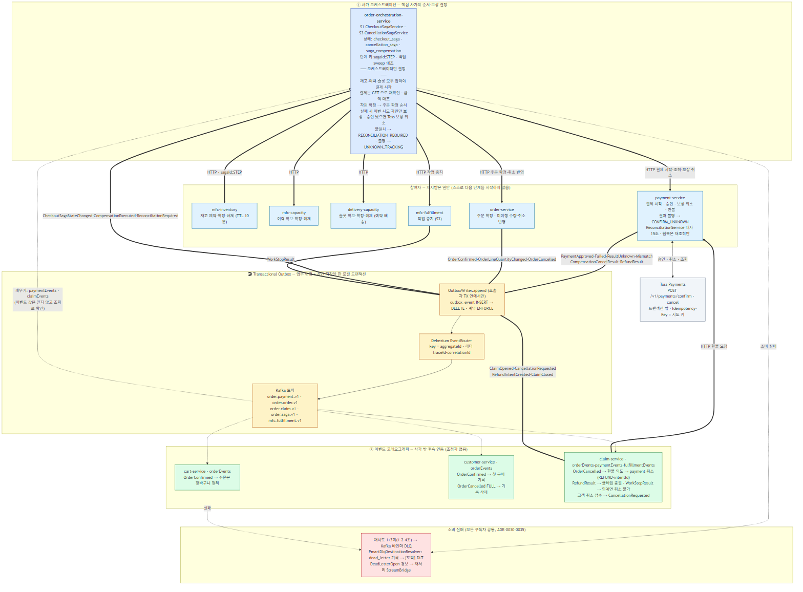

# 결제 흐름의 패턴별 책임 — 사가 오케스트레이션 · 이벤트 코레오그래피 · Transactional Outbox

- 기준: main `b8e70b7`(2026-11-04) **구현된 코드**, 추적 작업 A·C·B(`a1d514c`, 2026-11-04) 반영 — 2026-11-05 다시 확인(그 뒤 주문·결제·사가 코드 변경 없음). 결정은 ADR-0003(주문 사가 오케스트레이션, 2026-11-04 사용자 유지 결정으로 승인).
- 관련: ADR-0009(Outbox·Inbox), ADR-0020(Toss 결제), ADR-0030(dead letter), ADR-0035(소비·DLT·재처리 = Spring Cloud Stream)
- 그림: [`diagrams/order-full-flow.png`](diagrams/order-full-flow.png)(동기 호출 위주 전체 흐름), [`diagrams/order-event-topics.png`](diagrams/order-event-topics.png)(이벤트 경로), [`diagrams/order-event-pipeline.png`](diagrams/order-event-pipeline.png)(이벤트 한 건·DLT·재처리). 해설은 [`order-full-flow-analysis.md`](order-full-flow-analysis.md).

원본 [`diagrams/payment-saga-patterns.mmd`](diagrams/payment-saga-patterns.mmd) · 영문판 [`payment-saga-patterns.en.png`](diagrams/payment-saga-patterns.en.png). 굵은 실선 = 오케스트레이션 명령(동기 HTTP·멱등 키), 이중선 = Outbox 발행, 점선 = 이벤트 반응·깨우기·소비 실패.

## 1. 한 줄 정리

> **핵심 주문 사가(결제 진입·확정 S1, 고객 취소 S3)는 오케스트레이션, 사가가 끝난 뒤 확정된 사실의 후속 연동은 이벤트 코레오그래피, 모든 이벤트 발행은 Transactional Outbox.**

세 패턴은 같은 문제를 푸는 것이 아니다.

| 패턴 | 푸는 문제 | PMart 에서의 질문 |
|---|---|---|
| 사가 오케스트레이션 | 여러 서비스에 걸친 자원 확보·결제·확정의 **순서와 보상을 누가 결정하나** | 다음 단계·실패 복구의 결정권자 = `order-orchestration-service` |
| 이벤트 코레오그래피 | 확정된 사실에 **각 서비스가 스스로 반응** | `OrderConfirmed`·`OrderCancelled`·`RefundResult` 를 받은 서비스가 자기 일을 한다 |
| Transactional Outbox | DB 변경과 이벤트 발행을 **함께 확정** | 업무는 저장됐는데 이벤트가 사라지는 일(이중 쓰기)을 막는다 — 위 두 방식 모두가 쓴다 |

PMart 의 사가는 "하나의 사가가 두 조정 방식을 동시에 쓴다"가 아니다. **사가 안은 오케스트레이션, 사가 밖은 코레오그래피**로 범위가 나뉜다.

## 2. 사가 오케스트레이션 — `order-orchestration-service`

### 2.1 맡는 사가

| 사가 | 코드 | 단계 |
|---|---|---|
| **S1 결제 진입·주문 확정** | `order-orchestration-service/.../application/CheckoutSagaService.java` | a 견적 확인 → b 재고 예약(mfc-inventory) → c 여력 확보(mfc-capacity) → d 슬롯 확보(delivery-capacity, 예약 배송만) → f 결제 시작(payment) → g 결제 결과 **조회** → h1 금액 대조 → i 자원 확정 → h2 주문 확정(order) → 완료. 실패 시 j 보상 |
| **S3 고객 취소(피킹 전 전체 취소)** | `.../application/CancellationSagaService.java` | 작업 중지(mfc-fulfillment) → 자원 해제(슬롯 → 여력 → 재고) → 주문 취소 반영(order) |

### 2.2 오케스트레이터만 결정하는 것

| 결정 | 내용 |
|---|---|
| 결제로 넘어갈지 | 재고·여력·슬롯이 **모두** 잡혔을 때만 결제 시작(OMS 전품목 동시 확보) |
| 확정할지 | 결제 상태를 이벤트 값이 아니라 `GET /internal/payments/{id}` 로 다시 확인하고, 승인 금액 = 사가 금액(KRW)일 때만 |
| 확정 순서 | 자원 확정 → 주문 확정(`OrderConfirmed` 는 자원 확정 뒤에만 나가야 한다는 카탈로그 조건) |
| 보상 범위 | **이번 시도에서 확보한 자원만** 거꾸로 해제(`saga_compensation` 기록 기준). 결제 승인이 이미 났으면(자원 유실·주문 확정 실패) Toss **전액 보상 취소** |
| 멈춤 | 금액 불일치 → `RECONCILIATION_REQUIRED`(확정·해제·취소 모두 멈추고 사람 확인) / 결제 결과 불명 → `UNKNOWN_TRACKING`(해제하지 않음, 자원은 10분 TTL) |
| 취소 가능 여부(S3) | 작업 중지 결과가 전부 STOPPED 일 때만 해제·취소 반영. 일부 진행 중 → 대기 후 재확인, 인계됨 포함 → `ESCALATED` |

### 2.3 상태·명령·복구

| 항목 | 구현 |
|---|---|
| 사가 상태 | order-orchestration DB `checkout_saga`·`cancellation_saga`(단계·상태), `saga_compensation`(보상 대상 자원) |
| 명령 전달 | **동기 HTTP**(Spring RestClient, `infrastructure/Participants.java`) → 참여자의 `/api/v1/internal/...` |
| 명령 멱등 | 단계 키 `sagaId:STEP` 을 `Idempotency-Key` 로. 같은 키 재전송 = 같은 결과(재고 이중 예약 없음) |
| 단계 트랜잭션 | 단계마다 한 트랜잭션 + 사가 행 `SELECT … FOR UPDATE` |
| 결과 불명 | 시간 초과·5xx = 실패가 아니라 단계 UNKNOWN → 같은 키로 재전송(`Downstream`: `UNKNOWN_RESULT` 는 보상 금지, 원결과 조회) |
| 멈춘 사가 | `@Scheduled` 백업 sweep 10초(`pmart.orchestration.sweep-interval`) — 30초 넘게 멈춘 사가, 자원 마감이 지난 `WAITING_RESULT` |
| 깨우는 신호 | `paymentEvents`(`order.payment.v1`) → S1 `kick()`, `claimEvents`(`order.claim.v1`, `CancellationRequested`) → S3 시작. 이벤트는 **깨우는 신호**일 뿐, 결과는 조회로 확인 |

### 2.4 참여자가 하지 않는 것
참여자(재고·여력·슬롯·결제·주문)는 **지시받은 일만 하고 스스로 다음 사가 단계를 시작하지 않는다.** 예: `InventoryReserved` 같은 이벤트를 구독해 결제를 시작하는 서비스는 없다 — 결제 시작은 오케스트레이터의 `POST /internal/payments` 한 경로뿐이다(아래 5장).

## 3. 이벤트 코레오그래피 — 사가 밖의 후속 연동

조정자 없이 각 서비스가 Spring Cloud Stream 소비 함수(ADR-0035)로 이벤트에 반응한다. 실패해도 이미 확정된 주문·결제를 되돌리지 않고, 각자 재시도 → `{topic}.DLT` + `dead_letter` 로 복구한다.

| 이벤트(토픽) | 발행 | 반응하는 서비스(소비 함수) | 하는 일 |
|---|---|---|---|
| `OrderConfirmed` (`order.order.v1`) | order-service | cart-service `orderEvents` | 주문분 장바구니 정리 |
| | | customer-service `orderEvents` | 첫 구매 혜택 사용 기록 |
| `OrderCancelled` (`order.order.v1`) | order-service(S3 반영 결과) | claim-service `orderEvents` | 취소 확정·환불 의도 생성 → payment 취소 요청 |
| | | customer-service `orderEvents` | FULL 취소면 첫 구매 기록 삭제 |
| `RefundResult` (`order.payment.v1`) | payment-service | claim-service `paymentEvents` | 환불 완료·클레임 종결 |
| `WorkStopResult` (`mfc.fulfillment.v1`) | mfc-fulfillment | claim-service `fulfillmentEvents` | 인계됨이면 취소 불가 처리 |

- 환불은 **claim-service 가 맡는다**(`RefundService` — 환불 의도 → `POST /internal/payments/{id}/cancellations`, 멱등키 `REFUND-intentId`, sweep 15초). 오케스트레이터는 S3 에서 환불하지 않는다.
- 구독자가 아직 없는 사실 이벤트: `order.saga.v1`(사가 상태·보상·대사 — 카탈로그상 backoffice-bff·BI·audit·case), `commerce.cart.v1`.

## 4. Transactional Outbox — 모든 이벤트 발행

| 항목 | 구현 |
|---|---|
| 저장 | `OutboxWriter.append`(common-messaging) — **호출자 트랜잭션 안에서만**. 계약 검증(ENFORCE) → `outbox_event` INSERT → 즉시 DELETE(표는 비어 있음, WAL 에 INSERT 가 남는다) |
| 전달 | Debezium(서비스마다 커넥터) EventRouter → 토픽(`topic` 열), key = `aggregateid`(같은 주문·시도는 한 파티션에서 순서 유지), 헤더 eventType·aggregateType·traceId·correlationId·traceparent(`traceparent` 는 2026-11-04 추가 — outbox `traceparent` 열, 그림에는 아직 없음) |
| 소비 쪽 짝 | Inbox(`InboxGuard`, `(sourceSystem, eventId)`) — 같은 사건 두 번 처리 방지. 업무 반영 뒤 offset 커밋. 처리 동안 MDC correlationId = 봉투 값(`EventConsumers`, 2026-11-04) |
| 실패 | 재시도 3회 → 바인더 DLQ `{topic}.DLT` + `dead_letter` → `DeadLetterOpen` 경보 → 재처리(StreamBridge) |

결제 흐름에서 outbox 로 나가는 사건과 같은 트랜잭션의 업무 변경:

| 서비스 | 같은 트랜잭션 | 사건 |
|---|---|---|
| payment-service | `PaymentLedger.applyConfirm` CONFIRMING → APPROVED | `PaymentApproved` (`PaymentEvents`, `order.payment.v1`) |
| | → CONFIRM_FAILED / CONFIRM_UNKNOWN / MISMATCH_HOLD / 만료 | `PaymentFailed` / `PaymentResultUnknown` / `PaymentMismatch` |
| | 보상 취소·환불 결과 | `CompensationCancelResult` / `RefundResult` |
| order-orchestration | 사가 상태 전이·보상 실행·대사 필요 | `CheckoutSagaStateChanged` / `CompensationExecuted` / `ReconciliationRequired` (`order.saga.v1`) |
| order-service | 주문 저장 CONFIRMED + 초안 닫기 (`OrderService.confirm`) | `OrderConfirmed` (`order.order.v1`) |
| | 미이행 수량 감소·취소 | `OrderLineQuantityChanged` / `OrderCancelled` |
| claim-service | 클레임 접수·취소 요청·환불 의도·종결 | `ClaimOpened`·`CancellationRequested`·`RefundIntentCreated`·`ClaimClosed` (`order.claim.v1`) |
| mfc-fulfillment | 작업 중지 기록 (`WorkStopService`) | `WorkStopResult` (`mfc.fulfillment.v1`) |

- outbox 는 **이벤트(사실)** 에 쓴다. 오케스트레이터의 **명령**은 outbox 가 아니라 동기 HTTP + 단계 멱등 키다(사가 행에 단계를 먼저 기록 → 그 사이 중단돼도 sweep 이 같은 키로 재전송). 명령까지 outbox 로 보내는 방식(상태 변경 + 명령 저장을 한 트랜잭션)도 가능하지만 지금은 쓰지 않는다 — 그 대신 오케스트레이터가 살아 있어야 다음 명령이 나간다(단일 장애점, 7장).
- outbox 가 묶는 것은 **그 서비스 DB 안의 변경과 발행할 사건**까지다. Toss 승인과 PMart DB 커밋은 한 트랜잭션이 아니다(6장).

## 5. 중복 지휘 점검 — 같은 단계를 두 경로가 시작하지 않는다

| 단계 | 시작·결정하는 유일한 경로 | 이벤트로 같은 일을 하는 서비스 |
|---|---|---|
| 재고 예약·여력·슬롯 확보 | 오케스트레이터 HTTP | 없음 |
| 결제 시작 | 오케스트레이터 `POST /internal/payments` | 없음 |
| 자원 확정 | 오케스트레이터 HTTP(`…/confirmations`) | 없음 |
| 주문 확정 | 오케스트레이터 → order `POST /internal/orders/{id}/confirmation` | 없음 |
| S1 실패 보상(자원 해제·Toss 보상 취소) | 오케스트레이터 | 없음(`PaymentFailed` 를 보고 스스로 해제하는 서비스 없음) |
| S3 자원 해제·주문 취소 반영 | 오케스트레이터 | 없음 |
| 고객 취소 뒤 환불 | claim-service(`OrderCancelled` 반응) | 오케스트레이터는 하지 않음 |

**업무 단위 멱등**(eventId Inbox 와 별개 — 메시지 ID 가 다른 두 요청의 중복을 막는다):

| 대상 | 키 |
|---|---|
| 사가 단계 명령 | `sagaId:STEP` |
| 사가 시작 | `CHK-draftId:requestId`, draft 당 열린 사가 1개(`SAGA_ALREADY_ACTIVE`) |
| 결제 시도 | 진행 중 시도가 있으면 재사용, Toss 요청 `Idempotency-Key` = 시도 키 |
| 환불 | `REFUND-intentId` |
| 주문 확정 | draft 잠금 + 이미 CONFIRMED 면 같은 결과 |

## 6. 결제 결과 불명 — PG 승인 뒤 응답 유실

payment-service 가 맡는다(오케스트레이터 아님).

1. 결제 승인 요청 전 **짧은 트랜잭션**: 소유자·paymentKey·금액(불일치면 Toss 미호출)·자원 만료(지났으면 `RESERVATION_EXPIRED`, 돈이 나가지 않음) 확인 → READY → CONFIRMING.
2. **트랜잭션 밖**에서 Toss `POST /v1/payments/confirm`(`TossClient`, `Idempotency-Key` = 시도 키, 연결 3초·응답 15초).
3. 결과 구분:

| Toss 결과 | 상태 | 경로 |
|---|---|---|
| 200 DONE · 금액·주문 일치 | `APPROVED` | 성공 → `PaymentApproved` → 사가 확정 |
| 4xx 거절 | `CONFIRM_FAILED` | 확정적 실패 → `PaymentFailed` → 사가 보상 |
| 시간 초과·5xx | `CONFIRM_UNKNOWN` | **결과 불명** → `PaymentResultUnknown`, 사가는 `UNKNOWN_TRACKING`(해제하지 않음) |
| 응답 필드 불일치 | `MISMATCH_HOLD` | 사람 확인 |

4. 불명 복구: `ReconciliationService` sweep 15초 — Toss 결제 조회 즉시 1회 → 1분 × 5회 → `MANUAL_REVIEW`, 이후 15분. `POST /webhooks/toss` 는 HMAC 확인·중복 제거 뒤 **재조회만 앞당긴다**(상태를 직접 바꾸지 않음).
5. 승인은 됐는데 그 사이 자원이 만료됐으면 사가가 `RESERVATION_LOST` → 보상으로 Toss 전액 취소(`CancellationService` 보상 취소), 취소 확인 전까지 자원 해제 보류·재시도.

## 7. 알려진 약점·확인할 것

- **오케스트레이터는 인스턴스 하나(단일 장애점).** 죽어 있는 동안 새 결제 진입·확정 진행이 멈춘다. 상태는 DB 에 있어 재시작 뒤 sweep 이 잇지만, 자원 TTL 10분을 넘기면 결제 승인 건은 보상 환불로 끝난다.
- ~~traceId·correlationId 가 사가 단계와 Kafka 에서 끊긴다~~ → **고침, 구현·LAN 확인 2026-11-04**(`a1d514c`, [`trace-correlation-plan.md`](trace-correlation-plan.md) 6·7장). 고치기 전: 사가 가상 스레드 실행기가 trace·MDC 를 넘기지 않고, Debezium 이 `traceparent` 를 싣지 않고, 소비 쪽이 봉투 값을 되살리지 않았다(그림 [`diagrams/trace-correlation-flow.png`](diagrams/trace-correlation-flow.png) 은 이 고치기 전 상태 그대로). 지금: 사가 실행기 `ContextExecutorService`(`OrchestrationConfig`), correlationId = sagaId(S1)·claimId(S3, `CorrelationScope`), `PaymentEvents` = 시도의 sagaId, outbox `traceparent` → Debezium 헤더, 바인더 observation, 소비 중 MDC correlationId 복원. LAN 결제 1건 = Zipkin trace 2개(결제 진입·승인 이후 — 사용자 요청이 두 번), 두 trace 를 correlationId = sagaId 로 묶는다. 현재 모습 그림은 [`diagrams/trace-correlation-target.svg`](diagrams/trace-correlation-target.svg).
- 이 문서는 코드·설계 근거다. **오케스트레이터 중단, Toss 승인 직후 응답 유실을 LAN 에서 재현한 장애 시험은 아직 없다.**
- 설계만 있고 미구현: S2 이행·결품·부분 취소, S4 예약 시간 변경(오케스트레이터 담당 예정).
