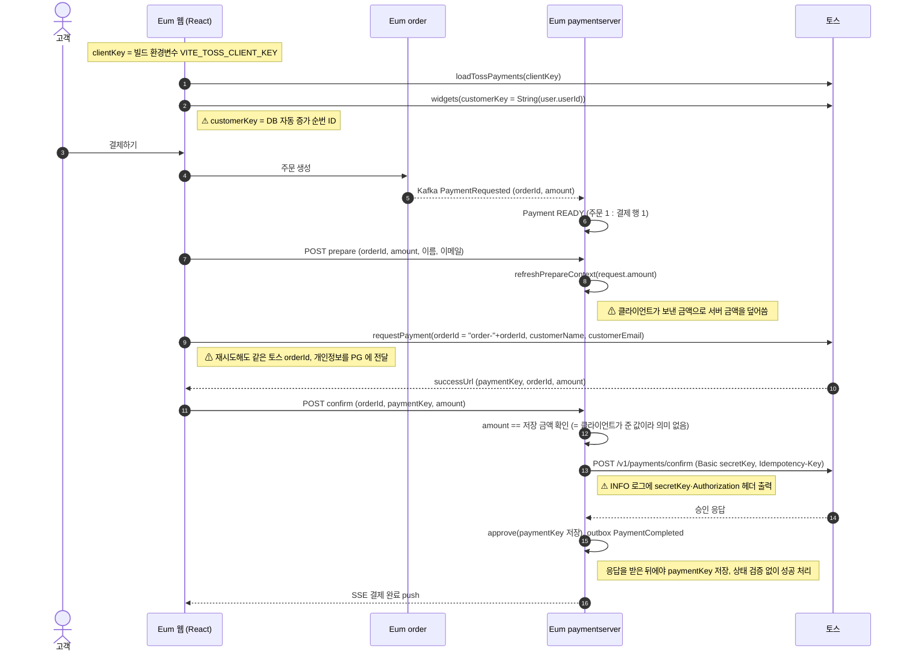
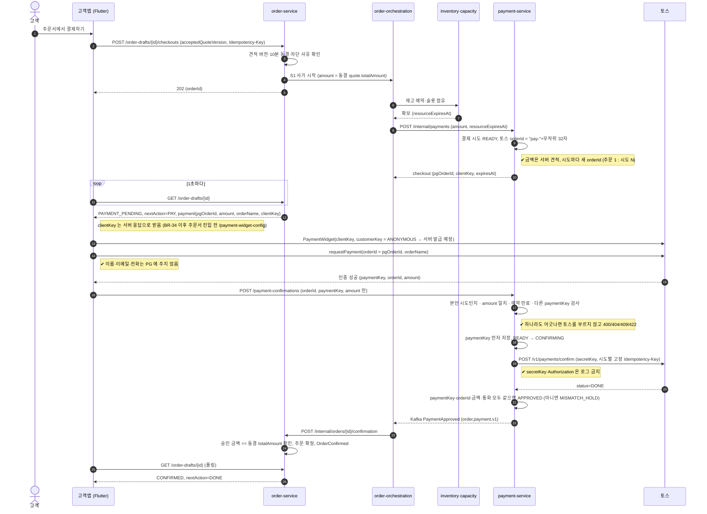
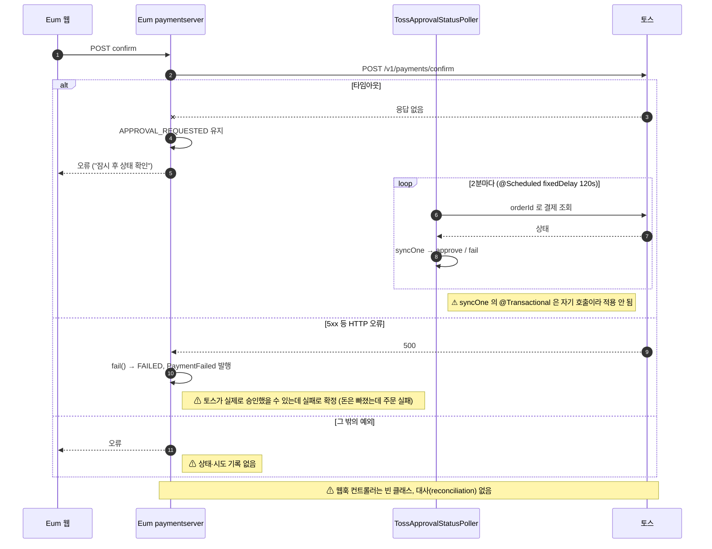
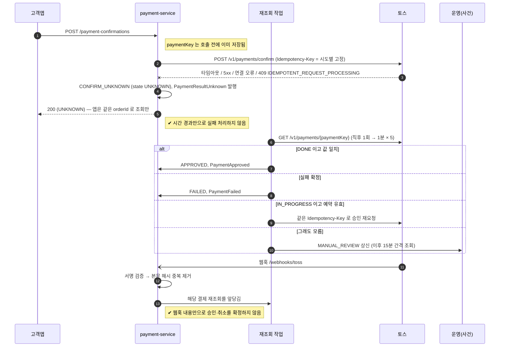
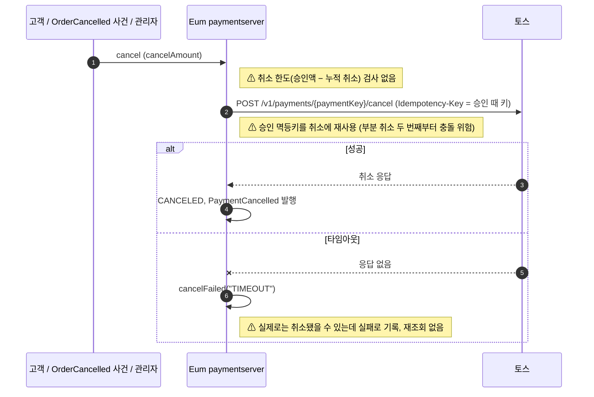
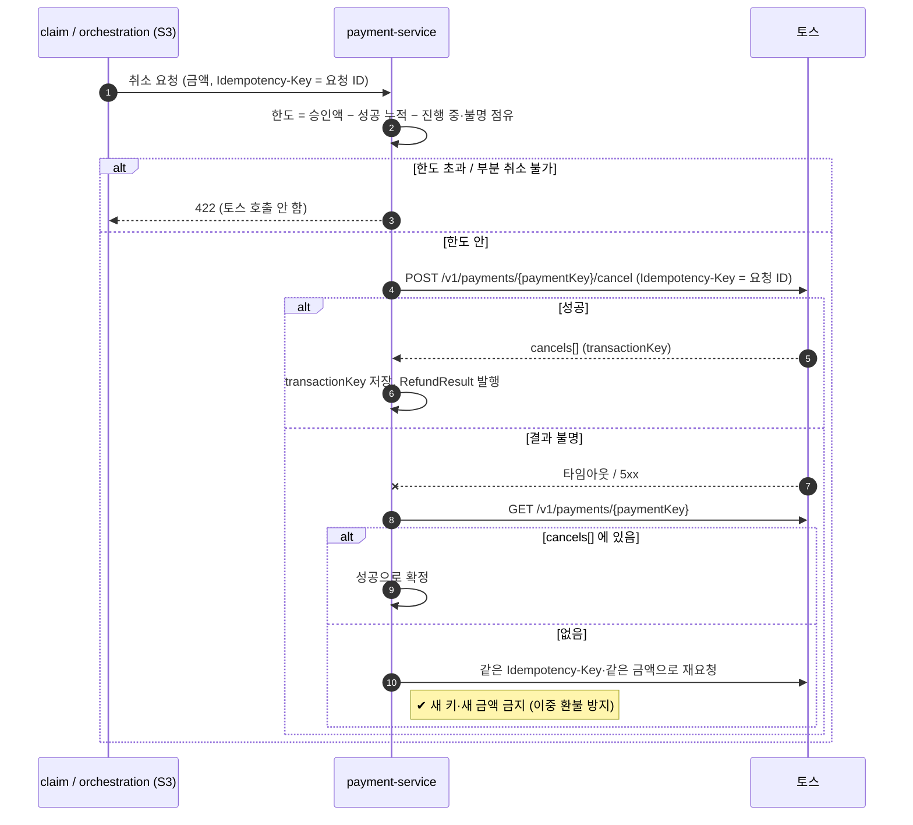

# 토스 결제 처리 비교 — Eum-main vs pmart (시퀀스 다이어그램)

- 작성: 2026-11-02. 참고용 비교(설계 결정 아님). pmart 결정은 ADR-0020, 외부 명세는 `payment-system-spec.md`.
- Eum 출처(읽기 전용 `../Eum-main`): `eum_frontend/src/pages/CheckoutPage.jsx`, `eum_backend/paymentserver/.../customer/service/PaymentService.java`, `client/TossPaymentsClient.java`, `TossApprovalStatusPoller`.
- 두 시스템 모두 **토스 결제위젯 + 서버 승인 API** 방식이다. 차이는 금액·ID 를 누가 정하는지, 결과 불명을 어떻게 다루는지, 키를 어떻게 다루는지에 있다.
- 다이어그램의 ⚠ 는 Eum 의 결함, ✔ 는 pmart 의 대응이다.

## 1. 정상 결제 — Eum

## 2. 정상 결제 — pmart

## 3. 승인 결과 불명 (타임아웃·5xx·연결 오류)

### 3-1. Eum

### 3-2. pmart

## 4. 취소·환불

### 4-1. Eum

### 4-2. pmart

## 5. 요약

| 항목 | Eum | pmart |
|---|---|---|
| 결제 금액 | 클라이언트 값으로 덮어씀 | 서버 동결 견적, 다르면 토스 미호출 |
| 토스 orderId | `order-`+주문 ID, 재시도에도 재사용 | 시도마다 `pay-`+무작위 32자 |
| paymentKey 저장 | 승인 응답 뒤 | 승인 호출 전 |
| 승인 성공 판정 | 응답만 받으면 | `DONE` + 4개 값 일치 |
| 5xx | 실패 확정 | 결과 불명 → 원거래 조회 |
| 타임아웃 | 2분 폴러(트랜잭션 미적용) | 1회 → 1분×5 → MANUAL_REVIEW |
| 취소 멱등키 | 승인 키 재사용 | 취소 요청마다 |
| 취소 한도 | 없음 | 진행 중·불명 점유까지 차감 |
| 웹훅·대사 | 없음 | 서명 검증 + 재조회 촉진 |
| 키 로그 | secretKey·Authorization INFO 출력 | 로그 금지, `live_` 기동 거부 |
| clientKey | 프런트 빌드 환경변수 | 서버 응답 |
| customerKey | 회원 순번 ID | `ANONYMOUS` → 서버 발급 예정(BR-34) |
| PG 에 개인정보 | 이름·이메일 | 주지 않음 |
| 결과 전달 | SSE push | 1초 폴링 (가져올 만한 점) |
