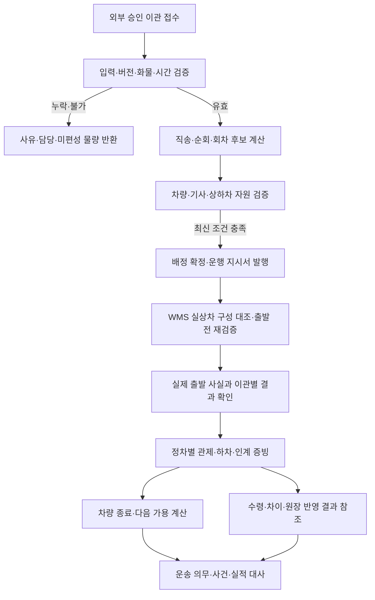

# TMS 비즈니스 로직 — 칠곡 DC→지역 MFC 보충 운송

문서 버전: 1.1 · 작성·상세 보강일: 2026-10-20 · 상태: 프로젝트 설계안 / 운영 입력 및 연계 계약 승인 전

> 이 문서는 승인된 보충 화물을 **어느 차량·기사로, 어떤 순서와 시간표로 운송하고, 언제 다시 차량을 사용할 수 있는지** 정의한다. 초기 부산 MFC 5곳과 확장 대상 26곳을 같은 구조로 수용한다. 실제 B마트의 공급망·노선·차량·입고시간을 검증한 운영 매뉴얼이 아니다. SCM 상세는 [SCM-business-logic.md](SCM-business-logic.md)를 참조한다. TMS 문서에서 SCM의 수요예측·보충량·안전재고·공급 배분·승인선을 선행 확정하지 않는다.

## 0. 적용 근거와 읽는 순서

### 0.1 자료의 지위

| 구분 | 반영한 내용 | 적용 한계 |
|---|---|---|
| 사용자 제공 자료 | 칠곡 DC, MFC 26곳의 명칭·권역, 부산 5곳의 위치, 층수 집계, 운영시간 구분, 운행 예시 | 이번 첨부에는 26곳의 전체 상세 주소표·좌표·실측 도로시간·현장 조사표가 없다 |
| 프로젝트 원문 | WMS v7의 독립 원장, 1요청·1이관·1출발, 출발 후 목적지 변경·CDC 반송 제외 | 실제 구현·시험 완료라는 뜻이 아님 |
| 이번 사용자 지시 | WMS·MFC·Commerce·OMS·Delivery·TMS의 고유 책임 정리, SCM 상세정책 독립 | 다른 영역을 대신 실행하는 중복 정의를 제거 |
| 본 문서의 설계안 | 운행/정차/예약 모델, 시간표·배차 검증, 상태명·메시지·오류·검증 시나리오 | 명시적 사용자 결정 외 세부 구현·운영값은 검토·승인 대상 |
| 공식 기술 참고 | OR-Tools 시간창 경로 예제, 탐색시간 제한·초기 경로, 도크 예약 사례 | 프로젝트 운영 정책이나 제품 채택을 확정하는 근거가 아님 |

용어: `원문 명시`는 제공 문서에 적힌 내용, `가정`은 설명용 조건, `제안`은 이번 설계, `확인 필요`는 근거·승인 부족을 뜻한다. 첨부가 외부 사이트에서 확인했다고 서술한 지점 정보는 여기서 새로 검증한 사실로 승격하지 않는다.

### 0.2 문서 간 책임의 우선 적용

1. 업무 소유권은 [시스템 책임 경계.md](시스템%20책임%20경계.md)를 함께 적용한다.
2. TMS 업무의 정본 문서는 이 파일이다. 파일명은 `TMS-business-logic.md`로 통일한다.
3. 재고·예약·TOUT·TIN은 WMS, 현장 작업은 MFC, 고객 주문·취소·클레임은 OMS, 고객 배송 배차·경로·ETA·라이더 수행은 Delivery가 정의한다.
4. 본 문서의 영문 상태·필드·메시지는 인터페이스 후보 명칭이다. 실제 배포된 API·테이블·이벤트로 단정하지 않는다.
5. 미설정 필수 안전·실행 조건은 무제한/0/정상으로 채우지 않는다. 해당 신규 실행을 보류하고 원인·담당·필요 입력을 표시한다. 이미 이동 중인 물품의 안전 책임은 계속 유지한다.

## 1. TMS의 목적·범위·참여자

### 1.1 포함하는 업무

- 칠곡 DC→MFC의 승인 운송 수요 접수·검증·보류·변경 이력.
- 직송/순회/회차 분산 후보, 차량·기사·구획·방문 순서·정차별 시간표 산출.
- DC 상차 자원, MFC 하차·인계 자원의 예약 조율과 중복 검증.
- 운행 지시서 발행, 배정 변경, 상차 결과 대조, 실제 출발·운행·도착·인계 증빙.
- 지연·고장·위치 단절·온도 이탈·수량 차이의 영향 계산과 담당 이관.
- 실차·기사 재가용 시각, 미편성 물량, 수행 실적·비용 근거·BI 원천 제공.

### 1.2 제외하는 업무

| 제외 영역 | 담당 또는 처리 |
|---|---|
| 수요예측·필요 보충량·안전재고·MFC별 공급 배분·공급 승인 | SCM. TMS는 승인 입력을 소비하고 운송 가능성을 회신 |
| CDC/MFC 현물·예약·LOT/LOC 수량·Transit·손실·폐기 전기 | CDC는 WMS, 목적센터는 MFC가 각각 자체 확정. TMS는 증빙 및 처리결과 참조만 보관 |
| MFC 검수·격리 판정·적치·고객 피킹·포장·판매 준비 | MFC의 현장 실행·자체 원장 반영 |
| 고객 주문·청구·취소·교환·환불 판단 | OMS 및 Payment |
| 고객 주소록·상품 전시·장바구니·구매 화면 | Commerce |
| MFC→고객 배송, 라이더 배차·경로·ETA·회수·수행료 | Delivery. 간선 차량·기사와 별도 자원·식별자 |
| 공급업체→DC 구매·실제 입고·ASN, MFC 간 새 재고 이관 | 초기 구현 제외. TMS 일반론을 근거로 기능을 추가하지 않음 |
| 출발 후 원이관 취소·타 MFC 목적지 전환·실제 CDC 반송 | 초기 구현 제외. 안전 보관·사건 이관을 계속 수행 |
| 외부 운송사 계약/API, 실제 기관 자격조회, 회계 전표·송금 자동화 | 초기 구현 제외. 등록 정보·모의 수행·비용 근거와 구분 |

### 1.3 참여자와 결정 권한

| 참여자 | TMS에서 수행 | 직접 확정할 수 없는 것 |
|---|---|---|
| 운송 계획 담당자 | 요청 보류 해소, 후보 비교, 운행·정차 편성 | 보충량·목적지 임의 변경, 재고 조정 |
| 배차 담당자 | 차량·기사 배정, 자원 일정 충돌 조정, 지시서 발행 | 안전 한도 무시·실물 미확인 출발 성공 |
| 간선 기사 | 본인 운행 확인, 도착·출발·인계·사고 증빙 등록 | 타 운행 변경·MFC 검수 합격·재고 전기 |
| CDC 현장 담당자 | 출고 준비·실상차 사실 및 출발 확인 협업 | 운송 조건이나 공급 승인 단독 대체 |
| MFC 수령 담당자 | 입고창·하차 여력, 인수 수량·품질·위치 확인 | TMS 배정 변경·CDC 재고 변경 |
| 관제/승인자 | 사고 담당 지정, 승인 범위 내 예외·수동 조치 감사 | 증빙 없는 완료·권한 밖 손실/환불 |

동일 직원이 여러 화면을 사용해도 각 동작의 업무 주관과 권한을 유지한다.

## 2. 칠곡 DC와 MFC 운송망 기준정보

### 2.1 초기·확장 범위

| 단계 | DC | MFC | 위치 노드 수 | 자기 자신 제외 방향 조합 |
|---|---:|---:|---:|---:|
| 초기 부산 검토 | 1 | 5 | 6 | 6×5=30 |
| 제공 목록 전체 검토 | 1 | 26 | 27 | 27×26=702 |

이 조합은 모든 방향을 조회할 때의 계산 수다. 허용 이동만 사용하면 줄일 수 있다. 시간대·차종별 행렬이나 같은 위치의 복수 요청 노드는 별도로 늘어날 수 있다. **MFC 수와 하루 운송 요청 수는 같지 않다.** 한 MFC가 날짜·시간·이관별로 여러 요청을 가질 수 있다.

칠곡 DC 주소 후보는 첨부에 기재된 `경북 칠곡군 지천면 산단터널로 240`이다. 실제 공급 DC 관계, 차량 출입구·상차장 좌표, 등록 센터 ID를 승인한 후 실행에 사용한다. 26곳 모두 실제 칠곡 공급이라는 사실은 확인되지 않았으므로 **프로젝트 시나리오**로 관리한다.

### 2.2 제공된 26곳의 계획 검토 그룹

| 계획 그룹 | MFC 목록 | 수 |
|---|---|---:|
| 대구·경산 | 대구달서, 대구북구, 대구수성, 대구중구, 경산 | 5 |
| 부산 | 부산진구, 부산해운대, 부산사하, 부산남구, 부산동래 | 5 |
| 울산 | 울산남구 | 1 |
| 김해·창원 | 김해, 창원 | 2 |
| 대전·세종 | 대전유성, 대전중구, 대전서구, 세종 | 4 |
| 청주·천안 | 청주상당, 청주흥덕, 천안 | 3 |
| 강원 | 원주, 춘천 | 2 |
| 전주 | 전주 | 1 |
| 광주·목포 | 광주서구, 광주광산, 목포 | 3 |
| 합계 | 충청·강원 9곳 + 경상·전라 17곳 | **26** |

권역은 후보 검색을 돕는 분류다. 같은 그룹이면 무조건 합차하거나, 다른 그룹이면 무조건 분리하지 않는다. 실제 도로시간·물량·시간창·차량·기사 조건으로 실행 가능성을 판정한다. 별도 부산 허브가 존재한다고 가정하지 않는다.

### 2.3 위치 자료와 확인 항목

| 대상 | 첨부에 있는 위치 | 층수 | 실행 전 확인 |
|---|---|---|---|
| 부산진구 | 동천로 109 | 2층 | 전체 주소 정규화·하차지·반입 동선 |
| 부산해운대 | 중동 로데오아울렛 일대, 제공 1775-7 / 첨부가 인용한 지점자료 1774-5 | 2층 | 지번 충돌·건물·실제 입고문. 어느 하나를 임의 확정하지 않음 |
| 부산사하 | 괴정동 995-3 | 2층 | 전체 주소·진입·정차·반입 조건 |
| 부산남구 | 수영로 305, 스파크타워 | 지하 1층 | 실제 하차 위치·지하 반입 |
| 부산동래 | 온천동 456-29 | 1층 | 실제 출입구·정차공간 |
| 대전중구 | 첨부에 지점명과 동구 홍도동 소재 가능성 언급 | 미제공 | 지점명과 행정구역을 별도 관리 |
| 광주서구 | 첨부에 동구 충장로2가 소재 가능성 언급 | 미제공 | 지점명으로 행정구역을 교정하지 않음 |
| 천안 | 첨부에 A동 117-1~4호 외 111호 차이 언급 | 미제공 | 실제 사용하는 공간·입고문 |
| 나머지 MFC | 명칭·권역만 이번 첨부에 있음 | 개별값 미제공 | 전체 주소·좌표·현장 조건 수집 필요 |

지번 충돌은 자동 지오코딩 성공으로 해결된 것으로 표시하지 않는다. 주소·출입구·하차지·인계지의 확인 상태를 각각 보존한다.

### 2.4 층수와 건물 반입 조건

첨부 집계는 B1 4곳, 1F 4곳, 2F 10곳, 3F 5곳, 4F 1곳, 5F 2곳으로 합계26곳이다. 지상2층 이상18곳, 지하 포함 비1층22곳이다. 이번 첨부만으로 집계를 각 지점에 완전히 재배정하거나 검증할 수는 없다.

거점마다 다음을 등록한다.

| 정보 | 용도 |
|---|---|
| 대표 주소, 진입 출입구, 하차 위치, 최종 인계 위치 | 건물 중앙 좌표를 하차점으로 오인하지 않음 |
| 진입 높이·폭·중량·회전 제한 | 실제 차량 적합성 검사 |
| 동시 하차 대수·정차 허용시간·대기 위치 | 현장 자원 예약 |
| 화물용 승강기 유무·시간·문 폭·내부 치수·하중 | 취급 단위 반입 적합성 |
| 건물 내 이동거리·공용 통로·반입 담당 | 차량 점유시간과 현장 작업 구분 |
| 온도대별 안전 대기·임시 보관 조건 | 대기 허용 및 품질 사건 판단 |
| 인계 책임 경계·연락 담당·증빙 방식 | 기사 작업 종료 시점 결정 |

상층이라는 이유만으로 차량을 배제하거나 승강기가 있다고 가정하지 않는다. 제한에 해당하는 차량·화물만 보류하며 무관한 운송까지 전체 차단하지 않는다.

## 3. 고객 영업시간과 물류 시간창

### 3.1 서로 다른 다섯 시간표

| 시간표 | 의미 | 정본/제공 주체 |
|---|---|---|
| 고객 주문 운영 | 고객 주문 접수 가능시간 | MFC 운영 입력, Commerce 표시·OMS 적용 |
| 직원 근무 | 수령·검수·적치 담당 가용시간 | MFC |
| 차량 진입·대기 | 건물·도로·출입 조건 | 거점 운영 승인 입력 |
| 하차·실물 인계 | 화물을 내리고 넘길 수 있는 작업 구간 | MFC/거점 담당 |
| 검수·적치·판매 준비 | 받은 재고가 사용 준비되는 작업 구간 | MFC 현장·자체 원장 |

첨부의 `09:00~24:00`은 공통 고객 운영시간 시나리오다. 26곳의 실제 입고창이나 새벽 수령 허가로 사용하지 않는다. 요일·날짜·휴일·임시 제한·적용 버전·승인자를 등록한다. TMS는 센터 창을 임의로 생성하거나 연장하지 않는다.

### 3.2 시간창이 제한하는 사건

`도착 허용창`, `작업 시작창`, `인계 완료 기한`, `판매 준비 목표`를 별도 필드로 둔다. 08:30까지 도착이라는 조건과 08:30까지 인계 완료라는 조건은 다르다. 종료시각 경계의 포함 여부, 조기 도착 대기 허용, 지각 접수 규칙을 운영 입력으로 명시한다. 예시 계산에서는 완료시각이 기한과 같으면 충족으로 본다.

09:00 판매 준비를 요구하면 `검수·적치 완료 → 인계 완료 → 차량 도착 → DC 출발 → 상차 시작`을 역산한다. 새벽 수령이 불가능하면 전날 보충이나 후속 공급을 **SCM 검토 대상으로 회신**한다. TMS가 다음 날 수요량을 임의로 늘리지 않는다.

### 3.3 날짜·시간대와 야간 운송

- 모든 실제·계획 시각은 날짜·시간대가 있는 값으로 저장한다. 화면의 영업일과 실제 사건 날짜를 분리한다.
- `2026-10-20 24:00`은 정규화 시 `2026-10-21T00:00:00+09:00`이다.
- 영업일, 상차일, 출발일, 수령일, 해당 물량의 판매 대상일을 연결한다.
- 운행 점유는 제안상 `[시작, 종료)` 구간으로 겹침을 검사한다. 끝과 다음 시작이 같아도 위치 이동·점검·준비가 필요하면 그 시간을 먼저 포함해야 한다.

### 3.4 기존 회차·목표 수치의 처리

| 기존 문서 수치 | 이번 적용 |
|---|---|
| 작업 개시06/11/16/21시, 출발08:30~09:30/13~14/18~19/23~익일00시 | CDC 배치안. 실제 승인 회차와 MFC 창을 함께 검증 |
| 일반 승인 후6시간, 긴급2시간 목표 | 기존 문서의 계획 목표. 측정 종료점·권역별 실행 가능성은 SCM 및 운송 협의 대기 |
| 3.5톤·5톤 듀얼온도 | 차량 후보. 등록 실차·구획·진입 조건으로 판단 |
| 도크10개, 일60~80대, 피크12~15대 | 실측 능력으로 사용하지 않는 계획 수치 |
| 부산15~50km 구간 시간표 | 칠곡→부산 실제 주행시간으로 재사용하지 않음 |

특히 03:25 상차 예시는 기존06시 작업 개시안과 충돌한다. 새벽 DC 작업·출발창 승인이 없으면 **계산 예시만 가능하고 실행할 수 없다.**

## 4. 운송 요청·운행·정차·화물의 관계

### 4.1 핵심 객체

| 객체 | 표현하는 의무·사실 | 구별할 것 |
|---|---|---|
| 승인 이관 TRF | 승인된 출발센터·목적MFC·상품·수량·기한 | 고객 주문·운행 ID와 다름 |
| 운송 요청 | TRF를 운송해야 하는 의무와 현재 편성 결과 | 승인량 자체를 변경하지 않음 |
| 운행 Trip | 실제 차량·기사·출발·정차·종료의 실행 단위 | 차량이 하루 수행하는 모든 업무와 다름 |
| 정차 Stop | 한 장소의 도착·대기·하차·인계·출차 | MFC 마스터와 다름. 같은 MFC 재방문은 별도정차 |
| 화물 할당 | 요청 행·LOT·LPN을 운행/정차/구획에 연결 | 계획 할당과 실제 상차 구성 구분 |
| 실제 출발 | 특정 실차가 떠난 불변 사실과 이관별 출발 구성 | 계획출발·상차완료·통지 횟수와 다름 |
| 인계 증빙 | 특정 화물·수량·인계자/인수자·위치·시각 | GPS 도착·검수 합격·TIN과 다름 |
| 자원 예약 | 차량·기사·도크·하차면의 점유 | 요청 수·출발 회차 수와 다름 |

### 4.2 수량과 출발 제한

1. 프로젝트 원문 정책은 **1요청·1이관·1출발**이다. 같은 이관을 용량 부족 때문에 여러 차량·회차로 나누지 않는다.
2. 여러 목적MFC의 이관을 한 차량에 합칠 수 있다. 차량의 출발 사실은 한 번이어도 각 TRF의 출발구성·수량·후속 수령은 별도로 검증한다.
3. 순회 중 MFC A→B 이동은 DC에서 실은 B용 화물을 운반하는 구간이다. A 재고를 새로 싣는 MFC간 재고 이관이 아니다.
4. 승인60 중 실출발48이면 미출발12를 별도 정리한다. 원승인 잔량 종료·실물/예약 정리는 공급 승인 주체와 CDC WMS의 일이다. 같은 TRF로12를 후속 출발시키지 않는다.
5. 추가 공급 필요는 SCM에서 별도 요청·승인한다. TMS는 운송 불가/미출발 잔량만 회신한다.
6. BOX/PLT는 LPN 취급 단위다. 상위 PLT와 하위 BOX를 동시에 총량에 더하지 않는다. SKU·LOT·기준단위 수량을 구성으로 연결한다. E/B 실물 SKU를 운송 편의로 상호 전환하지 않는다.

## 5. 정상 업무 흐름과 기능 목록



실선은 업무 진행 관계다. WMS 전기는 별도 정본 거래이며 TMS 안에서 직접 수행하지 않는다. 모든 정차·수량 의무가 해소되지 않으면 차량 운행이 끝나도 요청/사건은 남는다.

| 기능 | 발생 조건·입력 | 처리·결과 | 예외·다음 담당 |
|---|---|---|---|
| 요청 접수 | 승인 TRF·버전·출처 | 원이관당 운송 계보 생성/기존 결과 반환 | 동일버전 다른본문 충돌→승인 주체 |
| 편성 적격 검증 | 목적지·기한·예정화물·준비시각·창 | 편성 가능 또는 보완대기 | 누락을 차량부족과 구분 |
| 운행 후보 | 유효 요청·도로시간·자원 | 직송/순회/회차 후보와 미편성 이유 | 미배정 요청 숨김 금지 |
| 적재 후보 | 중량·부피·구획·취급단위 | 화물별 차량/구획/정차 연결 | 1TRF 분할금지·용량 초과 보류 |
| 자원 배정 | 후보·실차·기사·도크·하차면 | 현행 버전 재검증 후 점유·배정 | 동시 충돌이면 대안 제시 |
| 지시서 발행 | 확정 계획·배정 | 기사에게 유효 버전 전달·수신 이력 | 수신 실패와 배정 실패 구분 |
| 출발 전 대조 | WMS 준비·검품·실상차·현재 제한 | 일치 화물·실차·기사 확인 | 오상차·누락·구버전은 출발보류 |
| 실제 출발 | 실제/모의 증빙·departureId | 출발 사실 보존·WMS 전기 결과 참조 | 응답불명은 원결과 조회 |
| 운행 관제 | 위치·사건·정차 실적 | 최신 ETA·남은 시간표·영향 요청 | 정보 오래됨·예측불가 표시 |
| 하차·인계 | 정차·LPN·수량·인계자/인수자 | 증빙 및 MFC 확인 결과 연결 | 미수령·과부족·품질 사건 |
| 종료·재가용 | 마지막 정차·복귀/다음 위치·준비 | 실차/기사별 다음 가용 계산 | 사고·미인계 의무는 유지 |
| 대사·실적 | 원출발·인계·WMS 결과·사건 | 해소/미결 의무·비용 근거·BI 제공 | 재고 조정·송금 직접 수행 금지 |

## 6. 승인 운송 수요의 접수·검증

### 6.1 접수 계약

| 입력 | 책임·사용 |
|---|---|
| 출처·TRF ID·버전·승인 참조·취소 상태 | 공급 승인 주체는 SCM. 개발/계약시험에는 승인된 모의 입력 가능 |
| 출발DC·목적MFC·요청행·SKU·승인수량·기준단위 | 승인 범위 검증. 화면 표시명으로 센터 식별 금지 |
| 필요 도착/인계/판매준비 시각·우선순위 | 시각이 제한하는 사건 명시. TMS가 임의 변경 금지 |
| WMS 출고 준비 예상·출고 보류 | 계획을 위한 예상과 실행 가능 결과 분리 |
| 예정 중량·부피·LPN/포장 구성·온도·취급 조건 | 미완성 예정 화물로 후보 생성 가능. 출발 전 실제 구성 재검증 |
| 수령창·현장 제약·기준정보 버전/기준시각 | MFC/거점 정본을 참조 |

LOT/LPN이 출고 작업 전 아직 확정되지 않았다면 확정 예정 상태를 표시하고 승인된 계획용 물성으로 후보를 계산한다. 구획·중량·시간 적합성을 판단할 근거도 없으면 실행 가능한 후보로 확정하지 않는다.

### 6.2 보류·거절 구분

| 상황 | 결과 | 보완 담당 |
|---|---|---|
| 미승인 제안만 수신 | 운송 실행 의무 생성 보류 | 공급 승인 주체 |
| 목적MFC 미식별·주소 충돌·하차지 미확인 | 기준정보 확인 대기 | 거점 담당 |
| 기한/작업창 의미 누락 | 시간조건 보완 대기 | 승인 주체·MFC |
| 물성·온도·중량/부피 근거 누락 | 화물 정보 대기 | CDC WMS·상품/현장 담당 |
| 출고 보류 | 출고조건 해소 대기 | CDC WMS |
| 수령창/현장 용량 불명 | 수령조건 확인 대기 | MFC |
| 모든 적격 차량이 없음 | 미편성·차량/구획 부족 | TMS 배차 |
| 주어진 창 안에 운행 불가 | 미편성·시간 제약 불가 | TMS→공급 승인 주체 |
| 같은 요청 같은 본문 | 기존 결과 | 중복 생성0 |
| 같은 요청·버전 다른 본문 | 충돌·자동 재시도 금지 | 원발신자 정정 |

SCM의 운영 연계가 미구현이어도 TMS에서 발주·자동 보충을 대신 구현하지 않는다. 개발용 승인 입력은 `SIMULATED` 출처·승인 역할·버전·수량·기한을 갖고 실제 공급 승인과 구별한다.

### TMS-D01 — 승인 운송 수요를 실제 편성 대상으로 받아들이는 처리

**업무 목적·시작:** SCM이 사업승인한 TRF가 도착했을 때 그 물량을 운송해야 하는 의무를 등록한다. 추천이나 MFC의 미승인 요청은 운송계산 참고자료로 볼 수 있어도 실행 가능한 운송요청으로 승격하지 않는다. SCM 승인과 CDC의 실제 재고확보는 별개이므로 승인수량만 보고 출발 가능으로 표시하지 않는다.

**입력·사전 조건:** 인증된 발신자, 원TRF/행·승인버전·승인근거, 출발센터·목적MFC, SKU·승인수량·단위, 기한이 의미하는 사건, WMS 준비예상·화물 물성, 현장 창을 받는다. 아직 LOT/LPN이 확정 전이면 예정 구성임을 명시한다. 준비 전 계획을 허용하는 것과 물성·수량도 모르는 계획을 실행 가능으로 확정하는 것은 다르다.

**정상 처리 순서:**
1. 원TRF·승인버전·본문 지문으로 기존 접수와 현재 취소/변경 상태를 조회한다.
2. 동일 건이면 원운송 요청과 이미 진행한 계획/배정 결과를 반환한다. 다른 본문이면 기존 값을 덮어쓰지 않는다.
3. 출발·목적센터가 다르고 현재 허용된 CDC→MFC 관계인지, 단위가 승인 SKU와 맞는지 검사한다.
4. 도착기한·인계기한·판매준비기한을 분리하고 WMS 준비·TMS 운송·MFC 후속작업 중 무엇이 남는지 확인한다.
5. 필수조건이 모두 갖춰지면 PLAN_READY, 보완이 가능하면 DATA_PENDING과 누락항목·담당·현재 영향을 기록한다.
6. 요청ID·원승인·입력 스냅샷·처리결과·통지의도를 함께 보존하고 SCM에 접수결과를 회신한다.

**판단 분기:** 주소만 불명인 요청을 차량부족으로 분류하지 않는다. 창은 있으나 운행시간상 기한이 불가능하면 TIME_INFEASIBLE이다. 승인취소가 먼저 확정됐으면 신규편성을 차단한다. 출발 여부까지 불명인 늦은취소는 원사실 조회로 보내며 과거 실제출발을 지우지 않는다.

**부분 성공·복구·완료:** 요청 저장 후 SCM 응답만 유실됐다면 같은 키로 원요청을 조회/반환한다. 새 요청을 생성하지 않는다. 접수 완료는 유효한 편성대상 또는 명확한 보류/거절이 남은 상태이며 배차·출발 완료가 아니다. 예를 들어 같은 TRF12개가3번 전송돼도 의무는12개 한 건이고, TRF의 새승인버전이14개라면 현재단계 영향을 검사한 변경으로 처리한다.

## 7. 직송·순회·회차 편성

### 7.1 부산 5곳의 비교 후보

| 후보 | 구성 예시 | 비교할 조건 |
|---|---|---|
| 개별 직송 | 각 MFC에 별도 운행 | 큰 물량·촉박한 기한, 공차/비용 |
| 2운행 | 진구·사하 / 동래·해운대·남구 | 예시 묶음일 뿐. 실제 경로·시간창 재검증 |
| 3운행 | 큰 물량은 직송, 나머지 순회 | 구획·시간 병목 완화 |
| 1운행 | 5곳 모두 순회 | 총물량·누적 정차·기사 가용 충분 여부 |
| 회차 분산 | 이른 회차와 후속 회차 | 승인 요청별 필요시각, 1이관1출발 유지 |

MFC 개수로 물량을 균등 분배하지 않는다. 2곳 물량이3곳보다 클 수 있고 냉동 구획·승강기·하차창이 우선 병목일 수 있다. 후보에는 운행 수, 필요 실차, 기사, 총시간, 구획별 적재, 기한 충족, 미편성 물량, 비용 산정 가능 여부를 함께 표시한다.

### 7.2 필수 제약과 비교 목표

필수 제약: 승인 목적지·수량·단일 출발, 물성/중량/부피/온도, 진입·반입 적합성, 출고 준비, 작업·수령창, 실차·기사·도크·하차면 중복 금지, 승인된 운행·휴게 조건, 진행 실물의 변경 금지.

필수 조건을 통과한 후보 사이에서 운행 비용·차량 수·주행·공차·대기·기존 확정 계획 변경량을 비교한다. 가중치·미편성 우선순위는 승인 입력이며 이번 문서가 확정하지 않는다. 비용 요율 미등록이면 비용은 `산정 불가`로 표시할 수 있으나, 비용 부재만으로 안전하고 유효한 수동 배차까지 자동 금지하지 않는다.

미편성 요청은 ID·수량·불가 조건·관련 자원·차선 후보·필요 승인과 함께 반환한다. 필수 조건을 완화해 몰래 편성하거나 요청을 결과에서 빼지 않는다.

### TMS-D02 — 직송·순회 후보를 만들고 미편성까지 판정하는 처리

**업무 목적·입력:** 유효 운송요청, 원승인 목적지/수량, 준비시각, 시간대별 도로행렬, 실차·기사·구획·현장 제약으로 실행 가능한 묶음을 찾는다. 권역 분류는 후보검색 범위를 줄이는 값이며 정해진 노선을 강제하는 값이 아니다.

**정상 처리 순서:**
1. 완료·이미출발한 요청과 취소/보류 요청을 새 편성풀에서 구분한다. 진행 요청을 새 요청으로 복제하지 않는다.
2. 각 TRF를 나눌 수 없는 실제출발 단위로 취급하고, 직송·복수MFC 순회·회차 분산 후보를 만든다.
3. 각 후보에 대해 준비시각→상차→첫구간→정차작업→후속구간→종료/복귀까지 전개한다.
4. 전체 화물의 구획/중량/부피, 각 정차의 창·기한, 실차/기사/시설 점유를 검사한다.
5. 필수제약 통과 후보만 비용·대기·차량수·변경량 등 승인된 비교기준으로 정렬한다.
6. 편성하지 못한 원요청도 수량·병목·기한영향·가능대안과 함께 결과에 남긴다.

**판단 분기:** A용12개와 B용12개를 용량24의 한차량에 싣는 후보가 가능해도 B 수령창을 놓치면 해당 순회안은 불가다. A의 단일TRF30개가 적격차량 용량24를 넘으면24+6으로 나누지 않는다. 다른 차량·회차 또는 SCM의 별도 요청/승인을 검토한다. 다른TRF끼리 합차할 때도 목적지·LOT·LPN·인계 수량은 섞지 않는다.

**실패·운영자 조치:** 도로행렬 누락은 MODEL_INPUT_PENDING, 계산 제한시간 종료는 계산상태로 표시한다. 해를 못 찾은 것과 수학적으로 불가가 확인된 것을 같은 확정불가로 단정하지 않는다. 운영자는 보류원인 보완·수동후보 작성·SCM 기한/요청 재심사를 수행할 수 있으나 안전제약을 해제하는 버튼은 제공하지 않는다.

**완료·재계산:** 선택후보·탈락사유·미편성목록·사용한 입력버전이 보존되면 후보계산이 끝난다. 아직 자원예약이나 기사 실행권한은 없다. 재계산은 미확정 후보를 대체할 수 있지만 확정배정·실제실행을 삭제하지 않는다.

## 8. 차량·기사·상하차 자원 배정

### 8.1 차량과 기사의 분리 검증

차량은 실차 ID·현재/예상 위치·가용시간·정비/운행 제한·중량·부피·구획·예냉·건물 진입을 검사한다. 기사는 별도 ID·해당 차량 운전 적격·가용시간·앞선 업무 위치/종료·근무/휴게 조건을 검사한다. 구체 법정 운행·휴게 한도는 이 문서에서 새로 정하지 않고 적용 대상에 맞게 승인된 입력을 사용한다.

같은 실차 또는 기사의 점유가 겹치면 배정을 확정하지 않는다. 제안 수락 방식과 내부 직접 배정 방식은 운영 모드로 분리한다. 기사 수락이 필요한 모드는 제안 ID·유효기한·배정버전을 검사해 유효 응답 하나만 확정한다. 알림 수신이나 기사 수락 의사는 실제 상차·출발이 아니다. 모드·만료시간은 미결정이다.

### 8.2 시설 자원

- DC: 해당 온도·차량을 받을 상차 위치·작업자/처리 여력·시간 구간.
- MFC: 하차면·동시 차량 수·인수자·승강기 등 실제 공유 자원.
- 자원 정본은 시설 담당/해당 WMS·MFC, TMS는 예약 참조와 승인 결과를 관리한다. 실제 저장 경계는 후속 계약으로 정한다.
- 차량·기사·시설 예약이 모두 필요한 모드에서 일부 확보만 성공하면 `확정 대기`다. 다른 요청이 그 자원을 사용하지 않도록 유효 점유를 유지하고, 실패 확정 시 새로 확보한 것만 보상 해제한다.
- 응답불명은 원예약을 조회한다. 확정 성공을 확인하기 전에 기사에게 실행 가능한 확정 지시서를 발행하지 않는다.

### 8.3 지시서에 담을 내용

운행 ID·계획/배정 버전, 실차·기사, DC 상차 위치/시간·출발창, 이관별 화물·LPN·구획·봉인, MFC 방문 순서, 각 정차의 도착·대기·작업·인계·출차 계획, 실제 하차/인계 위치·현장 주의, 증빙 절차, 비상 연락, 마지막 정차 후 승인된 종료/복귀 위치를 제공한다. 바뀐 지시서는 구버전을 실행 불가로 표시하고 수신/확인 상태를 추적한다.

### TMS-D03 — 실차·기사·시설을 함께 확보하고 배정을 확정하는 처리

**시작·입력:** 운영자가 후보를 채택하거나 승인된 자동확정 조건이 충족됐을 때 후보버전·원요청·실차·기사·상차/하차 예약구간을 받는다. 확정 직전 각 자원의 최신상태를 다시 읽는다. 계산 당시 가용했다는 사실만으로 현재도 가용하다고 판단하지 않는다.

**정상 처리 순서:**
1. 후보가 인용한 요청·승인·준비·현장창 버전과 현재값의 차이를 확인한다.
2. 실차는 앞 운행의 종료위치·복귀/준비까지 포함한 점유, 기사는 별도의 위치·가용/근무조건을 검사한다.
3. 필요한 DC 도크·MFC 하차면 등 공유자원을 해당 정본의 예약계약으로 확보한다.
4. 확보한 예약ID·유효기간·담당 정본을 원배정에 연결한다. 일부만 성공하면 RESERVED/PENDING이며 확정실행 지시를 발행하지 않는다.
5. 모든 필수자원과 조건이 확인되면 배정버전을 하나 증가시켜 CONFIRMED로 확정하고 지시서 전달의도를 남긴다.
6. 기사·WMS·MFC에 같은 배정버전의 결과를 제공한다. 각 수신자별 전달상태는 배정상태와 별도다.

**경합·부분실패:** 실차가04~12시 점유 중이면 다른 운행의11~13시 배정을 거절한다. 기사만 비어 있어도 차량충돌은 해소되지 않는다. 차량예약 성공/도크예약 실패 시 이번 시도에서 새로 확보한 자원을 확인해 보상 해제하거나 운영정책상 유효 점유로 유지한다. 다른 운행의 예약을 해제하지 않는다. 해제 응답불명은 원예약 조회 후 처리한다.

**수락 모드·구버전:** 기사 수락이 필요한 운영모드라면 유효제안 하나만 현재버전에서 확정한다. 수락 후 재배정됐다면 이전 기사의 늦은 응답은 새 배정을 바꾸지 못한다. 내부 직접배정 모드에는 불필요한 기사수락을 강제하지 않지만 동일 적격·경합검증을 적용한다.

**복구·완료:** 배정성공/지시서전달실패는 기존 배정을 조회하고 지시서만 재전송한다. 완료조건은 필요한 자원과 현재버전의 확정 및 전달상태가 설명되는 것이다. 기사에게 알림이 왔다는 사실만으로 화물인수·출발을 확정하지 않는다.

## 9. 온도 구획·적재 계획

| 검증 축 | 판단 규칙 |
|---|---|
| 중량 | 화물·용기·팔레트 등을 포함한 실제 총중량이 실차의 승인된 유효 한도 이내 |
| 부피·치수 | 단순 합계 외 문 폭·내부 치수·배치·적층·압궤를 검증 |
| 구획 | 각 구획의 중량·부피·공간·온도 적합성을 동시에 만족 |
| 혼적 | 상품별 혼적 금지·위생·누출·압궤·온도 조건 유지 |
| 하차 접근 | 먼저 내릴 화물을 다른 목적지 봉인을 훼손하지 않고 꺼낼 수 있는가 |
| 반입 | 하차 단위가 MFC 승강기·통로에 적합한가 |
| 실제 대조 | 계획과 실제 LPN·SKU/LOT·수량·구획·물성이 일치하는가 |

`총중량 여유`가 `냉동 구획 여유`를 뜻하지 않는다. 듀얼온도라는 명칭만으로 상온·냉장·냉동 모두 적합하다고 보지 않는다. EA를 고정 계수로 톤/팔레트로 바꾸지 않는다. 상품별 승인 온도·허용 노출/대기 기준을 사용하며 임의의 -18℃/몇 분을 전 품목 공통 정책으로 만들지 않는다.

정차순서가 바뀌면 적재 접근성·구획·시간창을 재검증한다. 이미 실은 화물의 임의 목적지 변경·무단 재포장·E/B 전환을 하지 않는다. 온도 누적 이력은 차량 교체·회차 변경으로 초기화하지 않는다.

### TMS-D04 — 예정 화물에서 실상차 구성으로 적재 적격을 확정하는 처리

**입력·책임:** 승인TRF/행, WMS 예정/실화물·LPN/LOT/수량·물성·봉인버전, 실차 구획·온도·예냉·허용하중/치수, 정차순서와 반입제약을 받는다. WMS는 화물구성 정본, TMS는 실차·구획·하차순서 적합성의 정본이다.

**정상 순서:** 상위PLT/하위BOX의 구성버전을 고정해 전개→각 실제상품·용기 무게/외형 반영→실차 전체한도와 구획별한도 동시검사→혼적/적층/출입문·하차접근 검사→각LPN의 운행·정차·구획 할당→WMS 실상차와 최종대조 순이다. 상위PLT와 하위BOX를 같은 공간·수량으로 두 번 더하지 않는다.

**판단 분기:** 총중량 한도1,000kg에 총620kg이더라도 냉동구획 한도100kg에 냉동120kg이면 불가다. 다른구획의 남는20kg을 온도 검증 없이 옮겨 채우지 않는다. 차량 구획값이 바뀌면 기존예냉·봉인·품질이 유효한지 다시 확인한다. 화물을 바꾸면 이전 검품/상차 적격을 현재구성에 자동 승계하지 않는다.

**실패·운영자 조치:** 누락·초과·다른MFC 혼입은 출발보류 후 WMS 원화물 확인으로 보낸다. WMS 수량을 TMS 화면에서 계획량에 맞춰 덮어쓰지 않는다. 물성 미설정은 추정0kg/0㎥로 계산하지 않고 보완을 요청한다. 이미상차됐다면 WMS의 적법한 미출발하차·실물/온도 확인을 거친다.

**완료:** 실차·구획·정차순서·실화물 구성버전과 적격결과가 연결되고 보류화물이 명확하다. 이것은 출발 전 조건의 성공이며 실제출발 또는 CDC TOUT 성공이 아니다. 중복 상차통지는 원상차 구성을 조회하고 새로운 화물을 생성하지 않는다.

## 10. 시간표·ETA·차량 재가용 계산

### 10.1 계획 계산식 [제안]

정차 i에 대해 다음과 같이 구분한다.

```text
도로 도착 A_i = 앞 정차 출차 D_(i-1) + 시간대·차종별 주행시간(i-1,i)
하차 시작 S_i = max(A_i + 진입/대기, 하차창 시작, 하차 자원 가용시각)
인계 완료 H_i = S_i + 하차 + 운송 담당 범위의 반입/인계
차량 출차 D_i = H_i + 출차 준비
판매 준비 R_i = MFC가 회신한 검수·적치·판매 준비 완료 예상
```

창이 인계 완료를 제한하면 `H_i≤기한`, 하차 작업 전체를 제한하면 해당 구간이 창 안에 들어가야 한다. 검수·적치가 인계 뒤 순차30분인 가정에서는 `R_i=H_i+30분`이다. 실제 병렬 작업·수령 인력 지연이 있으면 MFC의 작업 계획 결과를 사용하며 TMS가 현장 작업시간을 확정하지 않는다.

차량 정차시간에는 기사가 수행하거나 기다려야 하는 작업만 포함한다. 차량 옆 인계로 기사 책임이 끝났다면 이후 MFC 내부 검수·적치 전체를 차량 점유에 더하지 않는다. 반대로 기사 반입·대기가 계약 범위면 포함한다. 같은 시간을 두 항목에 중복 더하지 않는다.

### 10.2 개점 전 보충 역산 [가정 예시]

칠곡→진구160분, 진구 인계30분, 진구→사하35분, 사하 인계30분, 인계 뒤 검수·적치30분, DC 상차50분이라고 가정한다. 두 MFC·DC 모두 해당 새벽 창과 인력이 별도 승인됐다는 조건이다.

| 시각 | 사건 | 후속 |
|---|---|---|
| 03:25 | DC 상차 시작 | 50분 |
| 04:15 | 실제 출발 계획 | 첫 주행160분 |
| 06:55 | 진구 도착 | 인계30분 |
| 07:25 | 진구 인계 완료·출차 | 진구 준비 예상07:55, 차량은 다음 주행 |
| 08:00 | 사하 도착 | 인계30분 |
| 08:30 | 사하 인계 완료 | MFC 준비30분 |
| 09:00 | 사하 판매 준비 예상 | 실제 정상재고·적치/운영 조건은 MFC/WMS 확인 |

03:25→09:00은335분으로 `50+160+30+35+30+30=335`다. 차량의 DC 출발→사하 인계는255분이다. 실제 칠곡→부산 도로시간이 아니며, 복귀·휴게·변동 대기·완충시간은 미포함이다. 새벽 창 또는 DC 작업승인이 없으면 실행 불가이며 예시를 고정 운행표로 배포하지 않는다.

### 10.3 지연 재계산과 재가용

앞 정차가20분 지연됐어도 다음 정차의 예정 대기15분이 흡수되면 다른 조건이 같을 때 후속 지연은5분일 수 있다. 남은 모든 정차를 현시점·도로시간·자원·창으로 다시 계산한다. 최초 약속·확정 계획은 지우지 않고 최신 ETA만 별도 갱신한다.

```text
차량 다음 가용 = 마지막 담당 정차 종료
               + 다음 상차지/승인 종료지 이동
               + 필요한 세척·점검·예냉·재준비
기사 다음 가용 = 앞 업무 종료·위치 + 이동·승인된 근무/휴게 조건
```

예를 들어 차량 복귀12:00, 준비40분이면 차량 가용12:40이다. 기사가13:10 가용이고 다음 상차지가 같다면 둘을 함께 쓰는 운행은13:10 이후 가능하다. 이 수치는 가정이다. 필요 차량 대수는 운행 수가 아니라 실차 점유의 겹침으로 검증한다. DC4회차가 실차1대의4회 운행을 보장하지 않는다.

### TMS-D05 — 정차 작업시간과 물류창으로 시간표를 판정하는 처리

**시작·입력:** 후보계산·준비지연·정차실적·도로정보·현장창 변경 시 남은 시간표를 계산한다. 원약속시각, 창의 의미, 준비/주행/진입/대기/하차/기사반입/출차, MFC 후속준비를 구분해 받는다.

**정상 순서:** DC 작업가능과 화물준비로 상차시작을 정하고 출발창을 검증→첫구간 도착→실제 현장/자원가용에 맞춘 작업시작→인계완료→출차→다음구간을 반복한다. 각 사건별 기한위반과 발생 원인을 남긴다. 판매준비는 MFC가 제공한 인계 이후 작업계획을 연결하고 기사점유에 전부 더하지 않는다.

**창 의미에 따른 분기:** 가정상 하차작업 전체가08:30~09:00 안에 끝나야 하고 작업30분이면08:30착수/09:00완료는 가능하다.08:40도착은 창 안 도착이어도09:10작업완료가 되므로 해당 후보는 불가다. 반대로 '도착만09:00까지' 조건이라면 같은 계산을 다른 조건으로 해석해야 한다. 창 의미 불명은 담당보완이며 TMS가 편한 쪽을 선택하지 않는다.

**지연·복구:** 첫 정차20분 지연과 다음정차 예정대기15분이 있었다면 재계산 결과 후속5분 지연일 수 있다. 전정차 실제종료·최신도로시간·예약을 다시 계산하고 후속을 일괄20분 이동시키지 않는다. GPS 단절로 근거가 없으면 예측불가/정보지연을 표시한다.

**완료·안내:** 최초약속·확정계획·최신예상·실제를 분리한 시간표, 위반예상 이관/물량, 다음운행 영향과 근거버전이 있어야 한다. 기한불가는 SCM 공급대안, 수령창 조정은 MFC에 요청한다. ETA를 늦춘 것으로 지연이 해소됐다고 표시하지 않는다.

## 11. 배정 확정·출발 전 변경·실상차 대조

1. 계산 결과의 승인 이관·차량·기사·도크·수령창 버전이 아직 유효한지 정본에서 확인한다.
2. 동시 배정 경합을 제어해 동일 자원을 중복 확정하지 않는다. 후보 계산 자체는 자원 확보가 아니다.
3. 필요한 예약 성공을 확인하고 계획·배정 버전 및 지시서를 확정한다. 통지 실패는 기존 배정을 유지하고 미전달만 복구한다.
4. 실차/기사/회차 변경 시 출고 화물·작업 마감·온도·기한·MFC 창·하차 접근성을 재검증한다. 구배정 제안의 늦은 수락은 차단한다.
5. 실제 상차 구성은 CDC WMS가 확정한 결과를 참조한다. TMS는 계획 운송조건과 대조하며 자기 화면에서 화물 수량을 임의로 고치지 않는다.
6. 타 MFC 혼입·누락·초과·품질 보류·봉인 불일치·구획 부족·기사/센터 제한·출발 취소 경합이 있으면 출발 허가를 보류한다.
7. 상차됐으나 미출발이면 WMS의 승인된 가상 하차·복귀/실물 확인을 거쳐 계획을 변경한다. 상차 취소 버튼만으로 실물과 예약을 자동 복원하지 않는다.

실제 출발 전 변경이 가능하다는 말은 WMS 작업과 현물을 무시하고 모든 변경을 즉시 확정할 수 있다는 뜻이 아니다. 출발 여부 불명 시 먼저 사실을 조회한다.

### TMS-D06 — 배정·회차·정차순서를 변경할 때 기존 의무를 정리하는 처리

**입력·분류:** 변경사유·원요청/배정버전·실제상차/출발·현재화물·원자원예약·새후보를 받는다. 변경 전에 실제출발 여부를 먼저 확인한다. 시스템이 READY여도 실제차량이 떠났다는 증빙이 있으면 미출발 변경 경로로 처리하지 않는다.

**미출발 정상 순서:** 변경범위를 잠정 고정→구지시의 추가실행을 제한→현재화물/작업/시설 상태 대사→새실차/기사/창·하차접근 검증→새예약 확보→유효배정 변경→기존예약의 필요한 범위 해제→기사·WMS·MFC에 새버전 통지 순으로 조율한다. 분산확보 과정의 원자성을 가정하지 않고 중간에는 변경대기 상태로 실행을 막는다.

**실패 분기:** 새차량은 확보됐으나 MFC창이 안 맞으면 새후보를 확정하지 않는다. 구배정이 여전히 안전·유효하면 유지가능성을 검사하고, 불가하면 실행보류로 표시한다. 양쪽배정을 동시에 유효하게 남기거나 보상실패를 숨기지 않는다. 구버전 지시서를 받은 기사의 늦은상차/수락은 현재버전 검사로 차단한다.

**출발 이후:** 목적MFC와 기출발 구성을 유지한다. 완료정차를 다시 편성하지 않고 승인된 범위의 남은시간·순서만 재검증한다. 안전구조 환적·타MFC변경·CDC반송은 자동변경 기능으로 실행하지 않는다. 필요하면 사고 담당에 현재위치·보관책임·실물증빙을 넘긴다.

**완료:** 변경 전후 배정·자원·실물상태·무효지시·수신자별 반영결과가 설명돼야 한다. 응답불명에서는 변경ID로 원결과를 조회하고 새변경을 반복 생성하지 않는다.

## 12. 실제 출발과 WMS 계약

### 12.1 사실과 원장 전기의 분리

TMS는 `departureId`, `tripId`, 실차·기사·시각·증빙·실제/모의 출처와 이관별 출발 구성 참조를 기록한다. 초기 프로젝트에서 모의 입력이면 `SIMULATED`를 표시한다. GPS 이탈이나 상차완료만으로 실제 출발을 합성하지 않는다.

CDC WMS는 승인·할당·실피킹·검품·실상차·최신 제한과 출발 증빙을 검증한 후 해당 이관의 `TOUT`을 확정한다. TMS는 이 결과를 참조할 뿐 재고를 차감하지 않는다.

| 사건 | CDC 현물 | CDC 원출발 Transit | MFC 현물 |
|---|---:|---:|---:|
| 계획·피킹·상차 | 총량 변화0 | 0 | 0 |
| 실제 출발 q의 CDC TOUT | -q | +q | 0 |
| MFC 실제 수령 r·자체 TIN 확정 | 0 | 아직 그대로일 수 있음 | +r(정상+격리) |
| CDC WMS가 같은 TIN 성공 확인 | 0 | -r | 추가 변화0 |

CDC WMS와 MFC 사이의 단일 DB 거래를 전제하지 않는다. MFC는 실수령·검수와 자체 TIN 확정을 맡고, WMS는 그 확정 결과를 확인해 CDC Transit을 대사한다.

### 12.2 다이관 부분 성공·응답불명

같은 실차의 TRF A 전기 성공/B 응답불명이면 차량 출발 사실을 보존하고 B만 원결과 조회한다. A를 다시 차감하거나 B를 새 출발로 만들지 않는다. 뒤늦은 동일 출발 구성의 누락 기록은 원사건 정정·복구이지 두 번째 실제 출발이 아니다. 원출발과 다른 수량·차량 주장은 충돌 사건으로 조사한다.

### TMS-D07 — 실제 발차를 기록하고 이관별 원장 응답을 대사하는 처리

**사전 조건:** 원이관별 유효승인/취소상태·WMS 실피킹/검품/실상차·현물잔량·차량/기사·운송구획·수령조건이 출발직전 유효해야 한다. TMS가 제공한 모의 발차는 SIMULATED 출처와 권한을 기록하며 실제차량 센서에서 확인한 사실처럼 표시하지 않는다.

**정상 순서:**
1. 운행의 실제출발 증빙과 departureId를 고정한다. 차량의 한출발과 각TRF 출발구성을 분리한다.
2. CDC WMS에 원출발·실화물 구성·시각·증빙을 전달한다.
3. WMS의 이관별 TOUT 확정ID·실출발량·미출발잔량·불명사유를 받는다.
4. TMS는 실제운행 IN_TRANSIT를 보존하고 이관별 원장반영상태를 별도 갱신한다.
5. MFC 도착예고·SCM 실행결과를 전달하되 각 수신자의 ACK를 분리한다.

**다이관 부분성공:** 한차량의 A12/B12 중 A의 TOUT 성공/B 응답불명이면 실제차량은 떠난 사실로 남는다. B의 원출발/실상차/TOUT을 조회해 누락만 복구한다. A를 다시 차감하거나 B를 새departureId로 재출발시키지 않는다. 요청 전체 성공을 반환해 B의 불명을 숨기지도 않는다.

**예외 사실:** 출발허가를 받기 전에 차량이 실제로 떠난 사고라면 '조건불가'라는 이유로 출발 증빙을 버리지 않는다. 무허가실행 사건·현재화물/보관책임을 남기고 WMS/관제와 정정·대사를 진행한다. 사후 기록이 정상출발허가를 소급 생성하는 것은 아니다.

**완료:** 원이관별 처리결과·미출발/통지 의무가 확인돼야 연계 처리가 끝난다. 원장불명 중 사고가 나도 원발차를 취소해 CDC 현물을 복원하지 않는다.

## 13. 정차별 도착·하차·인계와 수령 대사

### 13.1 현장 흐름

도착 기록 → 진입/접안·대기 → 하차 시작 → 이관별 화물·수량 대조 → 인계 증빙 → MFC 인수 확인 → 출차를 기록한다. MFC의 수령·검수·격리·적치는 현장 시스템에서 실행한다. TMS는 그 결과를 원운송에 연결한다.

인계 증빙에는 운행/정차/TRF·원출발·LPN 구성·SKU/LOT/단위·수량, 인계자/인수자·장소·발생시각, 사진/봉인·서명 참조, 이상사유를 보존한다. 단말 버튼이나 QR 스캔은 입력 근거이며 상대 확인·현재 구성·중복 여부를 검증한다.

진구 인계를 마쳐도 사하 화물이 남으면 운행은 진행 중이다. 모든 인계를 끝내도 복귀를 운행 범위에 포함했다면 승인 종료지 도착 전까지 운행은 끝나지 않는다. 복귀를 별도 업무로 분리한 경우에도 실차의 위치·가용을 앞당기지 않는다.

### 13.2 수량 예시와 불변식

출발12, MFC 실수령10=정상8+격리2이면 CDC는 출발 시 `현물-12/Transit+12`, MFC는 `TIN+10`, CDC는 그 TIN 확인 뒤 `Transit-10`으로 미정산2를 유지한다. 격리2는 MFC가 받은 현물이지 미수령2와 같은 물량이 아니다.

```text
원이관·SKU/LOT별 실출발 q
  = MFC 확정수령 누계 r + 승인된 운송손실 l + 대사후 미정산 t
```

TMS는 이 불변식의 원천 연결과 차이 조사 근거를 제공한다. 손실/폐기 전기는 WMS와 지정 승인자 책임이다. MFC TIN은 성공했으나 CDC 통지가 실패하면 `수령 전기 완료/CDC 확인 대기`를 표시한다. 잠정 Transit과 기수령 현물을 단순 합쳐 총재고로 발표하지 않는다. 수령결과 참조·재조회로 겹침을 대사한다.

### TMS-D08 — 현장 인계와 미수령을 정차별로 확정하는 처리

**시작·입력:** 해당MFC 도착 시 원운행/정차·현재기사·원출발/이관·예정LPN/하위구성·실제계수·인계자/인수자·장소/시각/증빙을 받는다. 도착 버튼/GPS는 정차 사실이며 수량 인수 증거가 아니다.

**정상 순서:** 도착→실제 대기/하차시작 기록→현재정차용 화물인지 스캔/원구성 대조→실수량·파손/봉인·인계범위 기록→MFC 상대확인 연결→기사담당 작업종료와 차량출차를 기록한다. MFC의 검수·TIN·판매준비는 별도 정본 결과로 계속 추적한다.

**수량 분기:** 예정12 중 현장인계10만 확인되면 인계누계10·미확인2다. 그2가 차량에 남았는지·상차누락인지·분실인지 증빙으로 조사한다. 다른 정차 화물에 섞거나 자동손실2로 종료하지 않는다. 실제받은10 중2가 격리여도 실수령은10이며 정상합격8만 인계한 것으로 바꾸지 않는다.

**차량 출차와 전기대기:** 기사의 책임범위가 실제상대인계로 끝나고 증빙이 확인됐다면 MFC의 TIN 응답이 늦다는 이유만으로 기사반입이 계속됐다고 허위 점유시간을 만들지 않는다. 차량은 승인된 다음업무를 진행할 수 있지만 인계/전기불명 사건은 유지한다. 반대로 상대인계 자체가 불명이면 수령완료로 표시하거나 같은 화물을 다른 곳에 넘기지 않는다.

**오프라인·완료:** 현장사실을 원실행ID로 내구 기록하고 재연결 후 같은 사실을 전송한다. 전송실패를 물건 미전달로 보고 재인계하지 않는다. 완료조건은 정차별 인계·남은화물·차량출차·현장수령/전기 참조상태가 대사되는 것이며 전체운행/요청완료와 구분한다.

## 14. 운행·요청·정차·연계 상태

모든 명칭은 설계안이다. 독립 상태 축을 하나의 `배송완료` 필드로 합치지 않는다.

| 축 | 후보 상태 | 완료의 의미 |
|---|---|---|
| 요청 편성 | RECEIVED / DATA_PENDING / PLAN_READY / ASSIGNED / IN_PROGRESS / OBLIGATION_PENDING / CLOSED / CANCELLED_BEFORE_DEPARTURE | CLOSED는 해당 운송 의무 및 참조해야 할 결과·미결 인계 확인. 재고·공급업무 전체종료와 다름 |
| 운행 | DRAFT / VALIDATING / CONFIRMED / LOADING / READY / IN_TRANSIT / PHYSICAL_ENDED / CLOSED | PHYSICAL_ENDED는 승인된 이동 구간 종료, CLOSED는 운송 기록·의무 대사까지 완료 |
| 정차 | PLANNED / ARRIVED / WAITING / UNLOADING / HANDOVER_PENDING / HANDOVER_RECORDED / DEPARTED | 인계기록과 MFC 수령/검수 확인은 별도 필드 |
| 배정 | PROPOSED / RESERVED / CONFIRMED / SUPERSEDED / CANCELLED | 확정 자원과 유효 버전만 실행 |
| 연계 | PENDING / SENT / ACKNOWLEDGED / UNKNOWN_RESULT / RECONCILIATION_REQUIRED | 업무 상태·증빙·전달을 독립 추적 |
| 사건 | OPEN / ASSIGNED / ACTION_PENDING / RESOLVED / CLOSED | 담당·증빙·승인·관련 원장결과를 확인한 뒤 종결 |

사고/지연은 운행의 별도 사건·플래그로 관리할 수 있다. `IN_TRANSIT`이라는 사실을 삭제하지 않는다. 출발 후 `DRAFT`나 미출발취소로 역행하지 않고, 늦은 도착 이벤트가 운행을 되돌리지 않는다. 미수령·품질·전기불명 사건은 차량 종료 후에도 살아 있어야 한다.

## 15. 지연·고장·품질·수량 차이

| 상황 | TMS 조치 | 협업·금지 |
|---|---|---|
| DC 출고 준비 지연 | 출발/후속 ETA·도크/다음 운행 영향 재계산 | WMS 준비를 추정 완료하지 않음 |
| 출발 전 차량/기사 불가 | 대체 자원·구획·진입·시간 검증, 새 배정 버전 | 수동배차도 동일 검증 |
| 도로 지연·하차 대기 | 남은 시간표·미충족 기한·영향 TRF/수량 계산 | 원약속을 최신 ETA로 덮지 않음 |
| 승강기·반입 장애 | 현장 가용·대기·온도·인계 범위 재확인 | 다른 MFC로 목적지 전환 금지 |
| 위치정보 단절 | 마지막 수신·위치 정확도·예측불가 표시, 기사 확인 | 오래된 좌표를 현재 위치로 위장 금지 |
| 온도 이탈·봉인 훼손 | 구획·기간·영향 화물·증빙 연결, 품질 담당 상신 | TMS가 정상 판매/폐기 판정 금지 |
| 인계 수량 과부족 | 원출발·실상차·하차·현장 재계수·TIN 연결 | 부족=즉시손실, 과수령=자동재고 금지 |
| 실제 출발 후 고장/사고 | 안전 확보, 위치·보관 책임·실물·온도 유지, 관제 이관 | 자동 차량 환적/재출발/원TRF 분할 기능은 초기 지원하지 않음 |
| MFC 수령 중지 | 이미 이동한 화물의 안전 보관·수령 협의 | 과거 출발 취소·자동 CDC 반송 금지 |
| 리콜 | 영향 LOT·운행·정차 확인, 출발 전 차단 협업, 진행품 안전 인계 | TMS가 품질 해제·재고 삭제 금지 |

안전 확보를 위한 현장 조치와 시스템의 재출발·목적지 변경 기능은 구분한다. 지원하지 않는 환적/반송이 필요하면 자동 실행하지 않고 수동 사고 대응 책임자·실제 사실·증빙을 남긴다. 향후 기능을 도입하려면 원TRF 단일출발·실물 계보·WMS 계약부터 승인해야 한다.

수량 차이의 조사기한·상신조건·승인선은 현재 승인된 WMS/재고사건 정책을 참조한다. 과거3영업일·10만원 등의 수치를 운영확정값으로 자동적용하지 않는다. TMS가 승인선이나 손실 평가액을 새로 정하지 않는다. 품질 폐기는 품질 책임자 승인·실행증빙과 해당 WMS 결과를 참조한다.

### TMS-D09 — 지연·온도·고장 사건을 담당자의 다음 업무로 연결하는 처리

**공통 입력:** 원운행/정차·발생/발견시각·위치/신선도·영향TRF/LPN·현재수량/보관책임·온도/봉인·증빙·신고자를 기록한다. 사고 접수와 원인 확정·책임/비용 승인·사건종결은 별개다.

**정상 대응 순서:** 사람/상품 안전확보→영향범위 임시식별→해당 신규출발/하차 등 필요한 행위만 보류→실물과 원출발/인계 사실 확인→남은시간표·품질/기한·다음자원 영향 계산→해당 주관자에 조치요청→답변/실제조치 결과를 원사건에 연결한다.

**원인별 분기:** 도로지연은 TMS가 ETA/기한영향을 제공하고 SCM은 공급대안, MFC는 수령여력을 판단한다. 온도이탈은 영향구획·기간·화물을 품질담당에 넘기며 센서정상복구만으로 상품정상 판정하지 않는다. 위치단절은 마지막정보를 표시하며 현재도 그곳에 있다고 확정하지 않는다. 출발후 고장은 보관책임을 유지하고 지원되지 않는 환적/재출발을 원TRF 두 번째출발로 만들지 않는다.

**부분 해결·운영자 조치:** 온도사건이 해결돼도 미수령 수량사건이 남으면 각각 유지한다. 운영자는 담당지정·증빙보완·안전수령협의·승인된 조치를 기록할 수 있다. 알림닫기·기사와 통화성공·차량수리 완료가 품질/수량사건 해결을 뜻하지 않는다.

**완료:** 영향수량·현재위치/책임·조치·승인·관련 WMS/현장 결과와 남은의무가 설명되고 담당자가 종결권한을 확인한다. 고객 환불이나 재고손실을 TMS가 대신 확정하지 않는다.

## 16. 변경·취소·재계획의 경계

| 시점 | 허용 동작 | 필요한 확인 |
|---|---|---|
| 후보/미배정 | 승인 버전 내 재편성·철회 반영 | 원요청 최신성·기확보 자원 |
| 배정/미상차 | 실차·기사·회차·순서 재계획 | 기존예약 정리·새예약 확정·구지시 무효 |
| 상차/미출발 | WMS 실물 확인·하차/복귀·재검증을 거친 변경 | 상차 구성·봉인·노출·출발 경합 |
| 실제 출발 이후 | ETA·안전 정차·지원되는 잔여 일정 조정 | 목적MFC·기출발구성 고정, 완료정차 고정, 새 목적지 금지 |
| 인계 이후 | 원사건 정정·차이/품질 조사·누락연계 복구 | 실제 인계 삭제 금지·재고 정정은 WMS |

출발 후 정차순서 변경은 잔여 화물 하차 접근·온도·수령창이 모두 유효한 경우에만 제안한다. 원문에서 지원이 불명확한 실행은 운영 확인 대기로 두며 단순히 솔버가 출력했다는 이유로 기사에게 변경 지시하지 않는다.

SCM 변경/취소 요청은 승인 버전·실제 출발·인계 여부를 대사한다. 이미 출발했다면 그 사실과 초기 미지원 범위를 회신한다. 출발 취소 응답불명에서 새 차량으로 같은 물량을 보내지 않는다.

### TMS-D10 — 운행을 끝내고 차량과 기사의 다음 가용성을 계산하는 처리

**입력:** 마지막정차의 실제기사작업 종료, 미인계화물/사건, 승인종료지·다음상차지, 복귀시간, 점검·세척·예냉 준비, 기사 종료위치·근무/휴게 조건을 받는다. 마지막MFC 인계완료를 운행전체 종료로 단정하지 않는다.

**정상 순서:** 각 정차의 화물·인계/미결 대사→남은 화물의 위치/책임 확인→승인된 이동구간 종료 확인→실차 종료위치/시각 기록→다음상차지까지 이동·준비 반영→기사 별도 가용 계산→다음운행 예약과 충돌 재검증 순이다.

**판단 분기:** 가정상 차량12:00복귀/준비40분이면 실차가용12:40이다. 같은차를 운전할 기사가13:10가용이면 공동배정은13:10 이후다. 기사교체가 가능하면 새기사의 적격·위치·가용을 검증한 별도배정이 필요하다. 단순히 오전/오후 가상차량 번호를 나눠 실차 중복을 숨기지 않는다.

**종료와 사건:** 차량의 실제이동은 끝났지만 미수령2·품질/전기불명이 남을 수 있다. PHYSICAL_ENDED와 요청/사건종결을 분리하고 책임자를 남긴다. 미결사건 때문에 차량이 실제로 계속 이동 중인 것처럼 표시하거나, 차량종료 때문에 사건을 자동완료하지 않는다.

**복구·완료:** 종료 이벤트가 중복돼도 다음가용/운행실적을 한 번만 반영한다. 늦은 정차실적은 원운행에 연결해 시각·실적을 정정하고 새운행을 생성하지 않는다. 다음가용이 늦춰지면 영향받는 후속예약을 충돌/검토 상태로 알려 담당자가 재배정한다.

## 17. 연계 계약과 데이터 계보

### 17.1 주요 교환

| 계약 후보 | 제공 → 수신 | 최소 내용 | 소비자의 결과 |
|---|---|---|---|
| ApprovedTransfer | SCM/승인 입력 → TMS | TRF·버전·센터·행·수량·기한 의미·승인 | 운송 접수/대기·사유 |
| OutboundReadiness | CDC WMS → TMS | 준비 예상/확정·보류·예정/실화물·물성·LPN/LOT | 계획/실상차 대조 |
| TripAssigned/Updated | TMS → CDC WMS·MFC | 운행·배정버전·차량·구획·순서·창·ETA | 상차/현장 수령 적합성 회신 |
| TruckActuallyDeparted | TMS → CDC WMS | 원출발·실차·시각·증빙·이관별 구성참조 | CDC TOUT 결과 참조 |
| TransferShipmentManifest | CDC WMS → MFC | TRF·출발·SKU/LOT/LPN·수량 | MFC 수령 예상. TMS가 발행 정본을 대체하지 않음 |
| Arrival/TransportHandoverEvidence | TMS ↔ MFC | 정차·원화물·현장 인계·이상·상대 확인 | 수령 사실 연결. TIN 직접 생성 아님 |
| ReceiptPostingResult | MFC → CDC WMS, TMS는 결과 참조 | receiptId·TIN/commit·원출발·정상/격리·수량 | CDC Transit대사, TMS 수량 의무 조회 |
| TransportIncident/ETAUpdated | TMS → 현장·공급 승인 주체·관제 | 영향 요청·수량·기한·ETA·근거시각·사유 | 수령/공급 대안 판단 |
| TripPerformance | TMS → BI/비용 담당 | 원계획·실적·정차·위치신선도·비용근거 | 분석/심사. 재고·지급 확정 아님 |

실제 통신은 API·사건 전달·배치 대사 중 계약으로 정한다. 모든 시스템의 직접 동기 호출이나 공유 DB를 요구하지 않는다. 고객 배송의 ShipmentReady·DeliveryAssignmentChanged·DeliveryResult는 **Delivery 계약**이며 이 TMS의 간선 사건으로 혼용하지 않는다.

### 17.2 최소 식별·버전·스냅샷

`sourceSystem`, `requestId`, `eventId`, `schemaVersion`, `aggregateId/version`, `expectedVersion`, `occurredAt/receivedAt`, `correlationId/causationId`, 인증주체·정책버전·증빙참조를 보존한다. TRF/행/승인버전, TMS 요청/운행/정차/배정, departureId, WMS load/TOUT/TIN/receiptId, LPN·SKU·LOT·센터·단위가 원물량까지 연결되어야 한다.

계획 화물, 확정 지시서, 실상차·실출발·실인계 구성은 별도 스냅샷이다. 마스터 변경으로 과거 차량 용량·요율·작업창·물성을 덮어쓰지 않는다. 고객 주문번호는 필요할 때 간접 영향 참조로만 사용하며 TRF와 같은 ID로 취급하지 않는다. 간선 기사와 Delivery 라이더의 ID·가용성·수행료도 공유 정본으로 가정하지 않는다.

## 18. 중복·역순·오프라인·불명 복구

1. 요청 멱등키는 출처·업무·requestId, 사건키는 출처·eventId를 기준으로 설계한다. 같은 키 같은 본문은 원결과, 다른 본문은 충돌이다.
2. 새 키로 같은 실제 출발/인계를 보내도 departureId·원실물·원이관의 업무 유일성으로 중복 효과를 차단한다.
3. 운행/배정 등 동일 객체의 버전으로 순서를 확인한다. 서로 다른 객체의 시각만 비교해 원인 순서를 단정하지 않는다. 선행 출발이 누락되면 조회·대사하고 수령 증빙을 삭제하지 않는다.
4. 타임아웃은 실패가 아니다. 원예약·원출발·원전기 결과를 조회한 뒤 같은 원식별로 미완료만 복구한다. 새 운송/새 TRF로 우회하지 않는다.
5. 로컬 확정과 발신 의도를 내구성 있게 연결하는 방식(예: outbox)을 제안한다. 수신자별 통지/ACK를 분리하며 한 통지 실패가 다른 성공이나 실제 이동을 취소하지 않는다.
6. 오프라인 단말의 구버전 지시는 자동 승인하지 않는다. 이미 발생한 실물 사실은 발생시각·수신시각·증빙을 보존해 조사·정정 경로로 수용한다. 저장 성공과 정본 확정 성공을 구분한다.
7. 처리불명은 운영 작업함에 원ID·현재실물·조회내역·담당·다음조치를 남긴다. 재시도 횟수·간격·상신기한·보존기간은 운영 승인 대기다.
8. 재고 성공/TMS 조회 실패, TMS 배정 성공/기사 통지 실패, TIN 성공/CDC ACK 실패를 각각 분리한다. 성공한 실행을 다시 하지 않는다.

### TMS-D11 — 원결과 불명과 수신자별 실패를 복구하는 처리

**시작·입력:** 운송요청·자원예약·배정·출발·인계의 응답이 유실되거나 역순/중복사건이 오면 원업무/실행ID·배정버전·실제증빙·자원정본·각수신자 처리상태를 조회한다. 전송오류는 실제미실행의 증거가 아니다.

**정상 복구 순서:** 원TMS 저장결과 확인→실차/기사/시설 예약정본 조회→WMS 원출발/실상차 및 MFC 원인계 확인→미접수/성공/거절/불명 구분→성공보존·확실한미완료만 원ID로 재전달→실물/수량·버전·통지의무 재대사 순이다. 서로다른 정본의 최신수정시각만 비교해 한쪽결과로 덮지 않는다.

**부분성공 사례:** 차량예약은성공했지만 응답을못받았다고 다른차를 추가로 예약하면 중복실차 점유가 생긴다. 먼저 원예약을 확인한다. 배정성공/기사알림실패는 알림만, WMS출발성공/SCM통지실패는 통지만 재전달한다. 실제인계가 있었는데 MFC/TMS화면이늦으면 물건을다시넘기지 않는다.

**정정·운영자 조치:** 같은원ID 다른수량/차량주장은 충돌로 조사한다. 사실오류를 정정하려면 원사건·새정정사건·승인/증빙을 연결하고 불변사건의 본문을 바꿔 재전송하지 않는다. 미확인실물의 새운송/새출발을 대체복구로 사용하지 않는다. 재시도소진은 담당/다음조치가 있는 미결작업으로 남긴다.

**완료:** 실물/원장/배정·자원·현재유효버전·수신자별 전달상태가 설명되거나 남은불명의 담당이 인수해야 한다. 관제 조회복구만으로 사고/수량사건이 끝난 것은 아니다.

## 19. 운영 화면과 사용자가 할 일

| 화면 | 핵심 표시 | 주요 동작 |
|---|---|---|
| 요청함 | 승인·준비·기한·보류 사유·미편성 물량 | 보완 요청·후보 계산·원요청 조회 |
| 운송 계획 | 직송/순회 후보·시간표·구획·미충족 조건 | 후보 비교·확정 전 검증 |
| 배차 일정 | 실차·기사·시설 점유·현재/다음 위치 | 수동/자동 후보 적용·충돌 조정 |
| 출발 준비 | 지시 버전·실화물·상차·최신 제한 | 불일치 보류·실제/모의 출발 기록 |
| 운행 관제 | 정차별 계획/ETA/실제·신선도·미인계·사건 | 재예측·담당 상신·지원되는 변경 |
| 기사용 | 본인 지시서·하차지·화물·인계 절차 | 도착/출발·증빙·도움 요청 |
| MFC 입고 예정 | 도착 차량·화물·창·ETA | 현장 수령 준비·인수 결과 연결 |
| 사건/대사 | 미출발·미수령·격리·전기불명·담당 | 원증빙 조회·재전달·조사 |
| 실적/비용 | 운행·정차·적재·대기·요율 버전 | 근거 검토·BI 제공 |

MFC 입고 화면을 TMS에서 보여줘도 검수/적치·TIN 실행의 소유권은 옮기지 않는다. 금지된 동작은 사유·해당 담당·현재 가능한 행동을 표시한다.

## 20. 실적·비용 근거·지표

계획 비용과 실제 근거를 분리한다. 등록·승인된 계약이 있을 때만 기본요금·거리·추가정차·대기·추가작업을 해당 적용 규칙으로 계산한다. 포함요금의 이중 청구를 방지하고 원운행·증빙·요율 버전·심사상태를 남긴다. 미등록은0원이 아니라 산정불가다. TMS 근거 생성은 회계 승인·실제 지급이 아니다.

| 지표 후보 | 원천과 기준 | 주의 |
|---|---|---|
| 정시 출발률 | 고정 기준 계획출발과 실제 출발 | 계획 변경 이력·제외조건을 버전 관리 |
| 정시 도착률 | 약속 도착기한과 실제 차량도착 | 최신 ETA를 분모 기준으로 바꾸지 않음 |
| 정시 인계율 | 인계기한과 실제 확인 인계 | 도착률과 다름 |
| 판매 준비 달성 | MFC/WMS 준비 결과와 목표 | TMS 도착만으로 성공 처리 금지 |
| ETA 오차 | 예측시점별 ETA와 실제 | 마지막 예측만 남겨 과거오차 삭제 금지 |
| 대기/작업시간 | 진입·대기·하차·인계·출차 | 내부 적치와 차량 점유 중복 금지 |
| 구획 적재율 | 구획별 유효 용량 대비 물성 | 중량/부피 따로 표시, 상하위 LPN 중복 금지 |
| 재가용 지연 | 앞 운행 종료·복귀·준비와 다음예약 | 운행수=차량수로 단순 환산 금지 |
| 미편성 수·물량 | 유효 승인 요청과 보류/미편성 사유 | 누락·설정대기를0수요로 처리 금지 |
| 인계 차이 | 실출발·MFC확정수령·미결·손실 | 정상/격리/미수령 구분 |

정확한 분자·분모·시간기준·취소 제외·지연수신 정정은 BI와 업무 담당이 정의한다. 운영 원천은 TMS가 보존하고 BI는 그 원천을 수정하지 않는다. 개인정보·기사 위치는 필요한 권한 범위로 제공하고 보존/마스킹 기간은 승인 대기다.

### TMS-D12 — 운행 실적을 비용 근거와 이의/추가작업으로 연결하는 처리

**입력·책임:** 원운행/정차·확정계획·실제거리/시간·대기/추가정차/작업의 증빙, 유효요율·포함항목·예외승인·계약버전을 받는다. TMS는 실적/계산근거를 제공하며 계약심사·회계/송금결과를 만들지 않는다.

**정상 순서:** 실제사건으로 이동/대기/작업구간 재구성→승인된비용항목과 단위매핑→기본요금에이미포함된항목 제거→요율/효력시점 적용→추가비용 승인요청/확정근거 구분→계획비용/실적근거/심사/실지급을 별도 표시한다.

**가정 사례:** 계약이 기본운행에 첫정차를 포함하고 추가정차만별도라면 총2정차에 추가정차수는1이다. 기본료+정차2회분을 중복청구하지 않는다. 실제대기40분이어도 계약상 유료대기 조건·공제/최소단위가 미등록이면 임의40분요금을 확정하지 않는다. 요율없음은0원이 아니라 산정불가다.

**차이·복구:** 기사신고와 현장시각이 다르면 원증빙/인계범위·실제대기를 조사한다. MFC가 기사인계뒤 수행한 자체적치를 기사대기로 청구하지 않는다. 실적정정은 이전근거와 정정버전을 보존하고 이미심사/지급된 건의 금액을 조용히 덮지 않는다. 근거전달 응답유실은 원비용근거ID로 조회하며 새청구를 만들지 않는다.

**완료:** 운행/증빙·적용요율·계산단위·포함/제외·예외승인·미정항목과 전달/심사상태가 연결된다. 이 상태가 실제지급완료는 아니다. BI에는 원실적과 정의된범위의 근거를 제공하고 확정되지 않은비용을 확정원가로 집계하지 않도록 표시한다.

## 21. 다른 시스템과의 최종 책임

| 영역 | 해당 영역이 확정 | TMS가 제공/소비 |
|---|---|---|
| CDC WMS | CDC 현물·예약·출고화물·TOUT·원출발Transit | 준비/실상차 소비, 운행/실출발 증빙 제공 |
| MFC | 자기센터 TIN·품질별 현물·예약·LOC/LOT 수량 | 수령 전기 결과 참조. TMS 직접 전기0 |
| MFC | 수령창·현장용량·실수령·검수·적치·판매준비 사실 | 도착 예고/인계증빙 제공, 현장 가능성 소비 |
| Commerce | 고객 구매 화면·주소록·전시·고객 조회 | 간선 운영 기능 직접 노출/실행 안 함 |
| OMS | 고객 주문·이행 집계·취소·클레임·환불 의도 | 공급 지연의 고객 영향은 담당 조율을 거쳐 간접 전달 |
| Delivery | 고객 배송 배차·경로·ETA·라이더 수행/회수·수행료 | 간선과 고객 배송을 별도 운영. 직접 선후 실행 의무를 새로 만들지 않음 |
| SCM | 필요량·공급계획·배분·승인·추가공급 판단 | 승인요청 소비, 편성불가/ETA/실적 반환. 내부 정책은 SCM 문서 참조, 운영값 승인 전 |
| 관제/BackOffice | 권한·운영 입력·지정 예외승인 | 사건·영향·증빙 제공. 담당 대신 판정하지 않음 |
| BI | 집계·지표 모델·분석 | 원천 사건·버전·신선도 제공 |

### 전체 연결 사례 — 두 MFC 순회와 TIN 확인 지연

**가정:** 같은SKU 기준단위, CDC현물100·안전/추가제약0, MFC A/B 보유0, 승인TRF A12/B12, 적격차량 총24, 승인된 새벽창·기사/시설이 있다. 두정차의 도로·작업시간은10.2장의 가상값이며 실제운송 데이터가 아니다. 고객출고·폐기/손실은 이 사례에 없다.

| 순서 | 업무·증빙 | TMS 결정/상태 | WMS·현장 결과와 남은의무 |
|---|---|---|---|
| 1 | SCM 승인A12/B12 접수 | 요청2개·원TRF/버전 유지 | CDC확보24는 별도확정·현물100그대로 |
| 2 | 합차24·진구→사하 후보 | 실차/기사/창·구획·2정차 검증 | 후보계산만으로 출고/인수0 |
| 3 | 자원확정·03:25상차 | 배정v1·지시서·실화물A/B대조 | 실상차24여도CDC현물100·Transit0 |
| 4 | 04:15 실제/모의발차증빙 | 한차량departureId·이관별A12/B12 | CDC각TOUT확인 후현물76/예약소진24/Transit24 |
| 5 | 06:55 A도착 | ARRIVED·현재A용LPN 확인 | GPS만으로TIN/현물증가0 |
| 6 | 07:25 A인계12·상대확인 | A인계증빙완료·다음정차진행 | MFC A TIN12성공·CDC ACK유실, 원receipt조회의무 유지 |
| 7 | 08:00 B도착·08:30 B인계12 | B인계기록·전체인계실적24 | B TIN12(정상10/격리2)·CDC확인12감소, A분 확인대기 |
| 8 | 마지막기사작업 종료·복귀 | 복귀가범위면아직물리운행종료전 | A/B실수령은각12, B격리2는 판매정상아님 |
| 9 | 가정상11:30복귀·준비30분 | 실차다음가용12:00 | 기사다음가용이12:30이면 공동배정은12:30이후 |
| 10 | A원TIN조회/CDC대사복구 | 같은원결과연결·새인계/새출발0 | CDCTransit최종0·현물76, MFC합24. 수량100보존 |

7단계에서 CDC 장부Transit이12를 보이는데 MFC A/B 현물은24일 수 있다. 이것을76+12+24=112개로 확정집계하면 A의기수령12를중복계상한 오류다. 원receipt와 대사한 논리Transit0으로 설명하거나 확인대기 표시를 해야 한다. TMS는 WMS와 MFC 숫자를 직접고치지 않고 원출발/인계/전기참조를 제공한다.

이 사례에서 차량인계완료, 차량복귀/다음가용, CDC원장대사, MFC품질/판매준비는 서로 다른 완료다. A의ACK유실을 '배송실패'로 바꿔 새TRF12를 보내거나 B격리2를 원Transit에 다시남기지 않는다. 복구담당은 원수령조회와 미전달만 처리한다.

## 22. 수용 검증 시나리오 [제안·미실행]

| ID | 입력/상황 | 기대 결과 |
|---|---|---|
| TT-01 | 같은 승인TRF·버전 재전송 | 운송 계보1개·기존 결과 |
| TT-02 | 같은 키 다른 수량 | 충돌·덮어쓰기/자동재시도0 |
| TT-03 | 승인 없는 보충 추천 | 운송실행 생성0·승인대기 |
| TT-04 | 목적MFC·하차지 불명 | 해당 요청 보류·차량부족과 구분 |
| TT-05 | 고객영업09시만 설정 | 새벽 입고창 자동생성0 |
| TT-06 | 판매준비09시·기사인계08:30·후속30분 | 준비예상09시. 실제판매개시는 MFC/WMS 확인 |
| TT-07 | 예시03:25상차·DC06시만 가용 | 후보 실행불가·새벽승인필요 |
| TT-08 | 26MFC, 한곳3회요청 | 요청수와 위치수 별도·누락0 |
| TT-09 | 승인TRF가 차량 한도 초과 | 분할출발0·보류/재승인 회신 |
| TT-10 | 두TRF를 한차량 순회 | TRF별 목적/수량·원출발 대사 유지 |
| TT-11 | 총중량 적합·냉동구획 부족 | 추가편성 불가 |
| TT-12 | 층수만2층·승강기 불명 | 자동승강기가정0·반입조건 확인 |
| TT-13 | 실차 같은시간 두운행 | 확정 최대1개 |
| TT-14 | 기사 같은시간 두차량 | 확정 최대1개 |
| TT-15 | 차량 비중복·도크 점유충돌 | 배정/실행 보류·대안 |
| TT-16 | 자원예약 일부성공·응답유실 | 원예약 조회·중복점유/실행지시0 |
| TT-17 | 계산 중 요청/차량 버전 변경 | 확정 전 재검증·낡은후보 차단 |
| TT-18 | 수동배차 용량/창 위반 | 자동배차와 동일하게 차단 |
| TT-19 | 구배정 제안 늦은수락 | 구버전 거절·새배정 유지 |
| TT-20 | 실상차에 다른MFC 혼입 | 출발보류·WMS 확인 |
| TT-21 | 상차완료·실제출발 없음 | CDC 차감/Transit증가0 |
| TT-22 | 실제출발 증빙 중복·새eventId | 같은 departure/TRF 효과1회 |
| TT-23 | 같은차량 A TOUT성공/B불명 | A 보존·B 원결과만 조회/복구 |
| TT-24 | 승인60·실출발48 | 미출발12 별도·원TRF재출발0 |
| TT-25 | 첫MFC인계·후속화물 남음 | 운행 진행중 |
| TT-26 | GPS 도착·인수미확인 | MFC TIN/정상인수 합성0 |
| TT-27 | 출발12·정상8·격리2 수령 | TIN10·대사후Transit2·격리2 별도 |
| TT-28 | TIN성공·CDC응답유실 | 수령완료/ACK대기·MFC재입고0 |
| TT-29 | 격리2폐기 | MFC격리에서만 승인차감·Transit추가차감0 |
| TT-30 | 앞정차20분지연·후속대기15분 | 조건동일시 후속5분지연·재계산근거 |
| TT-31 | 복귀12시·준비40분·기사13:10가용 | 공동자원13:10 이전배정0 |
| TT-32 | 위치 단절 | 마지막시각·정보지연표시·도착추정0 |
| TT-33 | 운송 중 온도이탈 | 화물/기간/구획사건·정상품자동승인0 |
| TT-34 | 출발후타MFC변경/반송요청 | 초기미지원·안전책임유지·과거출발취소0 |
| TT-35 | 운송후늦은도착·오프라인인계 | 원사건계보·상태역행/이중인계0 |
| TT-36 | 운행 종료·미수령/사건미결 | 차량종료와 요청/사건종결 분리 |
| TT-37 | 배정성공·기사통지실패 | 배정재생성0·미전달만복구 |
| TT-38 | 과거정상/재개뒤 최신안전차단 | 최신정본으로 출발보류 |
| TT-39 | ETA늦춰갱신 | 최초약속·과거오차 유지 |
| TT-40 | 요율미등록 | 비용산정불가·0원/지급완료표시0 |
| TT-41 | 10월20일24시~익일01시운행 | 날짜·시간대 포함 점유·중복검사 |
| TT-42 | 고객배송D1 라이더배차 요청 | Delivery 계약으로 라우팅·간선Trip자동생성0 |
| TT-43 | SCM/TMS운영연계미구현·승인된모의입력 | 시뮬레이션명시·공급승인실운영완료주장0 |
| TT-44 | 마지막인계 후 복귀가 운행범위 | 종료지 도착·준비전 실차재사용0 |

표는 수용 기준이다. 실제 앱·지도·차량·현장·통합시험은 실행하지 않았다. 결과 검증은 응답뿐 아니라 TMS 예약/배정 이력·실제 증빙·WMS 원전기·수신자별 전달 기록을 함께 대조해야 한다.

## 23. 운영 입력·팀 합의 대기

| 항목 | 현재 상태/필요 결정 | 미설정 시 |
|---|---|---|
| 칠곡과26MFC 공급 관계 | 프로젝트 시나리오, 실제관계 미확인 | 실제공급망 확정표시 금지 |
| 전체주소·진입/하차/인계좌표 | 부산 일부 위치·충돌만 제공 | 영향 운송 실행대기 |
| 층별 반입·승강기·시간창 | 현장조사 필요 | 위험/적합성 불명 차량·화물 대기 |
| 새벽 DC 작업·MFC 입고 | 개점 전 예시는 별도승인 필요 | 예시 운행 배포 금지 |
| 실차·구획·기사 일정 | 후보차종을 실제명부로 승격 금지 | 배정 확정 불가 |
| 도로시간·교통·갱신 주기 | 외부 경로/실측 데이터 계약 필요 | 추정/모의표시·운영적합 확인 |
| 운행·휴게·자격·온도/노출 한도 | 적용대상별 승인입력 필요 | 필수조건 불명 신규실행 대기 |
| 직접배정/수락 모드·기한 | 간선 운영방식 결정 필요 | 승인된 모의/수동절차만 |
| 도크/하차 자원 예약 정본 | 시설담당·TMS 연계 계약 | 공동자원확정 미완료 표시 |
| 솔버·시간제한·평가기준 | OR-Tools 후보, 제품·가중치 미확정 | 검증된 수동후보 사용 가능 |
| 출발후 잔여정차 순서변경 | 안전·실물·현장 합의 필요 | 자동지시 금지 |
| 고장후 환적·구조운송 | 초기자동실행 미지원 | 안전사건 수동 이관 |
| 비용요율·예외비용·개인정보 보존 | 별도 승인 필요 | 산정불가/권한제한 |
| SCM 상세 정책 | [SCM-business-logic.md](SCM-business-logic.md) v1.0 설계안 | SCM 승인계약을 소비. 내부계산/배분은 TMS에서 확정 금지 |

## 24. OR-Tools 적용 제안과 기술 참고

OR-Tools는 운행 후보의 차량 배정·방문 순서·시간창을 계산하는 선택지다. 주소를 넣으면 도로시간을 자동 생성하는 서비스가 아니므로 주행시간 행렬은 별도로 확보한다. 공식 시간창 예제는 시간 행렬과 방문 시간창을 입력으로 사용한다. [Google OR-Tools VRPTW](https://developers.google.com/optimization/routing/vrptw) (확인:2026-10-20)

프로젝트 모델에서는 승인TRF 단일출발, 구획/진입 적합성, 준비시각·서비스시간·수령창·실차/기사/시설 예약을 추가 검증해야 한다. 같은 장소의 복수 요청을 병합하더라도 행별 의무·기한·수량을 복원할 수 있어야 한다. 공식 예제를 실행했다는 이유로 이 제약들이 구현됐다고 주장하지 않는다.

초기에는 회차별 후보 계산 후 실제 차량·기사·시설 일정을 결합해 검증할 수 있다. 오전·오후를 가상차량으로 나누면 같은 실차의 복귀·준비·기사 연결 제약을 별도로 추가한다. 다회차 모델을 실제 구현했다는 의미는 아니다.

초기 경로와 탐색시간 제한을 사용하는 기능은 후보 개선에 참고할 수 있다. 제한시간 종료·해 없음·모델오류·입력부족을 구분하고, 가능해를 찾았어도 전역최적 증명으로 표시하지 않는다. 계산 결과는 **최신 조건 재검증→자원확보→배정확정**을 거친다. [Google Common Routing Tasks](https://developers.google.com/optimization/routing/routing_tasks) (확인:2026-10-20)

도크 예약을 운송과 연결해 별도 관리하는 사례는 시설 점유 모델의 참고다. 특정 제품의 기본값을 본 프로젝트의 도크수·시간으로 복사하지 않는다. [Microsoft Learn: Set up an appointment for a load](https://learn.microsoft.com/en-us/dynamics365/supply-chain/transportation/tasks/set-up-appointment-load) (확인:2026-10-20)

구현 언어·Spring/Java/Python 구성·배포 단위는 이 문서가 확정하지 않는다. 기존 Delivery의 AI/경로 계산 구성을 간선에 자동 이식하지 않는다.

## 25. 참조·변경 이력

| 자료 | 적용 범위 |
|---|---|
| [사용자 첨부 원문 보존본](문서_책임정리_20261020/TMS_사용자_입력원문.txt) | 칠곡·26MFC 시나리오, 현장/시간창, 정상 운송·예시·최적화 입력 |
| [WMS-business-logic.md](WMS-business-logic.md) | 제1부0.1~0.3, CDC-F-020~025, 제4부 연계계약. CDC/MFC 원장·단일출발 |
| [MFC 작업관리](MFC-business-logic/02_작업관리.md) | 수령/현장작업·센터여력·공급 요청, 고객 피킹은 해당 문서 |
| [MFC 재고관리 계약](MFC-business-logic/03_재고관리.md) | MFC 현장·자체 재고의 단일 확정 경계 |
| [MFC 데이터 연계](MFC-business-logic/04_데이터_연계.md) | 원사건·버전·전달·인계·수령 계약 |
| [Commerce](Commerce-business-logic.md) | 고객 구매/조회 경계, 공급 예정으로 판매 개시 금지 |
| [OMS](OMS-business-logic.md) | 고객 주문·현장이행·취소·클레임·Delivery 협업 |
| [Delivery](Delivery-business-logic.md) | 고객 배차·라이더·배송·회수·수행료, TMS 간선과 구분 |
| [기존 TMS 수정 전 보존본](문서_책임정리_20261020/TMS-business-logic.md) | 기존 협업 원칙 참고. 부산 근거리/차종/회차 수치를 확정값으로 재사용하지 않음 |

2026-10-20: 첨부 기반 신규 작성. 정상 운송 편성·자원·시간표·실행·대사를 본문 중심으로 정리했다. SCM 수식·승인선·배분은 정의하지 않았다. 기존 문서의 책임 중복 수정은 [책임 정리 변경 기록](문서_책임정리_20261020/변경기록.md)에 남긴다. 이 문서는 인포그래픽 제작 완료나 실제 시스템 구현 완료 보고서가 아니다.
