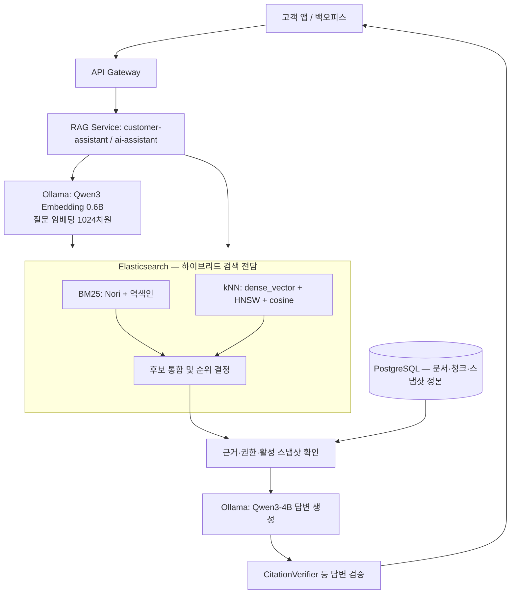
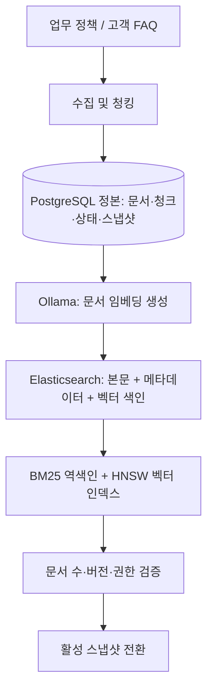

# 바로픽(BaroPick) — Elasticsearch 중심 하이브리드 RAG 아키텍처

> **목적:** 바로픽 고객·운영자 AI 상담에서 Elasticsearch가 **BM25 키워드 검색과 벡터 kNN 검색을 함께 전담**하고, PostgreSQL은 **문서·청크·버전·스냅샷 등 데이터 정본(Source of Truth)** 을 유지하는 아키텍처를 설명한다.
>
> **주의:** 이 문서는 **도입 제안 구조**이며, 현재 바로픽에 이미 적용 완료된 구성이라는 뜻이 아니다. 2026년 11월 18일의 **pgvector 제거·Elasticsearch 전면 대체 계획을 재사용하거나 재승인하는 문서가 아니다.**

## 1. 핵심 결론

**Elasticsearch 중심 하이브리드 RAG + PostgreSQL 정본 유지**는 실무적으로 타당한 아키텍처다. 데이터베이스를 정본으로 두고 검색엔진에는 검색 최적화된 복제 인덱스를 두는 방식은 널리 활용된다. 다만 모든 기업의 표준 구조는 아니며, 규모가 작은 RAG에서는 PostgreSQL + pgvector 단독도 충분할 수 있다.

| 구성 요소 | 주요 역할 |
|---|---|
| **PostgreSQL** | 원본 문서·청크·문서 버전·활성 스냅샷·답변 이력 등 정본 관리 |
| **Elasticsearch** | 문서 BM25 키워드 검색, `dense_vector` 기반 kNN 의미 검색, 후보 통합·순위 산정 |
| **Ollama / Qwen3 Embedding** | 문서 및 사용자 질문을 임베딩 벡터로 변환 |
| **Ollama / Qwen3-4B** | 근거 문서에 기반해 자연어 답변 생성 |
| **Spring Boot RAG 서비스** | 인증·권한·질문 처리, 검색 조율, 활성 근거 확인, 프롬프트 조립, 답변 검증 |
| **pgvector 확장** | 주 검색 경로에는 필요 없음. 현재 DB 스키마·마이그레이션과 호환성을 검토해 유지/제거를 **별도로 결정** |

**구분해야 할 점:** PostgreSQL을 정본으로 유지하는 것과 pgvector를 주 벡터 검색 엔진으로 유지하는 것은 다르다. 제안 구조에서 **검색은 Elasticsearch가 전담**하고 PostgreSQL은 정본을 관리한다.

## 2. 전체 아키텍처



- **검색 요청:** 사용자 질문을 임베딩한 뒤 Elasticsearch에서 BM25와 kNN 검색을 수행한다. 결과를 통합하고, 유효한 문서인지 확인한 다음 생성 모델에 전달한다.
- **정본 확인:** Elasticsearch 문서는 검색 최적화된 사본이다. 문서의 접근 권한, 활성 스냅샷 및 정책 상태는 정본과 일치해야 한다.
- **서비스 분리:** 고객용 RAG와 운영자용 RAG는 인덱스·권한을 분리해 내부 업무 문서가 고객에게 검색되지 않도록 한다.

## 3. 문서 수집·색인 과정 (질문 이전)



1. 업무 문서 또는 고객 FAQ에서 문서와 청크를 생성한다.
2. PostgreSQL에 정본과 문서 버전·스냅샷을 관리한다.
3. 임베딩 모델이 청크를 벡터로 변환한다. 바로픽의 기존 LAN 운영 기록상 모델은 `qwen3-embedding:0.6b`, 차원은 1,024이다.
4. Elasticsearch 전용 RAG 인덱스에 제목·본문·청크 ID·스냅샷 ID·권한 메타데이터·벡터를 저장한다.
5. 새 인덱스의 내용과 활성 문서 버전을 검증한 뒤 검색에 사용하는 인덱스를 전환한다.

**중요:** 정본 DB와 ES는 하나의 트랜잭션이 아니므로, 동기화 실패·색인 지연·중복 재시도를 고려한 **버전 검증 및 재처리**가 필요하다. ES 인덱스는 정본을 통해 재구축할 수 있어야 한다.

### Elasticsearch RAG 문서 예시

아래는 실제 구현 스키마가 아닌 **설명용 예시**다.

```json
{
  "chunkId": "CHUNK-001",
  "snapshotId": "IDX-20261127",
  "scope": "CUSTOMER",
  "title": "냉동식품 반품 정책",
  "content": "냉동식품은 단순 변심 반품이 제한됩니다.",
  "authority": "APPROVED",
  "embedding": [0.12, -0.05, 0.31]
}
```

실제 `embedding`은 1,024차원이며, Elasticsearch 매핑에는 `dense_vector`의 차원·유사도 설정을 명시한다. 본문에는 Nori와 적절한 한국어 검색 분석기를 적용한다.

## 4. 질문 응답 과정

예시 질문: **“냉동식품 주문했는데 마음이 바뀌었어. 반품 가능해?”**

| 단계 | 처리 |
|---|---|
| 1 | 고객이 앱에서 질문을 제출하고 API Gateway를 거쳐 고객 RAG 서비스로 전달한다. |
| 2 | Ollama 임베딩 모델이 질문을 벡터로 변환한다. |
| 3 | Elasticsearch BM25가 `냉동`, `반품`, `변심` 등의 키워드와 관련된 청크를 찾는다. |
| 4 | Elasticsearch kNN이 의미적으로 가까운 청크를 찾는다. |
| 5 | 검색 결과를 가중 점수 또는 RRF 등의 방식으로 통합해 후보를 정렬한다. |
| 6 | 문서 권한·현재 활성 스냅샷·정책 상태를 확인하고 신뢰할 수 있는 근거만 선택한다. |
| 7 | Qwen3-4B가 근거 문서를 바탕으로 답변을 생성한다. |
| 8 | CitationVerifier 및 도메인 검증 로직을 거쳐 고객에게 반환한다. |

**RRF(Reciprocal Rank Fusion)**는 BM25 점수와 벡터 유사도를 직접 더하는 대신 검색 **순위**를 이용해 두 목록을 결합한다. BM25와 cosine 점수는 척도가 다르므로 결과 결합 방식을 평가해 선택해야 한다.

## 5. pgvector는 어떻게 되는가?

- **PostgreSQL은 계속 사용한다.** 문서 원본·청크·활성 스냅샷·응답 이력 등 데이터 정본을 관리하기 때문이다.
- **pgvector의 유사도 검색은 주 검색 경로에서 빠진다.** BM25와 벡터 검색을 Elasticsearch가 함께 수행한다.
- 임베딩 캐시가 필요하면 PostgreSQL의 일반 배열(`real[]` 등)이나 별도 캐시 테이블을 고려할 수 있다.
- 기존 DB에는 `vector` 컬럼 및 pgvector 확장에 의존하는 마이그레이션이 있을 수 있다. 이를 즉시 삭제하지 말고 데이터 마이그레이션·호환성·롤백 여부를 따로 판단한다.

즉 **“PostgreSQL 정본 유지”는 “pgvector로 벡터 검색 지속”과 동일하지 않다.**

## 6. 이 구조가 실무적인 이유

1. **정본·검색 엔진의 책임 분리:** PostgreSQL은 데이터 정합성과 버전을, ES는 검색·랭킹을 담당한다.
2. **하이브리드 검색의 단일 실행 지점:** BM25와 kNN을 같은 검색 엔진에서 실행하므로 검색 경로가 상대적으로 단순해진다.
3. **정책 근거 관리:** 검색 점수와 별개로 활성 버전·승인 여부·권한을 검증할 수 있다.
4. **검색 인덱스 재구축:** ES 장애 또는 매핑 변경 시 PostgreSQL 정본으로 다시 인덱싱할 수 있다.
5. **기존 기술 활용:** 바로픽은 이미 Elasticsearch·PostgreSQL·Ollama·Spring Boot를 운영하므로 전혀 새로운 검색 제품을 도입할 필요가 없을 수 있다.

다만 **모든 실무 RAG에서 이 방식이 정답인 것은 아니다.** 운영자 문서 약 1,700청크, 고객 약 60청크 규모에서는 PostgreSQL + pgvector 방식만으로도 충분할 수 있으며, ES 중심 전환이 응답 속도나 검색 품질을 자동으로 개선하지는 않는다.

## 7. 바로픽 구현 시 중요 고려사항

### 7.1 검색·근거 품질

- **검색 성능 지표:** Recall@K, MRR/nDCG, 정확한 정책 청크 포함률.
- **답변 지표:** 정답률, 근거 일치율, 원문 발췌 폴백 비율, 잘못된 정책 생성 건수.
- **질문 변형:** `주문 확인`, `주문을 확인해줘`, `주문 어디서 봐?` 같은 표현을 함께 평가한다.
- **근거 검증:** 정책의 승인 상태와 유효 버전을 검색 점수보다 우선한다.

### 7.2 검색 결과 결합

- Elasticsearch에서 **BM25 + kNN 가중 점수 결합**을 구현할 수 있다.
- **RRF**를 사용하려면 현재 LAN Elasticsearch 8.18 Basic의 기능·라이선스를 확인한다. 기존 프로젝트 검증 기록에서는 ES 내장 RRF가 제한되었으므로 **Java 측 RRF**도 후보가 된다.
- RRF 점수는 문서의 사실성을 나타내지 않는다. 근거 적합성·권한·활성 스냅샷을 별도로 확인해야 한다.

### 7.3 장애 및 운영

- ES 인덱스와 PostgreSQL 정본이 불일치하면 이전 정책을 답변에 사용하지 않는다.
- 고객용·운영자용 인덱스 및 접근 정책을 분리한다.
- ES 검색 실패 시 안전한 오류 처리 또는 별도 승인된 폴백 경로를 사용한다.
- 모델 호출 지연, ES 검색 지연, 근거 검증 지연, 답변 생성 시간을 구분해 관측한다.
- LLM 생성 결과의 CitationVerifier 실패 때문에 원문이 반환되는 문제는 검색 엔진 변경만으로 해결되지 않으므로 별도 진단한다.

## 8. 단계적 도입 권장 순서

| 단계 | 작업 | 완료 기준 |
|---|---|---|
| 1 | 현재 pgvector RAG 기준선 수집 | 검색 정확도·응답 지연·폴백 비율 측정 |
| 2 | RAG 전용 Elasticsearch 인덱스 구현 | 본문과 벡터 모두 색인, 권한 분리 검증 |
| 3 | BM25 + kNN 결합 구현 | 검색 결과 품질 평가 및 무효 청크 배제 |
| 4 | 기존 pgvector와 병렬 비교 | 동일 질문·근거·정답으로 정확도/지연 비교 |
| 5 | 검증된 경우 ES를 주 검색 경로로 전환 | 활성 스냅샷 및 장애 복구 시험 통과 |
| 6 | pgvector의 장기 역할 별도 결정 | 캐시·마이그레이션·롤백 영향 정리 |

## 9. 바로픽 관련 코드·문서 링크

- 백엔드 저장소: https://github.com/code-and-pick/pmart-backend
- 운영자 RAG: https://github.com/code-and-pick/pmart-backend/tree/main/services/ai-assistant-service
- 고객 RAG: https://github.com/code-and-pick/pmart-backend/tree/main/services/customer-assistant-service
- 현재 RAG 인수인계: https://github.com/code-and-pick/pmart-backend/blob/main/docs/rag/HANDOVER.md
- 상품 검색의 Elasticsearch BM25+kNN 참고 구현: https://github.com/code-and-pick/pmart-backend/blob/main/docs/adr/0088-semantic-product-search.md
- 기존 상품 검색 구조: https://github.com/code-and-pick/pmart-backend/blob/main/docs/architecture/product-search.md

> **최종 정리:** 바로픽의 제안 C안은 **PostgreSQL = 데이터 정본 / Elasticsearch = BM25 + 벡터 검색 전담 / Ollama = 임베딩·생성 / RAG Service = 조율·근거 검증** 이다. 이는 실무적으로 타당하지만, 기존 RAG 대비 개선 효과는 실제 비교 평가로 확인해야 한다.
