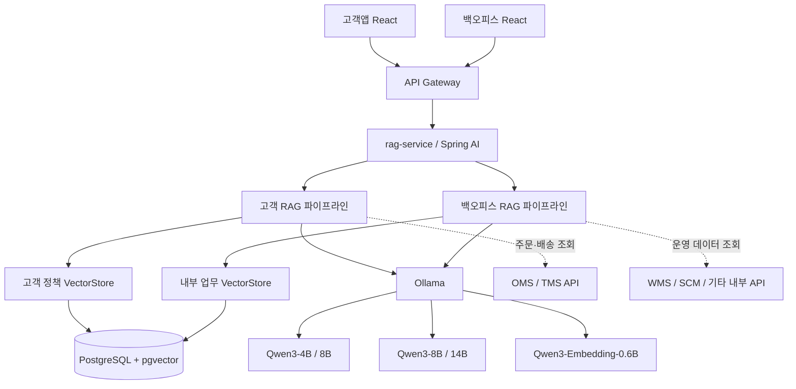

# 바로픽 RAG 챗봇 무료 모델 추천 — 공식 출처 포함

바로픽은 **고객앱(Customer)**과 **백오피스(Backoffice)** 양쪽에 RAG 챗봇을 도입할 예정이므로, 두 환경의 목적에 맞춰 모델을 선정하는 것이 좋습니다.

**추천 방향:** 임베딩 모델은 하나를 공통으로 사용하고, 대화용 LLM은 고객앱과 백오피스에서 다르게 운영합니다.

오픈 웨이트 모델을 자체 PC에서 실행하면 토큰당 외부 API 요금은 발생하지 않습니다. 다만 하드웨어·전력·운영 비용은 발생하며, 모델별 라이선스 확인이 필요합니다.

## 1. 무료 임베딩 모델

임베딩 모델은 사용자의 질문과 문서를 숫자 벡터로 변환합니다. 고객앱의 반품 정책 검색과 백오피스의 업무 매뉴얼 검색에 모두 사용됩니다.

| 모델 | 크기 | 라이선스 | 특징 | 공식 링크 |
|---|---:|---|---|---|
| Qwen3-Embedding-0.6B | 0.6B | Apache 2.0 | 가볍고 다국어 지원 | [Hugging Face](https://huggingface.co/Qwen/Qwen3-Embedding-0.6B) |
| BGE-M3 | 약 568M | MIT | 다국어, 긴 문서, 다양한 검색 방식 | [Hugging Face](https://huggingface.co/BAAI/bge-m3) |
| Multilingual E5 Large | 약 560M | MIT | 다국어 의미 검색 | [Hugging Face](https://huggingface.co/intfloat/multilingual-e5-large) |
| Qwen3-Embedding-4B | 4B | Apache 2.0 | 품질 향상 후보, 자원 사용 증가 | [Hugging Face](https://huggingface.co/Qwen/Qwen3-Embedding-4B) |
| Qwen3-Embedding-8B | 8B | Apache 2.0 | 고성능 검색 후보 | [Hugging Face](https://huggingface.co/Qwen/Qwen3-Embedding-8B) |

### 우선 비교할 두 모델

**1순위: Qwen3-Embedding-0.6B**

- 한국어를 포함한 다국어 지원
- 0.6B 규모로 비교적 경량
- 고객 정책과 내부 업무 문서 검색에 모두 활용 가능
- Apache 2.0 라이선스
- [Ollama 다운로드 페이지](https://ollama.com/library/qwen3-embedding)

**2순위: BGE-M3**

- 다국어 검색 지원
- 최대 8,192토큰 입력 지원
- Dense·Sparse·Multi-vector 검색 기능 제공
- 기존 Elasticsearch와 하이브리드 검색을 검토하기 좋은 후보
- [Ollama 다운로드 페이지](https://ollama.com/library/bge-m3)

> BGE-M3의 다양한 검색 기능은 모델 자체의 능력입니다. Spring AI의 기본 VectorStore 연결만으로 모든 검색 방식이 자동 활성화되지는 않습니다.

## 2. 무료 대화용 LLM

대화용 모델은 검색된 문서를 읽고 한국어 답변을 생성합니다.

| 모델 | Ollama 모델 파일(대략) | 추천 대상 | 공식 링크 |
|---|---:|---|---|
| Qwen3-4B | 2.5GB | 고객앱 경량 상담 | [Ollama](https://ollama.com/library/qwen3:4b) |
| Qwen3-8B | 5.2GB | 고객앱·백오피스 공통 | [Ollama](https://ollama.com/library/qwen3:8b) |
| Qwen3-14B | 9.3GB | 복합 업무 질문 | [Ollama](https://ollama.com/library/qwen3:14b) |
| Gemma3-4B | 3.4GB | 경량 다국어 상담 비교 | [Ollama](https://ollama.com/library/gemma3:4b) |
| Gemma3-12B | 8.2GB | 내부 문서 분석 비교 | [Ollama](https://ollama.com/library/gemma3:12b) |

> 파일 크기는 Ollama에 게시된 모델 변형에 따라 달라질 수 있습니다. 실제 RAM·VRAM 필요량은 모델 파일보다 큽니다. 모델별 답변 품질 순위는 바로픽 업무 데이터로 평가해야 합니다.

- [Qwen3-8B 원본 모델 카드 및 라이선스](https://huggingface.co/Qwen/Qwen3-8B)
- [Google Gemma 모델 및 이용 조건](https://ai.google.dev/gemma/terms)

## 3. 고객앱과 백오피스의 모델 구분

### 고객앱 — Qwen3-4B 또는 Qwen3-8B

고객은 짧고 정확한 답변을 기대합니다.

- 배송비 및 무료배송 기준 문의
- 교환·반품 및 신선보장 정책
- 주문 취소 가능 여부
- 배송 진행 상태 확인
- 상품 관련 질문

**초기에는 Qwen3-4B로 응답 속도를 확인하고 답변 정확도가 부족하면 8B를 비교**하는 방향을 추천합니다.

### 백오피스 — Qwen3-8B 또는 Qwen3-14B

운영자는 복잡한 내부 업무를 질문할 가능성이 높습니다.

- MFC 재고 및 발주 정책
- OMS·WMS·TMS 운영 절차
- 주문 취소 및 사가 보상 처리 절차
- Kafka·Debezium 장애 대응 매뉴얼
- 정산 및 클레임 업무
- 내부 시스템 운영 가이드

**우선 Qwen3-8B를 사용하고 복합 질문 품질 평가 후 14B 도입을 검토**합니다.

## 4. 추천 통합 아키텍처

고객앱용과 백오피스용 RAG 서비스를 처음부터 완전히 분리할 필요는 없습니다. 하나의 `rag-service`에서 사용자 유형에 따라 검색 데이터와 모델을 분기할 수 있습니다.



### 설계 시 중요한 점

1. **검색 범위 분리:** 고객이 내부 운영 매뉴얼·재고 원가·관리자 정보에 접근하지 못하도록 인증된 권한을 기준으로 서버에서 제한합니다. 프롬프트만으로 접근을 막아서는 안 됩니다.
2. **실시간 정보와 RAG 구분:** 주문 상태나 현재 재고는 문서 검색이 아니라 기존 서비스 API에서 조회합니다. Spring AI Tool Calling을 사용할 수 있지만 실제 권한 검증은 해당 서비스가 수행해야 합니다.
3. **문서 인덱스 분리:** 임베딩 모델은 공유하되 고객 정책과 내부 업무 문서를 별도 테이블이나 스키마에서 관리하는 방식이 안전합니다.

## 5. 실제 설치 및 Spring AI 연동

### Ollama 모델 다운로드

```bash
# 공통 임베딩 모델
ollama pull qwen3-embedding:0.6b

# 고객앱용
ollama pull qwen3:4b

# 백오피스용
ollama pull qwen3:8b

# 모델 동작 확인
ollama run qwen3:4b
ollama run qwen3:8b
```

### Gradle 의존성

```kotlin
implementation("org.springframework.ai:spring-ai-starter-model-ollama")
implementation("org.springframework.ai:spring-ai-starter-vector-store-pgvector")
```

### Spring AI 기본 설정 예시

```yaml
spring:
  ai:
    model:
      chat: ollama
      embedding: ollama

    ollama:
      base-url: http://ollama-server:11434

      chat:
        model: qwen3:4b

      embedding:
        model: qwen3-embedding:0.6b
```

이 설정은 기본 대화 모델을 4B로 지정한 예시입니다. 백오피스용 8B는 별도 `ChatModel` Bean 또는 요청별 모델 옵션을 이용해 선택해야 합니다. 실제 속성명과 설정 동작은 프로젝트에서 사용하는 Spring AI 버전에 맞춰 확인해야 합니다.

- [Spring AI — Ollama Chat](https://docs.spring.io/spring-ai/reference/api/chat/ollama-chat.html)
- [Spring AI — Ollama Embeddings](https://docs.spring.io/spring-ai/reference/api/embeddings/ollama-embeddings.html)

## 6. 최종 추천 조합

| 구성 | 고객앱 | 백오피스 |
|---|---|---|
| 임베딩 | Qwen3-Embedding-0.6B | 동일 모델 공유 |
| 대화 모델 | Qwen3-4B | Qwen3-8B |
| 모델 서버 | Ollama | Ollama |
| 벡터 DB | pgvector | pgvector |
| 문서 저장 영역 | 고객 공개 정책 | 내부 업무 문서 |
| 실시간 정보 | OMS·TMS API | OMS·WMS·SCM API |
| 모델 이용료 | 로컬 실행 시 API 요금 없음 | 로컬 실행 시 API 요금 없음 |

초기 개발에서는 이 구성이 단순합니다. 검색 품질이 부족하면 BGE-M3를 비교하고, 고객 응답 품질이 부족하면 Qwen3-8B를 평가합니다.

바로픽 PC1~PC4는 이미 여러 백엔드 서비스와 Kafka, Elasticsearch 등을 실행하고 있으므로, 모델 파일 크기뿐 아니라 추론에 필요한 메모리·GPU 여유를 확인해야 합니다. 8B 모델 파일이 약 5.2GB라고 해서 VRAM 5.2GB만으로 안정적인 동시 서비스가 보장되지는 않습니다.

## 7. 공식 출처 모음

### 임베딩 모델

- [Qwen3-Embedding-0.6B — Hugging Face](https://huggingface.co/Qwen/Qwen3-Embedding-0.6B)
- [Qwen3-Embedding-4B — Hugging Face](https://huggingface.co/Qwen/Qwen3-Embedding-4B)
- [Qwen3-Embedding-8B — Hugging Face](https://huggingface.co/Qwen/Qwen3-Embedding-8B)
- [BGE-M3 — Hugging Face](https://huggingface.co/BAAI/bge-m3)
- [Multilingual E5 Large — Hugging Face](https://huggingface.co/intfloat/multilingual-e5-large)
- [Qwen3 Embedding — Ollama](https://ollama.com/library/qwen3-embedding)
- [BGE-M3 — Ollama](https://ollama.com/library/bge-m3)

### 대화용 LLM

- [Qwen3-4B — Ollama](https://ollama.com/library/qwen3:4b)
- [Qwen3-8B — Ollama](https://ollama.com/library/qwen3:8b)
- [Qwen3-14B — Ollama](https://ollama.com/library/qwen3:14b)
- [Gemma3-4B — Ollama](https://ollama.com/library/gemma3:4b)
- [Gemma3-12B — Ollama](https://ollama.com/library/gemma3:12b)
- [Qwen3-8B — Hugging Face](https://huggingface.co/Qwen/Qwen3-8B)
- [Gemma 사용 조건](https://ai.google.dev/gemma/terms)

### Spring AI

- [Spring AI — Ollama ChatModel](https://docs.spring.io/spring-ai/reference/api/chat/ollama-chat.html)
- [Spring AI — Ollama EmbeddingModel](https://docs.spring.io/spring-ai/reference/api/embeddings/ollama-embeddings.html)
- [Spring AI — PGvector VectorStore](https://docs.spring.io/spring-ai/reference/api/vectordbs/pgvector.html)
- [Spring AI — Tool Calling](https://docs.spring.io/spring-ai/reference/api/tools.html)

---

**결론:** 바로픽은 고객앱 `Qwen3-4B`, 백오피스 `Qwen3-8B`, 공통 임베딩 `Qwen3-Embedding-0.6B`부터 검증하는 것이 적절합니다. 이후 실제 한국어 정책 질문과 운영 매뉴얼 질문에 대한 정답률·검색 정확도·지연시간을 측정해 최종 확정합니다.
