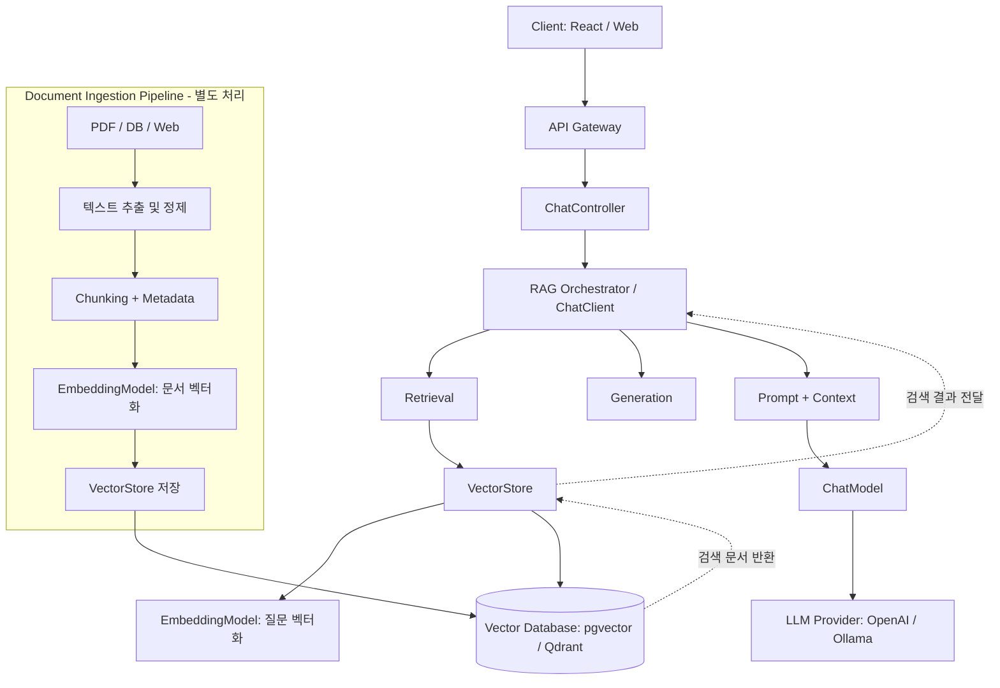

# Spring AI RAG 아키텍처 검토

첨부한 `spring ai rag arch.svg`를 기준으로 검토한 내용입니다.

**결론부터 말하면, 기본적인 Spring AI 기반 RAG 아키텍처로는 적절하지만, 현재 구조를 그대로 구현하는 것은 추천하지 않습니다.**

전체적인 구성 요소는 잘 잡혀 있습니다. 다만 실제 RAG의 실행 순서와 데이터 흐름이 일부 잘못 표현되어 있고, 바로픽의 MSA 환경에 적용하려면 몇 가지 구성 요소를 추가하는 것이 좋습니다.

## 1. 전체 구조 평가

| 검토 항목 | 평가 | 의견 |
|---|---|---|
| Client → API Gateway | 적절 | 기존 바로픽 구조와 호환 |
| Spring Boot + Spring AI | 적절 | 독립적인 AI 서비스로 구성 가능 |
| ChatController / ChatClient | 보완 | 서로 역할이 다른 컴포넌트 |
| RAG Orchestrator | 적절 | 검색·컨텍스트·LLM 호출 조율 |
| VectorStore | 적절 | 검색 인터페이스로 활용 |
| EmbeddingModel | 수정 필요 | VectorStore 아래에 직렬 배치한 흐름이 부정확 |
| ChatModel | 적절 | LLM 호출 추상화 |
| Vector Database | 적절 | PGVector 또는 Qdrant 사용 가능 |
| Document Ingestion Pipeline | 보완 | 데이터 수집·갱신·삭제 정책 필요 |
| 보안·운영·모니터링 | 누락 | 운영 환경에서는 반드시 고려 |

가장 중요한 수정 사항은 **VectorStore, EmbeddingModel, ChatModel을 단순히 위에서 아래로 연결하는 구조가 아니라, 검색과 답변 생성을 구분해 표현하는 것**입니다.

## 2. 반드시 수정해야 하는 부분

### ① EmbeddingModel 연결 구조

현재 그림에서는 다음과 같이 연결되어 있습니다.

```text
VectorStore
    ↓
EmbeddingModel
    ↓
Vector Database
```

이것은 실제 컴포넌트 간 호출 관계를 정확하게 보여주지 못합니다.

실제로는 사용자가 질문하면 `VectorStore`가 `EmbeddingModel`을 이용해 질문을 벡터로 변환하고, 그 벡터를 이용해 데이터베이스를 검색합니다.

```text
사용자 질문
    ↓
VectorStore.similaritySearch()
    ├── EmbeddingModel
    │       └── 질문 → 벡터 변환
    │
    └── Vector Database
            └── 유사 문서 검색
                    ↓
                검색 결과
```

특히 문서 저장 시에도 EmbeddingModel을 사용합니다.

**즉, EmbeddingModel은 검색과 문서 색인 양쪽에서 사용되는 모델**입니다.

### ② 검색 결과가 ChatModel로 전달되는 과정 누락

현재 그림에는 `VectorStore`와 `ChatModel`이 나란히 놓여 있지만, 검색 결과가 LLM에 어떻게 전달되는지 표현되지 않았습니다.

RAG의 핵심은 다음 순서입니다.

1. 사용자 질문 수신
2. 질문을 임베딩해 관련 문서 검색
3. 검색된 문서를 Context로 구성
4. 사용자 질문 + Context + 시스템 지침을 Prompt에 포함
5. ChatModel을 통해 LLM 호출
6. 생성된 답변 반환

이 부분을 명확하게 표현해야 단순한 LLM 챗봇과 RAG 시스템의 차이가 드러납니다.

### ③ Document Ingestion Pipeline 보완

현재 구조는 다음과 같습니다.

```text
PDF / DB / Web
      ↓
ETL / Chunking / Embedding
      ↓
VectorStore 저장
```

기본적으로 맞습니다. 다만 운영 환경이라면 다음 단계로 구분하는 것이 좋습니다.

```text
문서 수집
   ↓
텍스트 추출
   ↓
정제 및 Chunking
   ↓
Metadata 부여
   ↓
EmbeddingModel
   ↓
VectorStore
   ↓
Vector Database
```

특히 `Metadata`가 중요합니다.

바로픽을 예로 들면, 배송 정책 문서에는 `documentId`, `version`, `effectiveAt`, `category`, `accessLevel` 등을 기록할 수 있습니다.

이렇게 해야 오래된 정책을 교체하거나 사용 권한에 따라 검색 결과를 제한할 수 있습니다.

Spring AI 공식 문서에서도 DocumentReader, DocumentTransformer, DocumentWriter 중심의 ETL 구조를 제시합니다.

## 3. 추천하는 수정 아키텍처

다음은 기존 그림의 구조를 유지하되, 실제 실행 흐름을 더 명확하게 표현한 개선안입니다.



> 위 다이어그램은 이해를 위한 논리 구조도입니다. 실제 Retrieval 단계에서는 VectorStore가 EmbeddingModel과 Vector DB를 각각 이용하며, 검색 결과는 Orchestrator 또는 Advisor를 통해 Context에 포함됩니다.

Spring AI에서는 처음부터 복잡한 오케스트레이터를 직접 구현할 필요가 없습니다. 기본적인 RAG라면 `QuestionAnswerAdvisor`, 검색 전후 처리를 세밀하게 제어하려면 `RetrievalAugmentationAdvisor`를 검토할 수 있습니다.

## 4. 바로픽 프로젝트 기준 추가 검토

여기부터는 첨부 그림에 없는 사항을 기존 바로픽 아키텍처에 맞춰 확장한 제안입니다.

| 항목 | 추천 | 이유 |
|---|---|---|
| AI 서비스 | `rag-service` 독립 구축 | 기존 MSA와 책임 분리 |
| API Gateway | 기존 Gateway 재사용 | JWT, Rate Limit, 라우팅 재사용 |
| Chat Framework | Spring AI | Spring Boot 환경과 통합 |
| Vector DB | PostgreSQL + pgvector 우선 검토 | 기존 PostgreSQL 운영 경험 활용 |
| Embedding | 한국어 지원 모델 별도 선정 | 문서 검색 품질에 직접 영향 |
| 상품 검색 | 기존 Elasticsearch 유지 | RAG 검색과 일반 상품 검색 목적 구분 |
| 데이터 동기화 | 초기 배치는 ETL, 변경은 이벤트 기반 검토 | 기존 Kafka·Debezium 활용 가능 |
| 관측성 | 기존 Prometheus·Zipkin·ELK 연동 | AI 요청 추적 및 장애 분석 |

### 특히 구분해야 할 부분

바로픽은 이미 Elasticsearch를 이용해 상품을 검색하고 있습니다.

여기에 Vector DB를 추가하더라도 기존 Elasticsearch를 없앨 필요는 없습니다.

- **Elasticsearch:** 상품명, 카테고리, 가격, 필터, 정렬 중심의 상품 검색
- **Vector DB:** 배송 정책, 교환·반품 안내, FAQ 등의 의미 기반 검색
- **OMS/WMS 등 원천 서비스:** 실시간 주문 상태, 재고, 배송 진행 정보 조회

예를 들어 고객이 "냉동식품을 단순 변심으로 반품할 수 있어?"라고 질문하면 RAG가 정책 문서를 검색합니다.

반면 "내 주문 지금 어디까지 왔어?"라는 질문에는 벡터 검색 결과를 신뢰하기보다 인증된 사용자 정보를 바탕으로 주문·배송 API를 조회해야 합니다. 이때는 Spring AI의 Tool Calling을 별도로 활용하는 구조가 적절합니다.

또한 고객별 주문 정보와 내부 운영 문서가 섞이지 않도록 접근 권한과 검색 범위를 분리해야 합니다.

## 5. 최종 판단

**현재 SVG는 Spring AI RAG의 개념도 수준에서는 충분하지만, 실제 구현을 위한 아키텍처로 사용하려면 수정이 필요합니다.**

우선순위를 정하면 다음과 같습니다.

1. **필수:** Retrieval → Context → Generation 실행 순서 명확화
2. **필수:** EmbeddingModel과 VectorStore 간 호출 관계 수정
3. **필수:** Ingestion Pipeline의 저장·갱신·삭제 처리 정의
4. **필수:** 인증 사용자별 데이터 접근 통제 및 검색 실패 처리
5. **권장:** AI 서비스 분리, 모니터링, 대화 이력 저장
6. **확장:** Elasticsearch와 Vector DB를 결합한 Hybrid Search 및 Tool Calling

바로픽에 적용한다면 처음부터 복잡한 Agent 시스템으로 만들기보다는 **Spring AI + pgvector + 기존 API Gateway를 중심으로 정책·FAQ용 RAG를 먼저 구축**하고, 이후 주문 조회나 배송 문의를 Tool Calling으로 확장하는 방향을 추천합니다.

이렇게 하면 기존 OMS·WMS·TMS·Elasticsearch 구조를 불필요하게 변경하지 않으면서 AI 기능을 추가할 수 있습니다.
