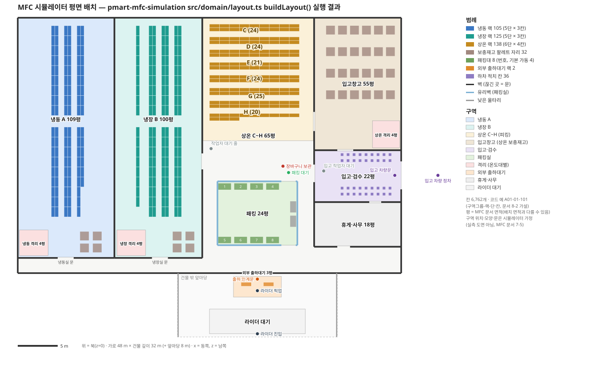

# 시뮬레이터 평면 배치 도면



- **출처**: `pmart-mfc-simulation/src/domain/layout.ts` 의 `buildLayout()` 를 그대로 실행해 얻은 좌표(`layout.json`)로 그렸다 — 손으로 옮겨 그린 것이 아니다. 기준: 시뮬레이터 커밋 `a6c3f2e`(layout.ts 마지막 변경), 2026-11-09.
- **주의**: 구역의 위치·모양·문은 **시뮬레이터의 가정**이다(MFC 업무 문서 7-5 "현장 실측 도면 아님"). 면적·랙 수·랙 규격·패킹대 수는 MFC 업무 문서 1장·4장 값을 따른다.
- 다시 그리기(시뮬레이터 평면이 바뀌면):
  ```bash
  cd docs/simulator/layout/tools
  node dump.mts ../layout.json            # Node 23.6+ (TypeScript 그대로 실행)
  python -I draw.py ../layout.json ../floorplan.svg
  ```
  `floorplan.png` 은 같은 그림의 이미지(브라우저 headless 캡처).

## 요약

- 건물 가로 48 m × 깊이 32 m(+ 남쪽 앞마당 8 m). 위 = 북, x = 동쪽, z = 남쪽.
- 서쪽부터 **냉동 A → 냉장 B → 상온 C~H** 가 북쪽 벽에 붙어 있고, 동쪽 끝에 **입고창고 → 입고·검수 → 휴게·사무**가 남북으로 이어진다. 가운데 남쪽에 **패킹실**(유리벽), 남쪽 벽 가운데 **출하 인계문** 밖에 **외부 출하대기 랙**과 **라이더 대기**.
- 입고 차량은 동쪽 벽 차량문(입고·검수 구역)에 붙는다. 상온 보충재고는 입고창고 팔레트, 냉장·냉동 보충재고는 각 저온실 안쪽 팔레트.
- 저온실(냉동·냉장)은 벽으로 닫고 남쪽에 문 하나씩, 냉장실은 상온 쪽으로도 문이 하나 있다.

| 구역 | 종류 | 좌표(m) | 배치 크기 | 문서 면적(평) |
|---|---|---|---|---|
| 냉동 A | FROZEN | x 0~12, z 0~30 | 12.0 × 30.0 m (약 109평) | 109 |
| 냉장 B | CHILLED | x 12.2~23, z 0~30 | 10.8 × 30.0 m (약 98평) | 100 |
| 상온 C~H | AMBIENT | x 23.2~37, z 0~15.4 | 13.8 × 15.4 m (약 64평) | 65 |
| 입고창고 | INBOUND_STORE | x 37.2~48, z 0~16.5 | 10.8 × 16.5 m (약 54평) | 55 |
| 입고·검수 | RECEIVING | x 37.2~48, z 16.7~23 | 10.8 × 6.3 m (약 21평) | 22 |
| 휴게·사무 | OFFICE | x 37.2~48, z 23.2~28.6 | 10.8 × 5.4 m (약 18평) | 18 |
| 패킹 | PACKING | x 25~35, z 20.5~28.5 | 10.0 × 8.0 m (약 24평) | 24 |
| 냉동·냉장·상온 격리 | QUARANTINE | 각 저온실 남서쪽 구석, 입고창고 남동쪽 구석 | 각 약 3.5 × 3.3 m (약 3평) | 각 4 |
| 외부 출하대기 | SHIPPING | x 27~33, z 32.4~35 (건물 밖) | 6.0 × 2.6 m | 3 |
| 라이더 대기 | PARKING | x 24~36, z 36.5~39.6 (건물 밖) | 12.0 × 3.1 m | — |

| 설비 | 수 | 비고 |
|---|---|---|
| 냉동 랙 | 105 | 5단 × 3칸, 남북 방향 줄, 가운데 횡단 통로 |
| 냉장 랙 | 125 | 5단 × 3칸, 같은 방식 |
| 상온 랙 | 138 | 6단 × 4칸, 동서 방향 줄, 그룹 C 24·D 24·E 21·F 24·G 25·H 20(문서 구역 면적 비례 — 시뮬레이터 가정) |
| 칸(로케이션) | 6,762 | 코드 `A01-01-101` = 구역그룹(A01)-랙(01)-단·칸(101), MFC 문서 8-2 가설 형식 |
| 패킹대 | 8 | 북쪽 4 · 남쪽 4(문서 기본 가동 4, 최대 8) |
| 보충재고 팔레트 자리 | 32 | 입고창고 24(상온), 냉동실 4, 냉장실 4 |
| 하차 적치 칸 | 36 | 입고·검수 구역 |
| 외부 출하대기 랙 | 2 | 칸 32 |

## 백엔드와 다른 점 (SIM-6 결정: 시뮬레이터가 맞춘다)

- **칸 코드**: 시뮬레이터 `A01-01-101` 형식 ↔ LAN 시험 센터 `MFC-SEED-01` 는 `A-S9-01-1-01` 형식(mfc-location 등록값, 코드 문법 Q-03 미결). 실서버 모드에서는 시뮬레이터가 백엔드 위치 목록을 읽어 그 코드로 칸을 매긴다.
- **구역 종류**: 시뮬레이터는 냉동·냉장·상온·입고창고·격리 등 평면 구역, 백엔드 위치는 위치마다 구역 종류(보관·피킹·포장·카트·반품 등)와 온도대를 갖는다. 대응표는 시뮬레이터가 실서버 연결 때 만든다.
- **도면 근거**: 둘 다 실측 도면이 아니다. 실제 센터 도면(Q-03)이 오면 백엔드 위치 기준과 이 평면을 함께 다시 본다.
