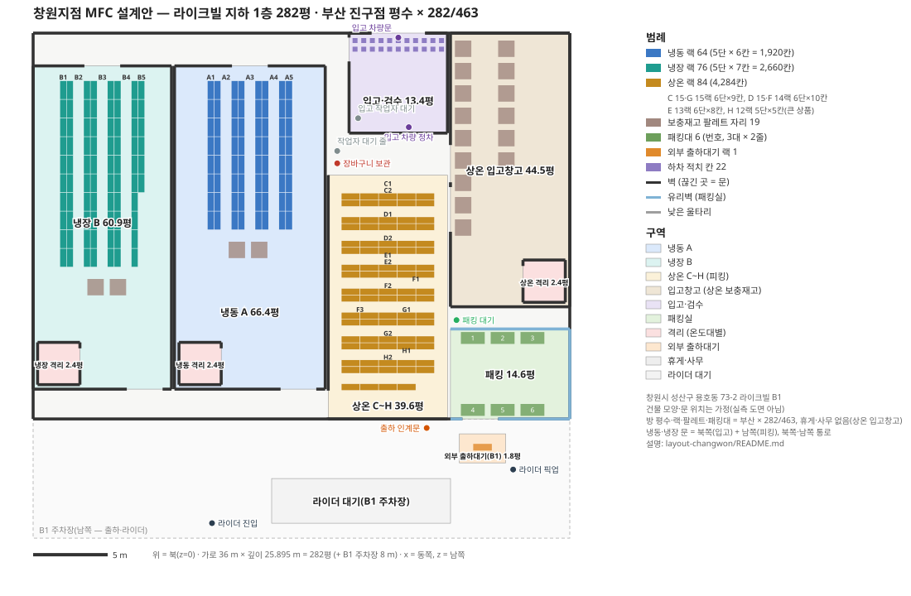

# 창원지점 MFC 평면 설계안 (2026-11-21)

- **주소·조건(사용자 2026-11-21)**: 창원시 성산구 용호동 73-2, **라이크빌 지하 1층, 282평**. LAN 에 등록하지 않은 **문서상 설계안**이다.
- **가정**: 건물은 **36.0 × 25.9 m 직사각형**(932.4 ㎡ = 282.05평). 출입은 **남쪽 한 면**(지하주차장 하역장 쪽 — 차량 경사로·화물 리프트)뿐이라고 가정했다. 기둥·코어 위치는 모른다.
- **SKU 목표 = 부산 진구점과 같은 구성**(사용자 결정): 냉동 2,180 · 냉장 3,270 · 상온 5,450(C 1,050 · D 1,100 · E 800 · F 1,100 · G 1,050 · H 350).
- **판정: 들어간다.** 282평(부산의 61 %)에서도 같은 SKU 를 85 % 운영 상한 안에 담는다 — 아래 표. 대신 보충재고 자리가 적어(팔레트 30) **보충·입고를 자주** 해야 한다.
- 만든 방법·배치 규칙·검사: 세종과 같다(`../layout-tools/build_layout.py`, 규칙 표는 `../layout-sejong/README.md`). 창원에서 다른 값만: 줄 끝 여유 북쪽 0.8 m·남쪽 1.2 m, 저온실 팔레트 접근 통로 1.2 m, 입고창고 팔레트 통로 1.8 m.

## 구조 — U 흐름 · 앞 통로 하나 · 촘촘한 블록

- **입고와 출고가 같은 남쪽 면**(지하 1층 출입이 한쪽뿐이라는 가정): 동남쪽 차량문 → 입고·검수 → 앞 통로 → 각 보관실, 피킹 → 앞 통로 서쪽 → 패킹 → 서남쪽 출하 인계문 → B1 하역장 출하대기. 물건이 U 자로 돌아 나온다.
- 보관실 4개(냉동·냉장·상온·입고창고)를 **북쪽에 한 줄로 붙이고** 그 앞을 **2.0 m 앞 통로 하나**(z 16.2~18.2)가 잇는다. 세종의 등뼈 + 양쪽 띠 구조와 달리 통로가 하나뿐이라 공용 통로 몫이 작다(약 30평 — 부산 55평).
- 피킹 줄은 남북 11랙(13.75 m), **횡단 통로 없이** 북쪽 끝 0.8 m 로 돌아 나간다(12랙 이하라 규칙상 필요 없음). 저온실은 동쪽 벽에 팔레트 한 열(보충재고 7자리)과 격리 칸을 붙였다.
- 패킹(8대)은 앞 통로 서쪽 끝 — 저온실 문에서 가장 가깝다. 휴게·사무는 패킹과 입고 사이.

## 구역 (layout.json 좌표, m)

| 구역 | 종류 | 좌표 | 크기(m) | ㎡ | 평 |
|---|---|---|---|---:|---:|
| 냉동 A(냉동 격리·팔레트 포함) | FROZEN | x 0~9.35, z 0~16 | 9.35 × 16.00 | 149.6 | 45.3 |
| 냉장 B(냉장 격리·팔레트 포함) | CHILLED | x 9.55~20.5, z 0~16 | 10.95 × 16.00 | 175.2 | 53.0 |
| 상온 C~H | AMBIENT | x 20.7~30.4, z 0~16 | 9.70 × 16.00 | 155.2 | 46.9 |
| 입고창고(상온 격리 포함) | INBOUND_STORE | x 30.6~36, z 0~16 | 5.40 × 16.00 | 86.4 | 26.1 |
| 패킹(8대) | PACKING | x 0~10.6, z 18.4~25.9 | 10.60 × 7.50 | 79.5 | 24.0 |
| 휴게·사무 | OFFICE | x 10.8~17.4, z 18.4~25.9 | 6.60 × 7.50 | 49.5 | 15.0 |
| 입고·검수·회수 | RECEIVING | x 17.6~36, z 18.4~25.9 | 18.40 × 7.50 | 138.0 | 41.7 |
| (냉동 격리) | QUARANTINE | x 6.95~9.25, z 11.2~15.9 | 2.30 × 4.70 | 10.8 | 3.3 |
| (냉장 격리) | QUARANTINE | x 18.1~20.4, z 11.2~15.9 | 2.30 × 4.70 | 10.8 | 3.3 |
| (상온 격리) | QUARANTINE | x 32.8~35.9, z 11.7~15.9 | 3.10 × 4.20 | 13.0 | 3.9 |
| 앞 통로·벽 | — | 나머지 | — | 99.0 | 29.9 |
| **건물 합계** | | | 36 × 25.9 | **932.4** | **282.1** |
| 외부 출하대기(B1 하역장, 건물 밖) | SHIPPING | x 2~8, z 27.6~30.2 | 6.00 × 2.60 | 15.6 | 4.7 |

## 랙·칸·SKU 수용량

보관실 깊이 16 m − 끝 여유 2.0 m = 14.0 m → 한 줄 최대 **11랙**(13.75 m). 줄 수: 냉동 = 홑줄 + 겹줄 4개(9줄, 랙 폭 6.85 m) + 팔레트 통로 1.2 + 팔레트 1.1 + 0.2 = 9.35 m, 냉장 = 홑줄 + 겹줄 5개(11줄) + 같은 팔레트 열 = 10.95 m, 상온 = 홑줄 + 겹줄 5개 + 통로 + 홑줄(12줄) = 9.6 m. 줄은 모두 채웠다.

| 온도·그룹 | 랙 | 단 × 칸 | 칸(이론) | 85 % 운영 | SKU 목표(부산) | 여유 | 판정 |
|---|---:|---|---:|---:|---:|---:|---|
| 냉동 A | 99 | 5 × 6 | 2,970 | 2,524.5 | 2,180 | 344 | 충족 |
| 냉장 B | 121 | 5 × 7 | 4,235 | 3,599.8 | 3,270 | 330 | 충족 |
| 상온 C | 24 | 6 × 9 | 1,296 | 1,101.6 | 1,050 | 52 | 충족 |
| 상온 D | 23 | 6 × 10 | 1,380 | 1,173.0 | 1,100 | 73 | 충족 |
| 상온 E | 21 | 6 × 8 | 1,008 | 856.8 | 800 | 57 | 충족 |
| 상온 F | 23 | 6 × 10 | 1,380 | 1,173.0 | 1,100 | 73 | 충족 |
| 상온 G | 24 | 6 × 9 | 1,296 | 1,101.6 | 1,050 | 52 | 충족 |
| 상온 H | 17 | 5 × 5 | 425 | 361.2 | 350 | 11 | 충족(여유 작음) |
| 상온 합계 | 132 | | 6,785 | 5,767.3 | 5,450 | 317 | 충족 |
| **합계** | **352** | | **13,990** | | **10,900** | | |

- **재설계 기록**: 처음 안(보관실 깊이 16 m, 저온실 팔레트 열 없이 냉장 10줄 × 11 = 110랙)은 냉장 85 % 슬롯 3,272.5 로 SKU 3,270 을 겨우 넘었고(여유 2.5), 줄 번호가 B10 이 되어 Q-03(줄 1자리)에 걸렸다. 그래서 **냉장 11줄 + 동쪽 팔레트 열**로 넓히고(121랙, 여유 330), **줄 번호를 통로 단위**로 바꿨다(냉장 통로 6개 = B1~B6). 상온은 12줄(132랙, 최소 127)로 두고 입고창고 폭 5.4 m 를 남겼다.
- 상온 그룹 배분: 최소 C 23·D 22·E 20·F 22·G 23·H 17 = 127, 남는 5랙은 여유율이 작은 그룹부터(C·D·F·G·E 에 1개씩). H 는 여유 11칸 — 큰 상품 SKU 가 늘면 먼저 부족해진다.
- 랙 수가 부산보다 적어도 SKU 가 들어가는 이유: 부산은 냉동 105·냉장 125·상온 138로 최소치(86·110·127)보다 넉넉히 두었고, 창원은 최소치 + 기하적으로 남는 줄만 채웠다.

## 수량 요약

`check_layouts.py` 가 이 표와 `layout.json` 을 대조한다.

| 항목 | 수 |
|---|---:|
| 냉동 랙 | 99 |
| 냉동 칸 | 2,970 |
| 냉장 랙 | 121 |
| 냉장 칸 | 4,235 |
| 상온 랙 | 132 |
| 상온 칸 | 6,785 |
| 상온 C 랙 | 24 |
| 상온 D 랙 | 23 |
| 상온 E 랙 | 21 |
| 상온 F 랙 | 23 |
| 상온 G 랙 | 24 |
| 상온 H 랙 | 17 |
| 랙 합계 | 352 |
| 선반 칸 합계 | 13,990 |
| 보충재고 팔레트 냉동 | 7 |
| 보충재고 팔레트 냉장 | 7 |
| 보충재고 팔레트 상온 | 16 |
| 패킹대 | 8 |
| 외부 출하대기 랙 | 2 |
| 하차 적치 칸 | 36 |

## 백엔드 칸 코드 (Q-03, 등록 안 함 — 계획만)

- `PMART_MFC=<창원 센터 ID> PMART_LAYOUT=docs/simulator/mfc/layout-changwon/layout.json python -I deploy/lan/seed/mfc_layout.py` — `plan()` 을 2026-11-21 에 돌려 칸 13,990 + 팔레트 30, 코드 중복 없음 확인.
- 줄 번호 = 통로 번호(세종과 같은 새 센터 규칙). 예 `C-B6-01-1-01`(냉장 6번 통로 1번 랙). 팔레트 `{온도대}-R1-NN-1-01`.
- `mfc_layout.py` 의 부산 좌표 고정 보조 위치(`RCV-C-01`·`RCV-F-01`·`RCV-A-02`·`RTN-A-01`)는 창원 좌표로 바꿔야 한다(범위 밖, 보고만).

## 열린 가정 (사용자 확인 필요)

1. 건물 모양 36 × 25.9 m 직사각형, 출입이 남쪽 한 면뿐. 지하라 **천장 높이**(문서 9-1: 2.5~3.2 m)가 랙 2.1 m + 스프링클러 여유를 넘는지 확인 필요.
2. 입고 차량이 B1 하역장까지 경사로로 내려오는지(차고 높이), 아니면 화물 리프트인지. 라이더가 B1 하역장까지 들어오는지(외부 출하대기 위치).
3. 격리 3곳이 문서 4평보다 작다(3.3·3.3·3.9평). 줄이지 않으려면 저온 팔레트를 더 줄여야 한다.
4. 보충재고 팔레트 30자리(부산 32, 세종 182) — 하루 2회 이상 입고를 전제로 한다.
5. 휴게·사무 15평(부산 18평).
