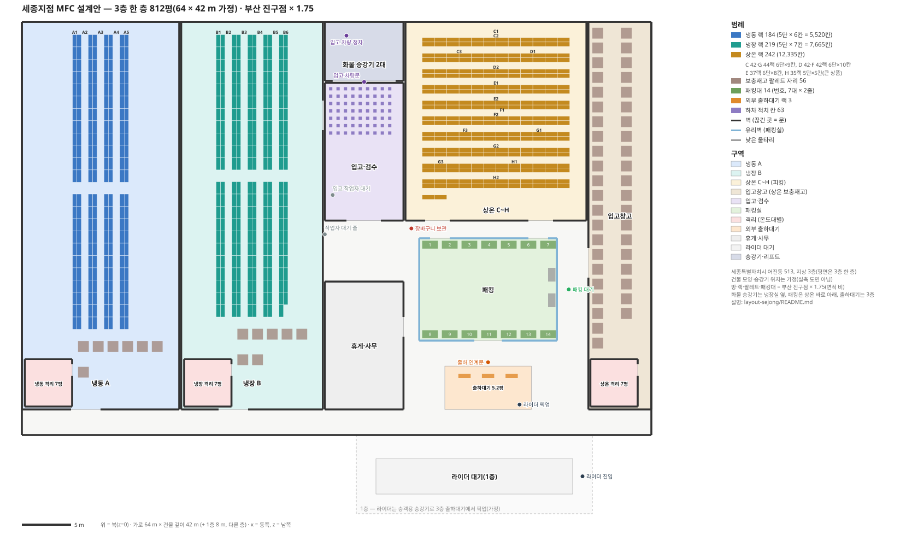

# 세종지점 MFC 평면 설계안 (2026-11-21, 사용자 검토 2차 반영)

- **주소·조건(사용자 2026-11-21)**: 세종특별자치시 어진동 513, **지상 3층 — MFC 는 3층 한 층 812평**. LAN 에 등록하지 않은 **문서상 설계안**이다.
- **가정**: 64.0 × 42.0 m 직사각형(2,688 ㎡ = 813.1평). 기둥·코어·창·소방 설비 위치는 모른다.
- **기준 = 부산 진구점 평면 × 면적 비 1.75**(사용자 "기준 MFC 설계도 비율대로", "평수에 맞게 랙 갯수를 늘리고 줄이는 것뿐"): 방 면적·랙·보충재고 팔레트·패킹대·격리·하차 칸을 부산 값의 1.75배로 했다. 랙 모양(1.25 × 0.45 m)·통로 0.7 m·칸 구조(단 × 칸)는 그대로.
- **SKU**: 칸 하나에 여러 SKU 를 소량 적재(사용자 "다품종 소량 적재")하므로 SKU 수로 랙 수를 정하지 않는다. 칸 수는 부산의 1.75배.
- **사용자 검토 2차(2026-11-21)로 바꾼 것**:
  1. 출하 리프트를 없애고 그 자리(패킹실 남쪽)에 **출하대기**를 둔다(3층). 라이더는 1층에서 승객용 승강기로 올라와 픽업한다고 가정.
  2. **화물 승강기는 냉동·냉장 옆** — 냉장실 바로 동쪽, 입고·검수와 붙어 있고 냉장실과 문으로 이어진다.
  3. **패킹대 바로 옆(북쪽)에 상온 C~H**.
- 만든 방법: `../layout-tools/build_layout.py`, 그림 `../layout/tools/draw.py`, 숫자 검사 `../layout-tools/check_layouts.py`.

## 배치 규칙 (모든 센터 공통)

| 항목 | 값 | 근거 |
|---|---|---|
| 랙 | 1.25(폭) × 0.45(깊이) × 2.1(높이) m | MFC 문서 1장 1절·9-1 |
| 랙 사이 통로 | 0.70 m | 1장 1-2·3-1 "70cm 유지" |
| 줄 형태 | 등 맞댄 겹줄, 모든 줄이 통로 하나에 면함 | 부산 평면과 같음 |
| 횡단 통로 | 줄이 12랙(15 m)을 넘으면 1.2 m | 부산 냉동·냉장 18랙 줄과 같음 |
| 수량 | 방 면적·랙·팔레트·패킹대·격리·하차 칸 = 부산 × 면적 비(세종 1.75, 창원 0.607) | 사용자 2026-11-21 |
| 칸 구조 | 냉동 5단×6, 냉장 5단×7, 상온 C·G 6×9, D·F 6×10, E 6×8, H 5×5 | 1장 3-3·4-2(부산과 같음) |

## 구조

- 서쪽: **냉동 A · 냉장 B**(부산처럼 랙은 방 북쪽, 남쪽에 보충재고 팔레트·격리실, 문은 남쪽 복도).
- 냉장 바로 동쪽: **화물 승강기 2대 → 입고·검수**(하차 적치). 냉장실 동쪽 벽에 문.
- 가운데: 위 **상온 C~H**(가로 줄), 바로 아래 **유리벽 패킹(7대 × 2줄)**, 그 아래 **출하대기**(출하 인계·라이더 픽업).
- 입고·검수 아래 **휴게·사무**, 동쪽 끝 **입고창고**(상온 보충재고·상온 격리).

## 구역 (layout.json 좌표, m — x 동쪽, z 남쪽)

| 구역 | 좌표 | 면적 |
|---|---|---:|
| 냉동 A | x 0–16.0, z 0–39.4 | 630 ㎡ (190.7평) |
| 냉장 B | x 16.2–30.6, z 0–39.4 | 567 ㎡ (171.6평) |
| 상온 C~H | x 39.0–57.4, z 0–20.2 | 372 ㎡ (112.4평) |
| 입고창고 | x 57.6–64.0, z 0–39.4 | 252 ㎡ (76.3평) |
| 입고·검수 | x 30.8–38.8, z 6.2–20.2 | 112 ㎡ (33.9평) |
| 화물 승강기 2대 | x 30.8–38.8, z 0–6.0 | 48 ㎡ (14.5평) |
| 휴게·사무 | x 30.8–38.8, z 26.4–39.4 | 104 ㎡ (31.5평) |
| 패킹 | x 40.4–54.4, z 22.0–32.4 | 146 ㎡ (44.0평) |
| 출하대기 | x 43.0–51.8, z 35.0–39.4 | 39 ㎡ (11.7평) |
| 냉동 격리 | x 0.3–5.11, z 34.29–39.1 | 23 ㎡ (7.0평) |
| 냉장 격리 | x 16.5–21.31, z 34.29–39.1 | 23 ㎡ (7.0평) |
| 상온 격리 | x 57.8–62.61, z 34.29–39.1 | 23 ㎡ (7.0평) |

부산 진구점 문서 평수 × 1.75: 냉동 191 · 냉장 175 · 상온 114 · 입고창고 96 · 입고검수 38.5 · 패킹 42 · 휴게 31.5 · 격리 7. 입고창고는 동쪽 끝 띠(76평)라 조금 작고, 냉동은 승강기 자리 때문에 냉장 쪽으로 조금 넓다.

## 수량 요약

`check_layouts.py` 가 이 표와 `layout.json` 을 대조한다(이름을 바꾸지 말 것).

| 항목 | 수 |
|---|---:|
| 냉동 랙 | 184 |
| 냉동 칸 | 5,520 |
| 냉장 랙 | 219 |
| 냉장 칸 | 7,665 |
| 상온 랙 | 242 |
| 상온 칸 | 12,335 |
| 상온 C 랙 | 42 |
| 상온 D 랙 | 42 |
| 상온 E 랙 | 37 |
| 상온 F 랙 | 42 |
| 상온 G 랙 | 44 |
| 상온 H 랙 | 35 |
| 랙 합계 | 645 |
| 선반 칸 합계 | 25,520 |
| 보충재고 팔레트 냉동 | 7 |
| 보충재고 팔레트 냉장 | 7 |
| 보충재고 팔레트 상온 | 42 |
| 패킹대 | 14 |
| 외부 출하대기 랙 | 3 |
| 하차 적치 칸 | 63 |

## 백엔드 칸 코드 (Q-03, 등록 안 함 — 계획만)

- `PMART_MFC=<세종 센터 ID> PMART_LAYOUT=docs/simulator/mfc/layout-sejong/layout.json python -I deploy/lan/seed/mfc_layout.py` 로 계획을 볼 수 있다(단계 없이 = 출력만).
- **줄 번호 = 통로 번호**(새 센터 규칙). 칸 코드 중복 없음·줄 번호 9 이하는 `build_layout.py` 가 만들 때 검사한다.
- `mfc_layout.py` 의 부산 좌표 고정 보조 위치(`RCV-C-01`·`RCV-F-01`·`RCV-A-02`·`RTN-A-01`)는 등록할 때 세종 좌표로 바꿔야 한다(이번 범위 밖).

## 열린 가정 (사용자 확인 필요)

1. 건물 모양 64 × 42 m 직사각형, 3층 한 층 전체 사용, 층고 충분.
2. 화물 승강기 2대의 위치(냉장실 동쪽, 북쪽 벽)와 용량.
3. 라이더가 승객용 승강기로 3층 출하대기까지 올라온다(1층 라이더 대기에서).
